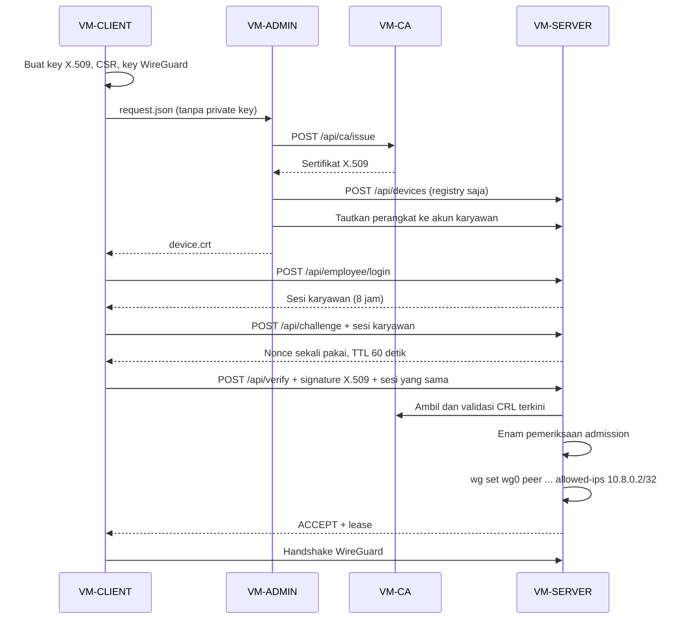

# Sistem VanGuard

Implementasi lab Tugas Akhir Zero Trust Network Access untuk **Ubuntu Server 22.04**.
Admission sertifikat dilakukan **sebelum** server menambahkan peer WireGuard.
Aturan utama tetap berada di [AGENTS.md](AGENTS.md) dan [VANGUARD_CONTEXT.md](VANGUARD_CONTEXT.md).

| VM | IP | Implementasi |
|---|---|---|
| CA | 192.168.100.10 | OpenSSL private CA, HTTPS API :8080 |
| SERVER | 192.168.100.20 | Registry SQLite, validator, HTTPS API :8081, daemon, WireGuard UDP :51820 |
| CLIENT | 192.168.100.30 | CLI Python, X.509 P-256 + pasangan kunci WireGuard X25519 independen |
| ADMIN | 192.168.100.40 | Dashboard Flask/Jinja2, SQLite, password + TOTP, HTTPS :5000 |
| ATTACKER | 192.168.100.50 | Skrip pengujian negatif terbatas pada lab |
| CLIENT-WINDOWS | 192.168.100.60 | VM tambahan disiapkan; OS/tunnel live masih menunggu instalasi dan validasi |

Server tunnel `10.8.0.1/24`; client `10.8.0.2/24`. Source/kernel WireGuard tidak diubah.
Client Windows tambahan direncanakan memakai `10.8.0.4/32`; kelima Ubuntu tetap
dipertahankan. [Status/panduan Windows](docs/WINDOWS_CLIENT.md) membedakan tes
helper native dari pengujian tunnel guest yang masih harus dilakukan.



Implementasi tersedia dalam `vanguard/`, pengujian dalam `tests/`, dan installer/unit systemd
dalam `deploy/`. Baca:

- [Panduan deployment lima VM](docs/DEPLOYMENT.md)
- [Cara mengakses VM dan dashboard yang sudah terpasang](docs/LAB_ACCESS.md)
- [Kontrak endpoint API](docs/API.md)
- [Keputusan keamanan dan batas operasional](docs/SECURITY.md)
- [Skenario uji Tugas Akhir](docs/TEST_PLAN.md)
- [Hasil verifikasi dan status deployment](docs/IMPLEMENTATION_REPORT.md)
- [Tutorial penggunaan dari awal sampai akhir](docs/TUTORIAL_PENGGUNAAN.md)
- [Panduan aktivitas dan arsip admin 0.1.6](docs/DASHBOARD_0.1.6.md)
- [Saran revisi proposal dan hasil audit fitur](docs/SARAN_REVISI_PROPOSAL_2026-10-12.md)
- [Riwayat dan arsip aktivitas admin 0.1.6](docs/DASHBOARD_0.1.6.md)
- [Perubahan dashboard 0.1.5](docs/DASHBOARD_0.1.5.md)
- [Checkpoint untuk melanjutkan pekerjaan](docs/CHECKPOINT.md)
- [Jurnal perubahan 8 Oktober 2026](docs/PROGRESS_2026-10-08.md)
- [Jurnal perubahan 9 Oktober 2026](docs/PROGRESS_2026-10-09.md)
- [Jurnal perubahan 10 Oktober 2026](docs/PROGRESS_2026-10-10.md)
- [Jurnal perubahan 12 Oktober 2026](docs/PROGRESS_2026-10-12.md)
- [Aktivasi admin dan authenticator](docs/AKTIVASI_ADMIN.md)
- [Urutan demo Tugas Akhir](docs/DEMO_TA.md)
- [Pengujian otomatis dan artefak GitHub](docs/CI.md)
- [Akun karyawan dan pengujian S-01](docs/EMPLOYEE_ACCESS.md)
- [Kesesuaian implementasi dengan proposal](docs/PROPOSAL_ALIGNMENT.md)
- [Protokol capture dan pencabutan berulang S-03/S-04](docs/SECURITY_EXPERIMENTS.md)
- [Hasil eksperimen S-03/S-04](docs/SECURITY_RESULTS_2026-10-09.md)
- [Definisi MTTD dan MTTR Respond untuk S-01](docs/RESPONSE_METRICS.md)
- [Hasil MTTD/MTTR aplikasi pada 0.1.4](docs/RESPONSE_METRICS_2026-10-10.md)
- [Rencana benchmark tiga konfigurasi](docs/BENCHMARK_PLAN.md)

Uji lokal (tidak membutuhkan root atau mengubah jaringan host):

```bash
python3 -m venv .venv
.venv/bin/pip install -c deploy/constraints.txt -e '.[test]'
.venv/bin/pytest -q
.venv/bin/ruff check vanguard tests scripts
```

Pada Ubuntu, paket `python3-venv` perlu dipasang lebih dahulu. Pengujian menggunakan
OpenSSL sungguhan dan adapter WireGuard dalam memori; handshake kernel memerlukan VM lab.
Tidak ada akun default, password default, private key, atau token deployment di repositori.
