# Flowchart lengkap sistem VanGuard

Edisi 5 November 2026 — **satu diagram terhubung dari persiapan sampai pemulihan**.
CA 0.1.17; server/admin dan installer Windows 0.1.15 menurut checkpoint terakhir.
Diagram menjelaskan implementasi, bukan bukti semua uji lapangan sudah lulus.
Di GitHub, buka diagram untuk memperbesar atau melihat layar penuh.

```mermaid
flowchart TD
    subgraph S1["1. Persiapan Lab, CA & Kesiapan Backend"]
        START([Mulai]) --> PLAN["Operator: inventaris, izin lab, backup, jam dan console<br/>Pilih mode aplikasi atau internet terkelola"]
        PLAN --> NET["Router pilot 192.168.50.0/24<br/>Host .10, PC LAN .20, laptop Wi-Fi .30<br/>Host meneruskan jalur ke VM backend 192.168.100.0/24"]
        NET --> CAEX{"CA operasional sudah ada?"}
        CAEX -->|Ya| KEEP["Gunakan root dan histori existing<br/>Jangan init ulang atau restore index/CRL lama"]
        CAEX -->|Tidak: lingkungan baru| NEW["Buat Root CA satu kali<br/>Lindungi private key CA dan backup konsisten"]
        KEEP --> BACKEND["Nyalakan VM CA, server dan admin<br/>HTTPS, CRL, WireGuard, daemon dan dashboard<br/>Firewall serta port forwarding aktif"]
        NEW --> BACKEND
        BACKEND --> HEALTH{"Layanan backend, TLS, CRL<br/>dan jaringan siap (ready)?"}
        HEALTH -->|Tidak atau unknown| FIX["Tunda admission baru; perbaiki penyebab<br/>Jangan bypass TLS, CRL atau firewall"]
        FIX --> HEALTH
    end

    subgraph S2["2. Distribusi Paket, Verifikasi Trust & Lockdown Endpoint"]
        HEALTH -->|Ya| PROFILE["Admin siapkan root PUBLIK, profil, pin server<br/>ID dan IP unik serta akun karyawan<br/>Gunakan JSON, QR atau token sah"]
        PROFILE --> INSTALL["Distribusi EXE atau folder BAT tepercaya<br/>Cek SHA256, UAC, OS x64 dan path<br/>Pasang CLI dan WireGuard tanpa silent error"]
        INSTALL --> INSTOK{"Instalasi berhasil?"}
        INSTOK -->|Tidak| INSTFAIL["Catat error atau reboot yang diminta<br/>Pertahankan key/config; perbaiki lalu ulang pasang"]
        INSTFAIL --> INSTALL
        INSTOK -->|Ya| PACKAGE{"Paket per-device?"}
        PACKAGE -->|Ya| WIZ["Wizard memakai profil dan alokasi admin<br/>Resume dengan state yang sama"]
        PACKAGE -->|Tidak: EXE umum| MANUAL["Admin menjalankan configure<br/>EXE umum saja belum memblokir internet"]
        WIZ --> TRUST["Cocokkan root fingerprint, profil dan public key server<br/>Periksa konflik subnet dan jalur HTTPS admin<br/>Gunakan token sah atau approval"]
        MANUAL --> TRUST
        TRUST --> TRUSTOK{"Semua cocok?"}
        TRUSTOK -->|Tidak| TRUSTFAIL["Hentikan konfigurasi; periksa profil dan jaringan<br/>Jangan mengganti root atau public key tanpa konfirmasi"]
        TRUSTFAIL -->|Setelah perbaikan sah| TRUST
        TRUSTOK -->|Ya| MODE{"Internet terkelola schema2?"}
        MODE -->|Tidak: schema1| APPONLY["Hanya aplikasi internal dilindungi<br/>Mode ini tidak memblokir internet langsung di endpoint"]
        MODE -->|Ya| GPO{"Gateway siap, tanpa konflik domain/GPO,<br/>preview policy berhasil?"}
        GPO -->|Tidak| POLICYFAIL["Tunda mode internet; tinjau bersama admin<br/>Jangan hapus kebijakan organisasi atau timpa routing tanpa cadangan"]
        POLICYFAIL -->|Prasyarat selesai| GPO
        GPO -->|Ya| LOCK["Aktifkan policy Windows sebelum enrollment<br/>Blok internet langsung dan IPv6<br/>Jalur admin/CA dan local route diizinkan"]
    end

    subgraph S3["3. Enrollment Identitas & Penerbitan Sertifikat"]
        APPONLY --> IDENTITY{"Identitas perangkat sudah ada?"}
        LOCK --> IDENTITY
        IDENTITY -->|Tidak| KEYS["ENDPOINT membuat key X.509 dan CSR<br/>serta pasangan key WireGuard independen<br/>Private key tetap di endpoint"]
        KEYS --> REQUEST["Kirim request.json PUBLIK ke admin"]
        IDENTITY -->|Ya| EXIST["Pertahankan key/config milik endpoint<br/>Periksa sertifikat dan state enrollment"]
        EXIST --> CERTREADY{"Sertifikat dan bundle sesuai?"}
        CERTREADY -->|Belum selesai enrollment| REQUEST
        CERTREADY -->|Expired, revoked atau key hilang| REPLACE["Penggantian identitas melalui admin<br/>Revoke identitas lama jika masih ada"]
        REPLACE --> KEYS
        REQUEST --> ADMIN["Admin login dashboard dengan password dan TOTP<br/>Periksa request, ID/IP, pemilik dan binding<br/>Terima dan terbitkan bundle ZIP"]
        ADMIN --> ISSUE["CA menandatangani CSR menjadi sertifikat perangkat<br/>Server menyimpan registry dan binding"]
        ISSUE --> BUNDLE{"Workflow selesai dan bundle tersedia?"}
        BUNDLE -->|Belum| PENDING["Pending: perbaiki penyebab dan retry<br/>Wizard menunggu approval dengan exit20<br/>Jangan bypass persetujuan admin"]
        PENDING --> BUNDLE
        BUNDLE -->|Ya| IMPORT["Endpoint import bundle<br/>Cocokkan root, profil, sertifikat dan key lokal"]
        IMPORT --> IMPORTOK{"Import valid?"}
        IMPORTOK -->|Tidak| PENDING
    end

    subgraph S4["4. Login Karyawan, Challenge Nonce & 6-Point Admission"]
        CERTREADY -->|Ya| LOGIN["Karyawan login melalui HTTPS<br/>Akun aktif dan binding perangkat wajib valid<br/>Login membuat sesi berdurasi"]
        IMPORTOK -->|Ya| LOGIN
        LOGIN --> SESSION{"Sesi karyawan valid?"}
        SESSION -->|Tidak| DENYLOGIN["Tolak login/admission<br/>Perbaiki akun, sesi atau binding secara sah"]
        DENYLOGIN --> LOGIN
        SESSION -->|Ya| CHALLENGE["Connect meminta challenge sekali pakai<br/>Endpoint menandatangani proof dengan key private X.509"]
        CHALLENGE --> SIX["Server menjalankan enam pemeriksaan perangkat<br/>1. Signature X.509 terhadap Root CA<br/>2. Sertifikat belum expired dan tidak ada di CRL<br/>3. Match fingerprint root dan profil terpasang<br/>4. Binding perangkat aktif dan valid<br/>5. CSR hash cocok dengan registrasi<br/>6. Proof signature sah untuk challenge"]
        SIX --> ADMIT{"Sesi, challenge dan seluruh cek lolos?"}
        ADMIT -->|Tidak| DENY["Fail-closed: tidak memberi lease/peer baru<br/>Catat alasan aman; lockdown schema2 tetap aktif"]
        DENY --> TROUBLE["Periksa akun, waktu, CRL, binding,<br/>sertifikat dan dependensi; tanpa bypass"]
    end

    subgraph S5["5. Tunnel WireGuard, Kontrol Akses & Pemantauan Berkala"]
        ADMIT -->|Ya| PEER["Server memasang peer WireGuard dan lease terbatas<br/>Lease tidak melewati akhir sesi<br/>Endpoint menerima status admitted"]
        PEER --> TUNNEL["Client membuka tunnel miliknya<br/>Periksa handshake, transfer dan konektivitas<br/>Terminal menampilkan status OK/ONLINE"]
        TUNNEL --> ACCESS{"Jenis trafik yang diminta?"}
        ACCESS -->|Aplikasi| RESOURCE{"Lease/sesi valid dan grant identitas,<br/>resource, protokol, port cocok?"}
        ACCESS -->|Internet schema2| INTERNET{"Lease/sesi valid, gateway siap<br/>dan grant internet perangkat aktif?"}
        RESOURCE -->|Ya| ALLOW["Izinkan hanya trafik yang memenuhi kebijakan"]
        INTERNET -->|Ya| ALLOW
        RESOURCE -->|Tidak| DROP["Default-deny: tolak trafik terkait dan akses aplikasi lewat LAN<br/>Tunnel aktif bukan jaminan akses jika tanpa grant"]
        INTERNET -->|Tidak| DROP
        ALLOW --> MONITOR["Client renewal; daemon rekonsiliasi peer dan policy<br/>Pantau sesi, lease, sertifikat, CRL dan kesehatan host<br/>Secara berkala jalankan event check"]
        DROP --> MONITOR
        MONITOR --> EVENT{"Ada perubahan status atau event?"}
        EVENT -->|Renewal berkala| CHALLENGE
        EVENT -->|Admin mengubah grant| ACCESS
    end

    subgraph S6["6. Pencabutan, Cleanup, Pemulihan & Audit"]
        EVENT -->|Logout karyawan| LOGOUT["Logout terautentikasi dan idempotent<br/>Cabut token, challenge dan akses tunnel<br/>Lepas lease dan hapus peer WireGuard di server"]
        LOGOUT --> LOGOK{"Pencabutan server dan pemutusan terkonfirmasi?"}
        LOGOK -->|Tidak atau offline| RETRY["Pencabutan/pemutusan belum terkonfirmasi<br/>Simpan bukti; retry setelah online/koneksi pulih"]
        RETRY --> LOGOUT
        LOGOK -->|Ya| CLEAN["Client menghentikan tunnel yang dimilikinya<br/>Cleanup gagal: pertahankan konfigurasi<br/>Pastikan ownership jalur/file aman"]
        EVENT -->|Admin revoke perangkat| REVOKE["Admin memasukkan alasan pencabutan<br/>CA memperbarui histori serial dan terbitkan CRL baru<br/>Server menghapus peer WireGuard terkait"]
        REVOKE --> REVOKED{"Workflow revoke selesai?"}
        REVOKED -->|Belum| REVOKING["Tetap revoking; periksa penyebab dan retry<br/>Jangan klaim pemutusan tanpa bukti"]
        REVOKING --> REVOKE
        REVOKED -->|Ya| REMOVE["Invalidasi admission dan hapus peer WireGuard<br/>Hapus IP lease dari server"]
        EVENT -->|Lease/sesi habis, akun nonaktif,<br/>sertifikat invalid atau CRL tidak tersedia| REMOVE
        EVENT -->|Disconnect, reboot client<br/>atau koneksi terputus| CLEAN
        REMOVE --> CLEAN
        CLEAN --> CLOSED["Status tunnel tertutup & konfigurasi lokal terjaga<br/>Lockdown schema2 tetap berlaku jika aktif"]
        CLOSED --> NEXT{"Tindakan lanjutan yang sah?"}
        TROUBLE --> NEXT
        NEXT -->|Sesi/layanan pulih dan identitas valid| LOGIN
        NEXT -->|Sertifikat revoked/expired atau key hilang| REPLACE
        NEXT -->|Maintenance lokal| RECOVER["Admin lokal memastikan tunnel berhenti dan ownership jelas<br/>Konfirmasi state aman sebelum retry"]
        RECOVER --> AUDIT["Audit lifecycle: waktu WIB, aktor, aksi, hasil, alasan aman<br/>Filter dan arsip CSV/JSON/manual"]
        NEXT -->|Selesai tanpa membuka lockdown| AUDIT
        ISSUE .-> AUDIT
        DENY .-> AUDIT
        LOGOUT .-> AUDIT
        REVOKE .-> AUDIT
        MONITOR .-> OBS["Pemeriksaan gagal: status tidak diketahui<br/>Liveness bukan readiness; daemon macet perlu perbaikan"]
        OBS .-> AUDIT
        AUDIT --> FINISH([Selesai: Catat kondisi akhir dan hasil uji])
    end

    classDef stop fill:#fff1f0,stroke:#b42318,color:#521b15;
    classDef decision fill:#fff8df,stroke:#a07800,color:#403000;
    classDef safe fill:#e9f7ef,stroke:#287a50,color:#143d28;
    classDef note fill:#eef3ff,stroke:#4566a0,color:#20304e;
    class TRUSTFAIL,FIX,INSTFAIL,POLICYFAIL,PENDING,DENYLOGIN,DENY,DROP,RETRY,REVOKING stop;
    class TRUSTOK,CAEX,HEALTH,INSTOK,PACKAGE,MODE,GPO,IDENTITY,CERTREADY,BUNDLE,IMPORTOK,SESSION,ADMIT,ACCESS,RESOURCE,INTERNET,EVENT,LOGOK,REVOKED,NEXT decision;
    class KEEP,PEER,ALLOW,FINISH safe;
    class AUDIT,OBS,PROFILE,SIX,CLOSED note;

```

**Cara membaca:** panah penuh adalah alur/tindakan; panah putus-putus adalah
pencatatan atau observasi lintas proses. Pilihan trafik berlaku per tujuan,
bukan berarti koneksi hanya boleh memakai salah satunya. Renewal lease tidak
memperpanjang sertifikat. Audit mencakup kejadian yang tersedia pada komponen
terkait; bukan jaminan setiap operasi client tercatat di dashboard.

**Batas:** mode internet dapat terhalang domain/GPO; jangan menghapus kebijakan
organisasi. Internet langsung baru diblok setelah policy endpoint aktif,
bukan hanya karena klik EXE atau registrasi CA. Pemutusan TCP aktif dan penerimaan
PC kampus tetap membutuhkan bukti uji lapangan tersendiri.

Langkah operasional: [manual](MODUL_PENGGUNAAN_VANGUARD.md),
[panduan lapangan dan terminal VM](PERSIAPAN_UJI_LAPANGAN.md),
[status pengujian](CHECKPOINT.md). Diagram lama tetap disimpan sebagai arsip;
untuk alur keseluruhan gunakan satu diagram ini.
