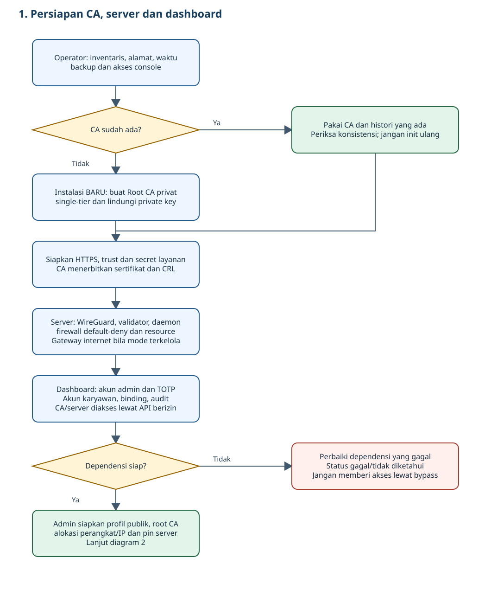
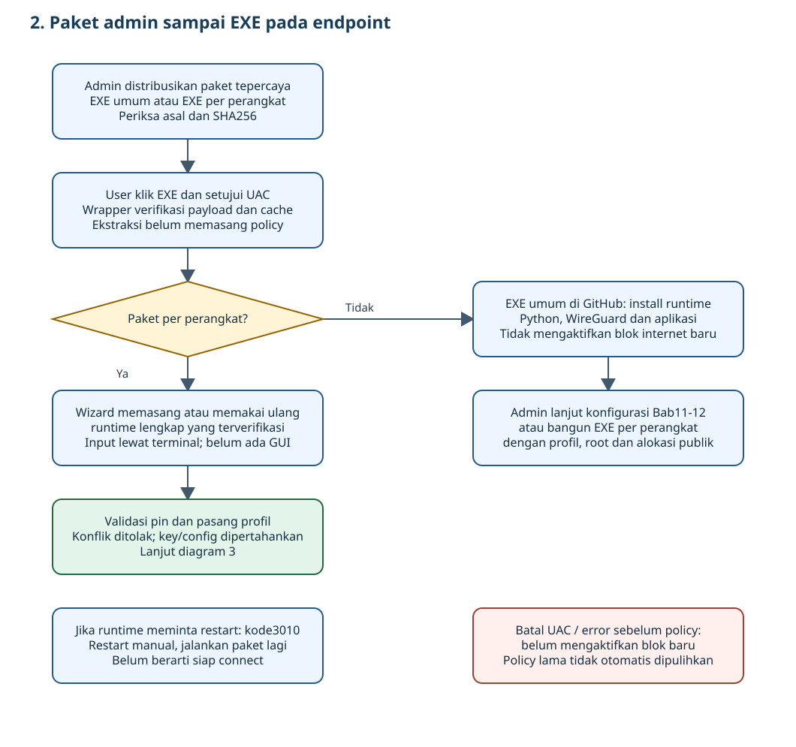
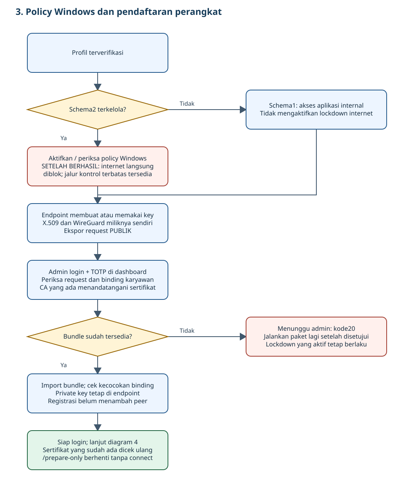
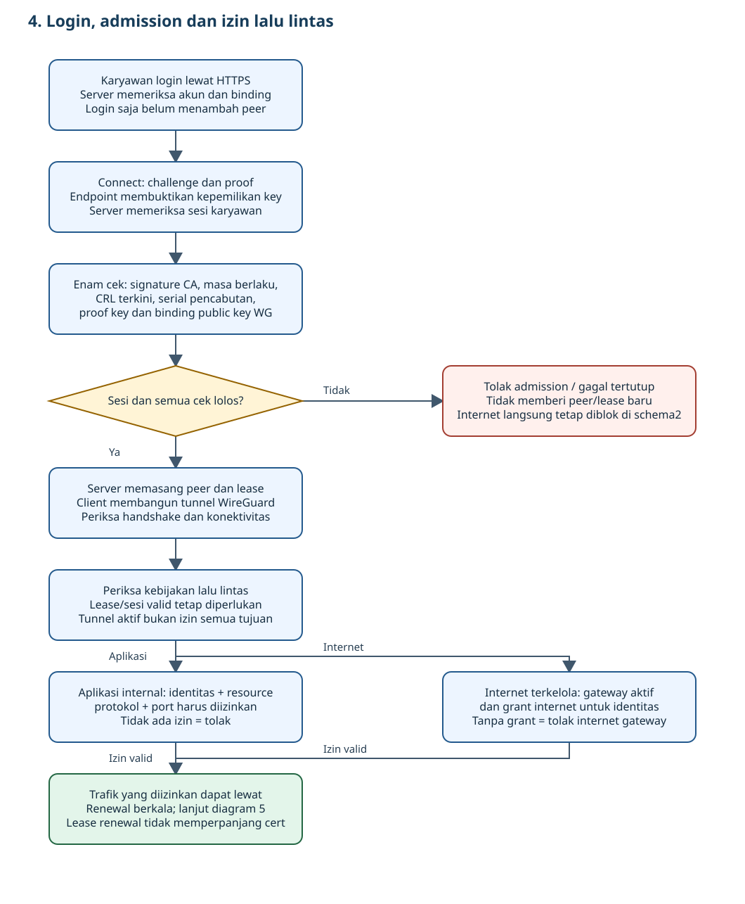
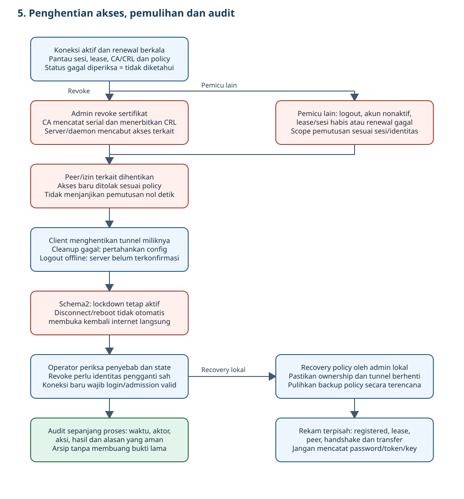

# Manual admin Sistem VanGuard

Edisi30 Oktober2026 · satu sumber resmi untuk pemasangan dan operasi.
HTML dengan nama yang sama dihasilkan dari Markdown ini; keduanya satu manual,
bukan panduan berbeda. Salinan manual di ZIP juga dihasilkan dari sumber ini.
Tutorial lama telah digabung dan dihapus dari tree terbaru; histori Git tetap ada.

Manual ini ditujukan kepada administrator yang menyiapkan sistem dari lingkungan
kosong sampai endpoint karyawan dapat mengakses aplikasi yang diizinkan. Setiap
langkah menyebut mesin, prasyarat, tindakan, hasil yang diperiksa dan kondisi
berhenti. Nilai berhuruf kapital adalah placeholder; jangan menyalin rahasia ke Git.

## 1. Urutan kerja administrator dan syarat selesai

Pilih jalur sebelum menjalankan perintah. Lab yang sudah terpasang **tidak**
memerlukan generate CA, pembuatan ulang VM atau init identitas utama.

| Tahap | Mesin/pelaksana | Bab | Hasil wajib sebelum lanjut |
|---|---|---|---|
| Rencana, alamat, backup | Admin/operator host |2–4 | IP tidak bentrok, inventaris privat dan akses console tersedia |
| Instalasi baru saja | Host dan lima Ubuntu |5 | OS/IP benar, paket/unit terpasang |
| CA/HTTPS baru saja | CA, server, admin |6 | Satu root, key lokal, chain/SAN/waktu benar |
| Token, admin/TOTP, firewall, layanan | CA/server/admin |7 | Secret privat, readiness berhasil, peer kosong |
| Jaringan PC/laptop | Router/host/endpoint |8 | Hanya admission HTTPS dan WG dapat dicapai, LAN aplikasi ditolak |
| Profil publik dan versi dashboard | Host/admin |9 | Root/key dikonfirmasi, bundle berprofil didukung |
| Installer endpoint | Windows administrator |10 | Exit0, pip/status lulus, belum ada identitas/tunnel |
| Akun, CSR, sertifikat dan binding | Endpoint dan dashboard |11 | Registered, key tetap endpoint, bundle cocok |
| Login dan penggunaan | Karyawan/endpoint |12–13 | Admission, handshake dan akses resource terpisah terverifikasi |
| Resource dan acceptance | Admin/server/endpoint |14–15 | Default-deny, grant eksplisit, logout/revoke memutus akses |
| Audit, operasi, pemulihan | Admin/operator |16–18 | Bukti aman, backup, lifecycle dan prosedur selesai |

**Lingkungan sudah terpasang:** inventaris/baseline Bab2–4 → pemeriksaan layanan
Bab7 → jaringan/profil Bab8–9 → endpoint baru Bab10–13. Jika endpoint sudah punya
identitas, gunakan status/login/connect; jangan ulang init. Semua perubahan harus
punya jurnal intent/hasil dan langkah pemulihan. Catat BELUM_TERUJI bila belum dijalankan.

Perintah **HOST** dijalankan di laptop Linux, **VM-ROLE** di guest yang ditulis,
dan **WINDOWS ADMIN** di PowerShell Run as administrator. Satu terminal per mesin
mencegah salah target. Hak admin lokal diperlukan untuk pengelolaan tunnel; akun
VPN sendiri tidak memberi hak admin Windows. Uji satu PC dahulu sebelum laptop.

### 1.1. Flowchart sistem lengkap: dari CA sampai EXE dan penggunaan

Diagram berikut menggambarkan implementasi kandidat0.1.14-fix1 pada branch
`feature/2026-10-22-physical-endpoints`. Baca berurutan 1→5. Gambar dapat dibuka
untuk diperbesar di GitHub; salinan HTML menyertakan gambar dan bisa dibaca offline.
**Setiap panah lanjut mensyaratkan tahap sebelumnya berhasil.** Bila gagal,
berhenti pada tahap tersebut dan periksa alasan/state; jangan menganggap tahap
berikutnya sudah selesai. Kotak merah menunjukkan penolakan atau pembatasan,
bukan selalu bug. Kotak kuning adalah keputusan.

#### 1.1.1. Persiapan layanan Linux dan otoritas sertifikat



CA menerbitkan sertifikat dan CRL; server mengambil data CA yang diperlukan untuk
validasi lewat jalur backend yang diizinkan. Dashboard mengelola registrasi,
revocation, akun/binding dan kebijakan. Endpoint tidak menerima private key CA.
Gunakan CA yang sudah ada pada lab ini. Rincian pemasangan dan trust ada di Bab5–9.

#### 1.1.2. Distribusi paket dan instalasi EXE Windows



EXE umum di downloads belum memuat profil/root/alokasi. Admin membuat paket
perangkat dengan input publik tepercaya, lalu membungkusnya menjadi EXE menurut
Bab14.0.1. Pengguna menerima satu EXE; bagian dalamnya tetap menjalankan BAT/wizard.
Kotak catatan di bagian bawah diagram menjelaskan kondisi batal/error/restart.
Tidak ada GUI form Login/Connect saat ini; interaksi menggunakan terminal.

#### 1.1.3. Kapan internet diblok dan bagaimana perangkat didaftarkan



**Klik EXE belum memblokir internet.** Pada pemasangan baru schema2, blok akses
internet langsung berlaku setelah penerapan policy dikonfirmasi berhasil. Jalur
kontrol terbatas untuk mencapai layanan tetap diperlukan. Jika penerapan policy
gagal/parsial, hasil blok belum dapat dipastikan: wizard berhenti dan mempertahankan
state/backup untuk inspeksi admin. Policy yang sebelumnya aktif tidak otomatis
dibuka karena error. Schema1 tidak mengaktifkan lockdown internet.

Diagram memperlihatkan pendaftaran pertama. Saat resume, key lama dipakai ulang;
sertifikat yang sudah tersedia melewati langkah meminta bundle lalu tetap harus
lolos admission. Bila belum disetujui, kode20 berarti menunggu admin. Request
publik dapat dipindah lewat media admin yang disetujui; jangan mengirim folder
identity. Admin mengikat akun/perangkat, menerbitkan sertifikat dan mengatur izin
resource/internet. Pemberian izin atau sertifikat belum memasang peer.

#### 1.1.4. Login, pemeriksaan perangkat dan akses yang diizinkan



Admission terjadi melalui HTTPS sebelum peer ditambahkan. Sertifikat X.509 tidak
disisipkan ke handshake WireGuard. Login gagal atau pemeriksaan perangkat gagal
menghentikan alur. Setelah peer terpasang, handshake/konektivitas perlu diamati;
status registered, lease valid, peer, handshake dan transfer merupakan fakta berbeda.
Cabang aplikasi dan internet menunjukkan dua jenis tujuan trafik, bukan keharusan
mengakses keduanya secara berurutan. Aplikasi memakai izin identitas/resource/
protokol/port; internet terkelola memakai gateway serta grant internet eksplisit.
Keduanya tetap dibatasi sesi dan lease. Bab11–14 memuat langkah operasionalnya.

#### 1.1.5. Renewal, logout, pencabutan dan pemulihan



Revoke sertifikat mencabut identitas terkait; logout mencabut sesi yang diminta
beserta akses yang dimilikinya, tanpa memutus sesi lain di luar cakupan. Penghapusan
grant internet menutup izin internet, tidak otomatis berarti sertifikat dicabut
atau seluruh izin aplikasi dihapus. CA/renewal gagal tidak memberi lease baru;
akses lama dibatasi lease dan pemantauan, sehingga kegagalan tidak boleh diklaim
selalu memutus trafik pada detik yang sama. Logout saat server tidak terjangkau
harus menampilkan pencabutan server belum terkonfirmasi.

Lockdown schema2 tetap aktif setelah disconnect dan reboot; koneksi ulang butuh
pemeriksaan baru. Recovery policy merupakan tindakan admin lokal terencana,
bukan efek otomatis logout atau uninstall. Audit dilakukan sepanjang alur,
walaupun ditampilkan di bagian bawah diagram. Rincian operasi ada di Bab12 dan16–18.

**Batas bukti:** flowchart menjelaskan source, bukan laporan seluruh pengujian
end-to-end. EXE umum diuji di Windows10 dan Windows11; resume EXE per-device
schema1 diuji di Windows10. EXE per-device schema2, UAC interaktif penuh dan PC fisik belum
dibuktikan oleh uji wrapper. Policy internet dan client native punya bukti VM
terpisah pada Windows10/11. Lihat [validasi EXE](VALIDASI_EXE_2026-10-29.md) dan
[checkpoint](CHECKPOINT.md). EXE/ZIP yang sudah diterbitkan masih menyertakan
salinan manual saat build; flowchart baru tersedia di manual repo dan HTML terbaru.

## 2. Arsitektur, akun dan batas akses

VanGuard mengizinkan perangkat menjadi peer WireGuard setelah akun karyawan
terautentikasi dan identitas perangkat lolos pemeriksaan. Sistem tidak mengubah
kernel atau protokol WireGuard.

Urutan kerja:

```text
Client membuat key sendiri → request publik → admin menerbitkan sertifikat/binding
Karyawan login → sesi akun → challenge → proof ditandatangani key perangkat
Server memeriksa sertifikat/CRL/proof/binding → ACCEPT → peer WireGuard aktif
Client membentuk tunnel → handshake → akses yang diizinkan → admission berkala
```

Enam pemeriksaan perangkat: signature X.509 terhadap Root CA, masa berlaku
sertifikat, CRL terkini, serial tidak dicabut, bukti kepemilikan private key
X.509, dan kecocokan sertifikat dengan public key WireGuard pada registry.
Password karyawan yang benar tidak menggantikan pemeriksaan tersebut.

| Jenis identitas | Dipakai untuk | Penyimpanan/penanggung jawab |
|---|---|---|
| Akun OS/console | Masuk Ubuntu atau Windows | Operator; inventaris privat host |
| Admin dashboard | Mengelola akun, sertifikat dan audit | Password + TOTP admin |
| Karyawan VPN | Meminta sesi akses VPN | Password karyawan dari admin |
| Identitas perangkat | Membuktikan perangkat memiliki key yang terdaftar | Private key tetap di client |
| Token antarlayanan | Otorisasi API administrasi CA/server | Berkas env privat layanan |

TOTP admin berasal dari aplikasi authenticator yang telah didaftarkan. Dashboard
memverifikasi kode enam digit; tidak menyediakan tombol untuk menampilkan kode
login berjalan. Karyawan VPN tidak memakai TOTP admin untuk login.

Sesi karyawan berlaku delapan jam pada implementasi ini. Admission berkala
memperbarui lease perangkat, tetapi tidak memperpanjang sesi karyawan. Ketika
sesi habis, karyawan harus login lagi. Private key, token sesi, seed TOTP, dan
password bukan lampiran laporan.

## 3. Inventaris, topologi dan perangkat lunak

| VM | LAN | Tunnel | Fungsi |
|---|---|---|---|
| VM-CA | 192.168.100.10 | — | OpenSSL private CA; HTTPS 8080 |
| VM-SERVER | 192.168.100.20 | 10.8.0.1 | Validasi, daemon, registry; HTTPS 8081 dan UDP 51820 |
| VM-CLIENT | 192.168.100.30 | 10.8.0.2 | Client Ubuntu 22.04 |
| VM-ADMIN | 192.168.100.40 | — | Flask/Jinja2, SQLite, dashboard HTTPS 5000 |
| VM-ATTACKER | 192.168.100.50 | — | Simulasi negatif yang diotorisasi dalam lab |
| VM-CLIENT-WINDOWS | 192.168.100.60 | 10.8.0.4 | Client Windows tambahan |

Jaringan libvirt `vanguard` menggunakan gateway host `192.168.100.1`.
Alamat `10.8.0.3` dicadangkan untuk eksperimen terpisah. Kelima Ubuntu tetap ada;
Windows adalah node keenam. Client memakai pasangan key masing-masing.

Host memakai KVM/libvirt, `virsh`, Virtual Machine Manager, SSH dan browser.
Windows memakai UEFI Secure Boot, TPM2, 4 GiB RAM, 2 vCPU dan disk sparse80 GiB.
RAM host yang tercatat sekitar 7,5 GiB; menyalakan seluruh node menambah beban.
Periksa `free -h` sebelum sesi dan hindari menjalankan pekerjaan berat bersamaan.
Status `running` pada libvirt belum membuktikan OS selesai boot atau VPN aktif.

Versi source0.1.12, service terakhir0.1.11 dan client lab0.1.9 harus diperiksa
kembali saat rollout. Source Git tidak otomatis mengganti paket di VM.
Endpoint installer terpisah0.1.12 tidak menimpa client lab lama di ProgramData.
VM Windows10 uji tambahan .100.70 diizinkan pengguna, bukan pengganti enam node
utama; tidak mendapat identitas VPN otomatis.

Target installer: Windows10 x64 build19044/19045 (21H2/22H2) dan Windows11 x64
build≥22000. Windows Server/x86/ARM64 ditolak. Target build pada installer bukan bukti semua edisi Windows telah diuji; lihat
matriks per OS/build pada laporan validasi dan checkpoint untuk hasil native.
Dukungan aplikasi tidak memperpanjang dukungan keamanan OS. Windows10 reguler
berakhir dukungan14Oktober2025; administrator memerlukan status servicing/ESU yang
sesuai atau edisi LTSC yang masih didukung. Media evaluation hanya untuk pengujian.
Sumber: [Microsoft Windows10](https://www.microsoft.com/en-us/software-download/windows10ISO),
[LTSC2021 lifecycle](https://learn.microsoft.com/en-us/lifecycle/products/windows-10-enterprise-ltsc-2021),
[Python3.13 Windows](https://docs.python.org/3.13/using/windows.html),
[WireGuard Windows](https://www.wireguard.com/install/).

Layanan contoh adalah internal-demo10.8.0.1 TCP8082 dengan grant eksplisit.
Tidak ada akses internet/ERP/file server otomatis. Registrasi, login, status
file dan ping tidak membuktikan akses aplikasi; tiap lapisan perlu bukti sendiri.

## 4. Baseline, backup dan membuka lab yang sudah ada

Catat waktu dan baseline, ruang disk serta lokasi backup di inventaris privat.
Saat guest mati, backup disk guest/UEFI/TPM serta XML melalui prosedur hypervisor;
jangan menyalin disk yang aktif tanpa mekanisme konsistensi. Preserve seluruh enam
VM, terutama CA dan identitas utama. Untuk upgrade aplikasi admin, gunakan backup
service yang dihentikan seperti Bab9. Backup bukan izin memulihkan CA lama.

Pada host, simpan XML/daftar disk, route, konfigurasi jaringan, ruleset host/libvirt,
konfigurasi router dan akses pemulihan. Contoh keluaran hanya ke folder privat:

```bash
# HOST: baru snapshot read-only; tidak menyalakan atau mengubah jaringan.
umask 077
backup_dir="$HOME/VanGuard-Privat/pilot-$(date +%Y%m%d-%H%M%S)"
mkdir -m 700 "$backup_dir"
virsh -c qemu:///system dumpxml VM-CA > "$backup_dir/VM-CA.xml"
virsh -c qemu:///system domblklist VM-CA --details > "$backup_dir/VM-CA-disks.txt"
ip -j -4 address show > "$backup_dir/addresses.json"
ip -j -4 route show > "$backup_dir/routes.json"
# Ulangi XML/daftar disk untuk lima guest lain; simpan firewall via admin host.
```

Jangan mengunggah backup atau environment/database. Pastikan backup dapat dibaca,
checksum cocok dan lokasi disk benar sebelum mengubah apa pun. Jangan restore
index, serial, crlnumber, CRL atau database keamanan lama saat rollback aplikasi.

### 4.1 Nyalakan dan periksa VM — HOST

```bash
cd /home/lui/vanguard
virsh -c qemu:///system list --all
free -h
virsh -c qemu:///system net-info vanguard
```

Jika jaringan `vanguard` tidak aktif, jalankan `virsh -c qemu:///system net-start
vanguard`. Nyalakan VM berstatus **shut off** sesuai kebutuhan, berurutan:

```bash
virsh -c qemu:///system start VM-CA
virsh -c qemu:///system start VM-SERVER
virsh -c qemu:///system start VM-ADMIN
virsh -c qemu:///system start VM-CLIENT
virsh -c qemu:///system start VM-CLIENT-WINDOWS
virsh -c qemu:///system start VM-ATTACKER
```

Jangan ulangi `start` pada VM yang sudah running. Attacker diperlukan saat
latihan keamanan. `scripts/open_dashboard.sh` yang tersedia saat modul ditulis
menyalakan lima Ubuntu; Windows tetap perlu dinyalakan terpisah.

Untuk melihat console:

```bash
virt-manager --connect qemu:///system
virt-viewer --connect qemu:///system VM-CLIENT-WINDOWS
```

Password console Windows terakhir ada pada kartu lokal
`/home/lui/VanGuard-Privat/AKSES_WINDOWS_TERBARU.txt`. Inventaris lengkap berada
di folder privat yang sama. Password console berbeda dari password VPN Windows.

### 4.2 Verifikasi layanan — HOST, lalu guest yang dipilih

```bash
.venv/bin/python scripts/ssh_preflight.py state/lab/inventory.json
ssh -F ~/.ssh/vanguard_lab_config 192.168.100.10
```

Preflight lama memeriksa lima Ubuntu, **tidak mencakup Windows**. Perintah SSH
menempatkan terminal pada VM-CA. Periksa, kemudian `exit` untuk kembali ke host:

```bash
sudo systemctl is-active vanguard-ca
timedatectl status
exit
```

Pada VM-SERVER melalui SSH `.20`, jalankan:

```bash
sudo systemctl is-active vanguard-server vanguard-daemon wg-quick@wg0
sudo wg show wg0
timedatectl status
```

Pada VM-ADMIN melalui SSH `.40`, jalankan:

```bash
sudo systemctl is-active vanguard-admin
timedatectl status
```

Target: semua unit di atas `active`, waktu benar, dashboard dapat dibuka melalui
**https://192.168.100.40:5000**. Di HOST, pemeriksaan TLS:

```bash
curl --fail --cacert state/deployment/root.crt \
  https://192.168.100.40:5000/healthz
```

Browser harus mempercayai root CA lab yang fingerprint-nya sudah diverifikasi.
Impor `state/deployment/root.crt` ke Authorities/CA browser bila diperlukan.
Jangan menyelesaikan masalah sertifikat dengan menonaktifkan pemeriksaan TLS.

## 5. Instalasi host dan paket Ubuntu — lingkungan kosong saja

### 5.1 Siapkan host, enam guest, source dan SSH

1. Siapkan host Linux dengan virtualisasi KVM, libvirt, virt-manager/virt-viewer,
   akses administrator dan penyimpanan untuk seluruh disk/backup.
2. Buat jaringan NAT libvirt `vanguard`, subnet192.168.100.0/24, gateway.1.
   Pastikan subnet tidak bertabrakan dengan jaringan host lain.
3. Pasang lima Ubuntu Server22.04 dengan nama/IP pada bab 3. Atur IPv4 statis,
   gateway/DNS.1, hostname, waktu, serta akun operator dan OpenSSH.
4. Siapkan satu Windows 11 tambahan dengan spesifikasi bab 3 dan IP.60. Pakai
   media resmi yang telah diverifikasi; selesaikan instalasi serta akun lokal.
   Jangan memakai ulang seed pemformatan pada disk berisi data.
5. Salin source yang telah diverifikasi ke direktori kerja pada setiap Ubuntu.
   Jangan ikut menyalin `state/`, `.venv/`, `.git/`, atau inventaris rahasia.
6. Siapkan key SSH host, cocokkan fingerprint guest melalui console, lalu catat
   host key. Salin `deploy/inventory.example.json` ke lokasi privat dan sesuaikan
   user/host/port/konfigurasi SSH lima Ubuntu. Password tidak dimasukkan inventory ini.
7. Jalankan `python3 scripts/ssh_preflight.py /path/to/inventory.json`. Target
   kelima role `ok: true`, Ubuntu 22.04 dan kemampuan sudo sesuai deployment.

Skrip `create_lab.py` serta `create_windows_client.py` adalah alat provisioning;
baca `--help` dan batasannya sebelum dipakai. Inventaris lima role yang digunakan
`deploy_lab.py` tidak boleh ditambah role Windows lalu dianggap otomatis didukung.

### 5.2 Pasang aplikasi Ubuntu pada role yang benar

Di root source **guest masing-masing**, jalankan hanya perintah yang cocok:

| Guest | Perintah |
|---|---|
| VM-CA | `sudo bash deploy/install.sh ca` |
| VM-SERVER | `sudo bash deploy/install.sh server` |
| VM-CLIENT | `sudo bash deploy/install.sh client` |
| VM-ADMIN | `sudo bash deploy/install.sh admin` |
| VM-ATTACKER | `sudo bash deploy/install.sh attacker` |

Installer memeriksa OS dan IP, memasang Python/aplikasi serta unit systemd.
Installer belum memulai layanan atau menerapkan firewall. Paket berada pada
`/opt/vanguard/venv`, state pada `/var/lib/vanguard`, konfigurasi pada
`/etc/vanguard`. Server mendapat key WireGuard dan config tanpa peer statis.


### 5.3 Persiapan konkret pada host baru

**HOST baru**, instal utilitas dari repositori Ubuntu:

```bash
sudo apt-get update
sudo apt-get install qemu-kvm libvirt-daemon-system libvirt-clients virtinst \
  virt-manager virt-viewer cloud-image-utils genisoimage ovmf swtpm swtpm-tools \
  git python3-venv openssl curl
virsh -c qemu:///system list --all
free -h
df -h /var/lib/libvirt/images
```

Ambil source `git clone https://github.com/LuiLuiLui886/vanguard-ztna.git`, lalu
`cd vanguard-ztna` dan `git switch main`. Untuk clone lama gunakan `git pull --ff-only`
setelah perubahan sendiri disimpan; jangan reset/force. Catat `git rev-parse HEAD`.
Siapkan key SSH Ed25519 operator tanpa menimpa key yang ada. Media Ubuntu22.04
cloud image harus berasal dari Ubuntu dan cocok SHA256/signature resmi sebelum
provisioning. ISO Windows harus berasal dari Microsoft dan cocok hash resmi.

Skrip berikut **hanya host kosong**, membuat lima Ubuntu dan jaringan baru:

```bash
sudo python3 scripts/create_lab.py --image /PATH/UBUNTU22_IMAGE.img \
  --public-key /PATH/OPERATOR_KEY.pub --operator NAMA_USER_HOST \
  --output /PATH/INVENTORY_PRIVAT_BARU
```

Jika nama VM/jaringan sudah ada, berhenti dan gunakan jalur lab terpasang.
Periksa output inventory privat dan guest console/SSH sebelum memasang paket.
Untuk Windows, buat VM tambahan memakai media resmi dan akun admin lokal, selesai
setup OS dahulu. Alat seed lab memformat disk baru: jangan gunakan pada disk lama.
Pada PC fisik cukup pakai OS yang sudah terpasang dan installer endpoint Bab10;
provisioning VM bukan bagian installer PC.

Salin source melalui SSH terverifikasi, misalnya arsip dari commit yang sudah
review: `git archive --format=tar HEAD -o /PATH/vanguard-source.tar` pada HOST.
Transfer arsip lalu ekstrak ke folder staging baru di guest. Isi arsip tidak boleh
mencakup inventaris privat/state/key. Verifikasi OS dengan `cat /etc/os-release`
dan alamat dengan `ip -br -4 address`; pilih satu role per guest pada tabel5.2.

## 6. Root CA, CSR HTTPS, trust, penerbitan dan CRL

Seluruh materi CA/PKI berada di bagian ini, mulai dari generate root hingga
backup dan troubleshooting. Bagian 6.1–6.9 memandu pemasangan CA/HTTPS;
6.10–6.13 menjelaskan siklus sertifikat dan pemeliharaan setelah instalasi.
Lanjutkan Bab7–10 untuk token, firewall, layanan dan client Windows,
lalu Bab11–16 untuk pendaftaran dan pemakaian sistem.

Contoh mengikuti CLI CA pada source VanGuard0.1.12, terutama `vanguard/ca.py`,
`vanguard/pki.py`, `vanguard/client.py` dan workflow dashboard. Setiap blok
menyebutkan tempat menjalankannya. **CA lab yang ada sudah terpasang**;
gunakan bagian pemeriksaan untuk pemeliharaan. Langkah init/generate/signing
hanya untuk pemasangan baru atau pekerjaan teknisi yang direncanakan.

### 6.1 CA itu apa dan apa hubungannya dengan VPN?

Certificate Authority (CA) adalah penerbit sertifikat. Sertifikat menyatakan
identitas pemilik public key dan ditandatangani CA agar pihak lain dapat
memverifikasi asalnya. Private key tetap dikuasai pemiliknya.

Contoh: client Windows membuat key P-256 dan meminta sertifikat untuk
`vm-client-windows`. CA menandatangani sertifikat menggunakan root private key.
Saat admission, server memverifikasi sertifikat tersebut menggunakan root
certificate, kemudian meminta proof yang hanya dapat dibuat pemilik key client.
Memiliki salinan sertifikat publik saja tidak cukup untuk membuat proof itu.

| Istilah | Makna praktis | Apakah rahasia? |
|---|---|---|
| Private key | Kunci untuk menandatangani atau membuktikan kepemilikan | Ya |
| Public key | Pasangan publik yang dipakai untuk verifikasi | Tidak |
| CSR | Certificate Signing Request; permintaan berisi identitas/public key dan signature pemohon | Bukan key rahasia; tetap dikelola operator |
| Certificate | Identitas/public key/masa berlaku/signature penerbit | Publik, dapat berisi metadata perangkat |
| Root CA | Trust anchor yang ditetapkan operator | Sertifikat publik; key root rahasia |
| Fingerprint SHA256 | Ringkasan untuk membandingkan sertifikat yang sama | Publik |
| Serial sertifikat | Nomor unik sertifikat pada CA | Publik; berbeda dari fingerprint |
| CRL | Certificate Revocation List, daftar serial tercabut bertanda tangan | Publik; harus valid dan terkini |
| SAN | Subject Alternative Name, misalnya IP endpoint HTTPS | Bagian publik sertifikat |
| EKU | Extended Key Usage, membatasi tujuan sertifikat | serverAuth atau clientAuth |

VanGuard memiliki dua kelompok sertifikat: HTTPS untuk identitas API/dashboard,
dan sertifikat perangkat untuk admission. Proof perangkat dikirim pada API
aplikasi; jangan menganggap mekanisme ini otomatis berupa mutual TLS pada setiap
koneksi. WireGuard tetap memakai keypair terpisah yang diikat pada registry.

### 6.2 Struktur file dan parameter CA yang sebenarnya

Pada VM-CA, direktori default `/var/lib/vanguard/ca` berisi:

```text
ca/
├── openssl.cnf          konfigurasi CA OpenSSL
├── private/root.key    root private key; jangan disalin ke client
├── root.crt            root certificate publik
├── index.txt           database status sertifikat OpenSSL
├── index.txt.attr      pengaturan database
├── serial              counter nomor sertifikat berikutnya
├── crlnumber           counter nomor CRL berikutnya
├── crl.pem             CRL yang sudah ditandatangani
├── newcerts/           arsip sertifikat menurut serial
├── issued/             cache issuance perangkat menurut hash CSR; muncul saat issuance
├── requests/           staging CSR/sertifikat HTTPS yang disiapkan operator
└── ca.lock             lock operasi perubahan CA
```

OpenSSL dapat membuat berkas `.old` saat memperbarui database/counter.
Jangan menghapus atau mengganti file state secara acak untuk mengatasi error.

| Jenis | Parameter implementasi |
|---|---|
| Root | RSA 3072, signature SHA256, CN VanGuard Root CA,3650 hari |
| Root extensions | CA:true, pathlen:0; keyCertSign dan cRLSign |
| HTTPS layanan | serverAuth, CA:false, SAN IP .10/.20/.40;365 hari |
| Key HTTPS pada prosedur instalasi | RSA 3072 dibuat pada guest layanan itu sendiri |
| Perangkat | P-256, digitalSignature, clientAuth, CA:false;30 hari |
| CRL | Masa berlaku1 jam; dibuat baru pada setiap fetch API |
| Key WireGuard client | X25519 independen dari key P-256 perangkat |

Angka masa berlaku adalah konfigurasi penerbitan source ini, bukan masa berlaku
yang tersisa pada lab Anda. Periksa `notBefore/notAfter` sertifikat yang aktual.
Root pathlen:0 berarti tidak ada rantai intermediate CA dalam desain ini.
Counter diawali teks heksadesimal 1000 pada init; pembuatan CRL/issuance akan
mengubah counter. Jangan menuntut nilai awal tetap sama pada CA yang sudah berjalan.

### 6.3 Persiapan sebelum generate CA

**VM-CA (.10), melalui console atau SSH terverifikasi:**

```bash
hostname
ip -4 address
timedatectl status
openssl version
id vanguard
sudo ls -la /var/lib/vanguard/ca
```

Pastikan Ubuntu 22.04, IP 192.168.100.10, jam benar, OpenSSL dan paket VanGuard
terpasang melalui `sudo bash deploy/install.sh ca` dari root source.
Installer membuat akun service `vanguard`, virtualenv dan direktori state.

Jika CA sudah memiliki konfigurasi/key/index, berhenti dari alur generate dan
lanjut ke pemeriksaan. Init menolak overwrite jika openssl.cnf sudah ada;
operator tetap harus memeriksa sisa instalasi parsial jika init dahulu gagal.
Jangan menghapus openssl.cnf hanya supaya init dapat dijalankan ulang.

Sebelum setiap perubahan, catat intent, guest sasaran dan lokasi backup pada
jurnal pekerjaan tanpa nilai secret. Untuk lab saat ini, gunakan direktori
inventaris privat host yang disebut pada modul ini.

### 6.4 Generate root CA pada VM baru

**VM-CA baru saja:**

```bash
sudo -u vanguard /opt/vanguard/venv/bin/vanguard-ca init
```

Arti perintah: `sudo -u vanguard` menggunakan pemilik state CA, executable
berasal dari virtualenv aplikasi, dan `init` menyiapkan CA lengkap.
Target keluaran: `CA initialized: /var/lib/vanguard/ca/root.crt`.

Di dalam init, aplikasi menyiapkan konfigurasi/database/counter, membuat key
root RSA 3072 dan sertifikat root self-signed, mengatur key 0600, lalu menerbitkan
CRL awal. Pengaturan OpenSSL penting yang digunakan:

| Opsi internal | Arti |
|---|---|
| req -new -x509 | Membuat sertifikat root self-signed |
| -newkey rsa:3072 | Membuat pasangan key root RSA 3072 |
| -nodes | Key tidak dienkripsi dengan passphrase dalam implementasi ini |
| -days 3650 -sha256 | Validitas dan algoritma signature sertifikat root |
| CA:true,pathlen:0 | Root berwenang sebagai CA tanpa intermediate |
| keyCertSign,cRLSign | Root dapat menandatangani sertifikat dan CRL |

Tabel menjelaskan operasi aplikasi; **jangan menjalankan salinan perintah
generate root generik secara terpisah pada direktori produksi**. Itu dapat
membuat key/root berbeda tanpa memperbarui state CA secara konsisten.
Key tanpa passphrase memudahkan layanan noninteraktif, sehingga akses filesystem,
VM dan backup harus dibatasi. Modul ini tidak mengklaim root disimpan dalam HSM.

Tempatkan root publik pada path trust standar:

```bash
sudo install -m 0644 /var/lib/vanguard/ca/root.crt /etc/vanguard/root.crt
```

Perintah ini menyalin **sertifikat publik**, bukan root.key.

### 6.5 Verifikasi root sebelum dipercaya

**VM-CA:**

```bash
openssl x509 -in /etc/vanguard/root.crt -noout -subject -issuer -serial -dates
openssl x509 -in /etc/vanguard/root.crt -noout -fingerprint -sha256
openssl x509 -in /etc/vanguard/root.crt -noout -ext basicConstraints,keyUsage
openssl verify -check_ss_sig -CAfile /etc/vanguard/root.crt /etc/vanguard/root.crt
sudo stat -c '%a %U:%G %n' /var/lib/vanguard/ca /var/lib/vanguard/ca/private/root.key
```

Harapkan subject/issuer VanGuard Root CA, tanggal masuk akal, CA:TRUE/pathlen:0,
Certificate Sign dan CRL Sign, hasil `OK`, direktori 0700 serta key 0600.
Pada setup standar, keduanya dimiliki akun service `vanguard`.
Tanggal keluaran OpenSSL biasanya GMT/UTC; dashboard dapat menampilkan WIB.

Pemeriksaan key tanpa mencetak isi key, bila diperlukan oleh teknisi:

```bash
sudo -u vanguard openssl pkey \
  -in /var/lib/vanguard/ca/private/root.key -check -noout
```

Target `Key is valid`. Jangan menambahkan `-text` atau mengeluarkan key PEM ke
log. Self-signature OK hanya membuktikan konsistensi root yang diperiksa;
untuk mempercayai asalnya, cocokkan fingerprint terhadap console CA/jalur
operator yang sudah dipercaya, bukan dari berkas yang sama tanpa pembanding.

### 6.6 Distribusikan root publik melalui HOST

Contoh ini menggunakan konfigurasi SSH lab. Pada instalasi lain, siapkan
konfigurasi yang setara dengan fingerprint host key yang telah diverifikasi.

**HOST, satu sesi terminal:**

```bash
umask 077
ca_stage=$(mktemp -d /tmp/vanguard-ca-public.XXXXXX)
scp -F ~/.ssh/vanguard_lab_config \
  192.168.100.10:/etc/vanguard/root.crt "$ca_stage/root.crt"
openssl x509 -in "$ca_stage/root.crt" -noout -fingerprint -sha256
```

Cocokkan fingerprint dengan hasil bagian 6.5 sebelum meneruskan. `$ca_stage` hanya
menyimpan sertifikat/CSR publik, dan nilainya berlaku pada terminal ini.

Contoh pemasangan trust untuk **VM-SERVER baru** dari HOST:

```bash
ssh -F ~/.ssh/vanguard_lab_config 192.168.100.20 \
  'sudo test ! -e /etc/vanguard/root.crt && sudo tee /etc/vanguard/root.crt >/dev/null && sudo chmod 0644 /etc/vanguard/root.crt' \
  < "$ca_stage/root.crt"
ssh -F ~/.ssh/vanguard_lab_config 192.168.100.20 \
  'openssl x509 -in /etc/vanguard/root.crt -noout -fingerprint -sha256'
```

Ulangi untuk .30, .40, .50 dengan IP sasaran yang benar. Jika root.crt tujuan sudah
ada, guard menolak overwrite; bandingkan fingerprint dan gunakan salinan yang
sama jika cocok. Ketidakcocokan trust adalah masalah yang perlu diperiksa,
bukan alasan mengganti root secara otomatis.

Windows menerima root.crt di `C:\ProgramData\VanGuard\client\root.crt` melalui
transfer tepercaya dan PowerShell Administrator. Browser admin mengimpor root
publik sebagai Authorities/CA untuk HTTPS. Semua salinan harus berasal dari
root yang sama. Jangan pernah mengirim private/root.key ke Windows atau browser.

### 6.7 Generate key dan CSR HTTPS pada setiap layanan

HTTPS membutuhkan key milik layanan, bukan root private key. Lakukan pada
**masing-masing VM-CA, VM-SERVER dan VM-ADMIN yang baru**:

```bash
sudo ls -l /etc/vanguard
```

Pastikan tls.key/tls.csr belum ada. Jika sudah ada, periksa atau rencanakan
penggantian dengan backup; jangan menimpanya dengan perintah berikut.

```bash
sudo openssl req -new -newkey rsa:3072 -nodes \
  -keyout /etc/vanguard/tls.key -out /etc/vanguard/tls.csr \
  -subj '/CN=VanGuard Service'
sudo chown root:vanguard /etc/vanguard/tls.key
sudo chmod 0640 /etc/vanguard/tls.key
sudo chmod 0644 /etc/vanguard/tls.csr
openssl req -in /etc/vanguard/tls.csr -noout -verify -subject
```

`-keyout` adalah file rahasia; `-out` adalah CSR yang boleh dikirim ke CA.
`-nodes` membuat key layanan tanpa passphrase untuk service noninteraktif.
Root:vanguard 0640 memungkinkan service membaca key. CSR harus menunjukkan
self-signature verify OK. Nama CN contoh boleh sama, tetapi setiap guest
membuat key sendiri dan memperoleh SAN IP berbeda saat signing.

### 6.8 Contoh lengkap: tanda tangani HTTPS SERVER lewat CA

Contoh berikut melanjutkan variabel `$ca_stage` dari bagian 6.6, dan mengikuti
jalur HOST → guest; tidak mengharuskan SSH guest ke guest.

**HOST:**

```bash
scp -F ~/.ssh/vanguard_lab_config \
  192.168.100.20:/etc/vanguard/tls.csr "$ca_stage/server.csr"
ssh -F ~/.ssh/vanguard_lab_config 192.168.100.10 \
  'sudo install -d -m 0700 -o vanguard -g vanguard /var/lib/vanguard/ca/requests'
ssh -F ~/.ssh/vanguard_lab_config 192.168.100.10 \
  'sudo test ! -e /var/lib/vanguard/ca/requests/server.csr && sudo tee /var/lib/vanguard/ca/requests/server.csr >/dev/null && sudo chown vanguard:vanguard /var/lib/vanguard/ca/requests/server.csr && sudo chmod 0600 /var/lib/vanguard/ca/requests/server.csr' \
  < "$ca_stage/server.csr"
```

Jika CSR staging sudah ada, periksa permintaan sebelumnya; jangan menganggap
gagal transfer berarti belum pernah ditandatangani.

**VM-CA:**

```bash
sudo -u vanguard /opt/vanguard/venv/bin/vanguard-ca sign-tls \
  --csr /var/lib/vanguard/ca/requests/server.csr \
  --ip 192.168.100.20 \
  --out /var/lib/vanguard/ca/requests/server.crt
```

`--csr` adalah permintaan publik milik SERVER, `--ip` menjadi SAN IP sertifikat,
dan `--out` adalah hasil publik. Source menolak output yang sudah ada dan
hanya menerima IP layanan .10, .20, .40. Target keluaran `TLS certificate signed`.
Sertifikat diberi CA:false, serverAuth, digitalSignature/keyEncipherment dan365 hari.

**HOST**, ambil hasil dan pasang pada SERVER baru:

```bash
ssh -F ~/.ssh/vanguard_lab_config 192.168.100.10 \
  'sudo cat /var/lib/vanguard/ca/requests/server.crt' > "$ca_stage/server.crt"
openssl verify -purpose sslserver -verify_ip 192.168.100.20 \
  -CAfile "$ca_stage/root.crt" "$ca_stage/server.crt"
ssh -F ~/.ssh/vanguard_lab_config 192.168.100.20 \
  'sudo test ! -e /etc/vanguard/tls.crt && sudo tee /etc/vanguard/tls.crt >/dev/null && sudo chmod 0644 /etc/vanguard/tls.crt' \
  < "$ca_stage/server.crt"
```

Ulangi alur tersebut untuk layanan lain dengan pemetaan berikut:

| Guest pemilik CSR | Nama staging CA | IP pada sign-tls | Tujuan sertifikat |
|---|---|---|---|
| VM-CA | ca.csr → ca.crt | 192.168.100.10 | /etc/vanguard/tls.crt di CA |
| VM-SERVER | server.csr → server.crt | 192.168.100.20 | /etc/vanguard/tls.crt di SERVER |
| VM-ADMIN | admin.csr → admin.crt | 192.168.100.40 | /etc/vanguard/tls.crt di ADMIN |

Root CA dan HTTPS CA berbeda: `root.crt` adalah trust anchor, sedangkan
`/etc/vanguard/tls.crt` pada VM-CA membuktikan endpoint HTTPS .10. Private key
HTTPS tetap di guest yang membuat CSR; root key tetap dalam direktori CA.

### 6.9 Verifikasi sertifikat HTTPS dan jalankan layanan

**VM-SERVER**, setelah hasil signing dipasang:

```bash
openssl x509 -in /etc/vanguard/tls.crt -noout -subject -issuer -dates
openssl x509 -in /etc/vanguard/tls.crt -noout -ext subjectAltName,extendedKeyUsage
openssl verify -purpose sslserver -verify_ip 192.168.100.20 \
  -CAfile /etc/vanguard/root.crt /etc/vanguard/tls.crt
```

Target SAN .20, serverAuth dan OK. Gunakan IP yang sesuai saat menguji CA/ADMIN.
Untuk membuktikan key dan sertifikat berpasangan tanpa menampilkan key, di guest
yang sama jalankan dua pipeline berikut dengan `pipefail`; hash harus sama:

```bash
set -o pipefail
sudo openssl pkey -in /etc/vanguard/tls.key -pubout -outform DER | openssl dgst -sha256
openssl x509 -in /etc/vanguard/tls.crt -pubkey -noout | \
  openssl pkey -pubin -outform DER | openssl dgst -sha256
```

Isi token pada env sesuai Bab7.1. `VANGUARD_CA_TOKEN` sama pada CA
dan ADMIN; token server independen. Token ini melindungi endpoint issuance/revoke,
bukan password karyawan. Simpan env root:root 0600 dan jangan tampilkan isinya.

Setelah CA TLS/env/firewall siap, **VM-CA**:

```bash
sudo systemctl enable --now vanguard-ca
sudo systemctl is-active vanguard-ca
```

**VM-SERVER atau VM-ADMIN**, yang diizinkan firewall CA:

```bash
curl --fail --cacert /etc/vanguard/root.crt https://192.168.100.10:8080/healthz
```

Target health `status: ok`. Host laptop tidak otomatis boleh mengakses port 8080
karena firewall CA membatasi sumber ke SERVER/ADMIN. Jangan membuka firewall
semua sumber hanya agar contoh curl dapat dijalankan dari host.
Health membuktikan endpoint hidup, bukan seluruh state CA/CRL sehat.

### 6.10 Bagaimana sertifikat perangkat diterbitkan?

1. Pada client baru, jalankan `vanguard-client init` sesuai Bab11.
   Client membuat P-256 identity.key, CSR dengan CN device ID, serta key WireGuard
   X25519 independen. request.json memuat CSR, public key WireGuard dan tunnel IP.
2. Admin membuat akun karyawan lalu mengunggah request.json pada dashboard.
3. Dashboard mengirim device ID dan CSR ke `/api/ca/issue` memakai token CA.
4. CA memeriksa signature CSR, satu CN yang cocok device ID dan key P-256.
   Extensions klien tidak disalin sembarang; profil perangkat berasal dari CA.
5. CA menandatangani sertifikat clientAuth 30 hari, mencatat serial/index dan
   menyimpan salinan berdasarkan hash CSR. Retry CSR yang sama dapat mendapat
   sertifikat yang sama; ini bukan renewal otomatis.
6. Dashboard mengirim sertifikat/public key WireGuard/tunnel IP ke registry SERVER
   dan menautkan akun karyawan. Status menjadi registered.
7. Sertifikat dipasang ke client asal. Karyawan login dan connect; server baru
   menambahkan peer setelah keenam pemeriksaan admission berhasil.

Jangan memakai `sign-tls` untuk perangkat. CLI CA hanya menyediakan `init` dan
`sign-tls`; tidak ada subcommand CLI `issue`/`revoke` dalam versi ini. Pengelolaan
perangkat rutin dilakukan melalui dashboard yang mencatat actor dan waktu.

Di client Ubuntu, inspeksi publik dapat dilakukan dengan:

```bash
sudo openssl x509 -in /var/lib/vanguard/client/device.crt \
  -noout -subject -issuer -serial -dates -ext extendedKeyUsage
```

Target CN device ID, issuer root lab, clientAuth dan tanggal valid. Pengecekan
OpenSSL ini belum membuktikan binding WireGuard, sesi karyawan, atau proof.
Sertifikat publik tidak memberikan akses tanpa private key yang cocok.

### 6.11 CRL, pencabutan dan pemeriksaannya

CRL memuat issuer, lastUpdate, nextUpdate, CRL number, serial tercabut dan
signature root. Source membuat CRL baru pada setiap fetch `/api/ca/crl` di
bawah lock CA. Artinya fetch CRL memperbarui crl.pem/crlnumber, bukan sekadar
membaca file. Tidak ada fallback menerima cache CRL expired ketika CA gagal.

Pada VM-CA, inspeksi file yang telah ada tanpa meminta CRL baru:

```bash
sudo -u vanguard openssl crl -in /var/lib/vanguard/ca/crl.pem \
  -noout -issuer -lastupdate -nextupdate -crlnumber
sudo -u vanguard openssl crl -in /var/lib/vanguard/ca/crl.pem \
  -noout -verify -CAfile /etc/vanguard/root.crt
```

Signature valid belum berarti CRL masih berlaku; periksa waktu secara terpisah.
Validator mewajibkan `lastUpdate <= waktu aktual < nextUpdate`. CRL bertanda
tangan yang maju maksimal1 detik hanya ditunggu hingga batas waktu lalu diperiksa
ulang; tidak diterima sebelum berlaku. Selisih lebih besar ditolak.

Contoh pengambilan CRL baru di **VM-SERVER**, menghasilkan state baru di CA:

```bash
crl_sample=$(mktemp /tmp/vanguard-crl.XXXXXX.pem)
curl --fail --cacert /etc/vanguard/root.crt \
  https://192.168.100.10:8080/api/ca/crl -o "$crl_sample"
openssl crl -in "$crl_sample" -noout -verify -CAfile /etc/vanguard/root.crt
openssl crl -in "$crl_sample" -noout -issuer -lastupdate -nextupdate -crlnumber
```

Untuk memeriksa **salinan sertifikat publik perangkat** yang ditempatkan teknisi
di `/PATH/device.crt` pada SERVER:

```bash
openssl verify -purpose sslclient -crl_check \
  -CAfile /etc/vanguard/root.crt -CRLfile "$crl_sample" /PATH/device.crt
```

Sertifikat sah mengembalikan OK. Setelah serialnya dicabut dan CRL baru diambil,
verifikasi harus gagal dengan `certificate revoked` (error 23). Error jaringan,
file salah atau CRL expired bukan bukti revocation berhasil.

Pencabutan operasional dilakukan admin melalui **Cabut akses & sertifikat**,
dengan alasan dan pemeriksaan target. Workflow menonaktifkan perangkat/server,
meminta CA mencabut serial, lalu mencatat penyelesaian. OpenSSL menandai index
`R`, mempertahankan sertifikat historis, dan menandatangani CRL baru.
Status `revoking` memerlukan retry setelah dependency pulih; status itu belum
menyatakan seluruh workflow berhasil. Gunakan perangkat disposable untuk latihan.

Pencabutan langsung CA dan pencabutan dashboard mempunyai batas pengamatan
berbeda: dashboard juga menonaktifkan perangkat segera melalui API server,
sedangkan deteksi CA-only bergantung pemeriksaan server/daemon. Jangan menyamakan
dua waktu tersebut dalam laporan penelitian. Catatan historis: revocation Windows saat15Oktober belum diuji
penuh pada bukti yang dirangkum modul ini.

### 6.12 Backup, kedaluwarsa dan pemulihan

Backup harus menyimpan seluruh state CA, bukan root.crt saja: key root,
openssl.cnf, index, serial, crlnumber, CRL, arsip sertifikat, konfigurasi layanan,
serta versi paket. Arsip mengandung rahasia dan harus tetap privat.

Contoh **HOST**, pada jendela pemeliharaan yang sudah disepakati. Admission/
renewal yang memerlukan CA dapat gagal selama layanan dihentikan. Jalankan di
subshell berikut; jika CA tadinya aktif, trap mencoba menyalakannya kembali
meski backup gagal. Selalu periksa hasil restart:

```bash
(
  set -euo pipefail
  umask 077
  ca_backup=$(mktemp -d /home/lui/VanGuard-Privat/ca-backup.XXXXXX)
  ssh -F ~/.ssh/vanguard_lab_config 192.168.100.10 \
    'sudo systemctl is-active --quiet vanguard-ca'
  trap 'ssh -F ~/.ssh/vanguard_lab_config 192.168.100.10 "sudo systemctl start vanguard-ca"' EXIT
  ssh -F ~/.ssh/vanguard_lab_config 192.168.100.10 \
    'sudo systemctl stop vanguard-ca'
  ssh -F ~/.ssh/vanguard_lab_config 192.168.100.10 \
    'sudo tar czf - -C / var/lib/vanguard/ca etc/vanguard' \
    > "$ca_backup/ca.tar.gz.partial"
  tar tzf "$ca_backup/ca.tar.gz.partial" >/dev/null
  mv "$ca_backup/ca.tar.gz.partial" "$ca_backup/ca.tar.gz"
  sha256sum "$ca_backup/ca.tar.gz" > "$ca_backup/SHA256SUMS"
)
ssh -F ~/.ssh/vanguard_lab_config 192.168.100.10 \
  'sudo systemctl is-active vanguard-ca'
```

Pastikan tidak ada operator lain menjalankan CLI CA saat backup; menghentikan
API tidak otomatis menghentikan operasi manual lain. Jika koneksi terputus,
periksa status service dan arsip `.partial`; jangan menyatakan backup lengkap.
Folder privat pada contoh harus sudah ada dengan mode 0700. Inventaris/token/key
dan arsip tidak diunggah ke GitHub, termasuk repository private.

Jika sertifikat perangkat30 hari expired, renewal admission tidak memperpanjangnya.
Workflow renewal sertifikat otomatis belum tersedia. Rencanakan pergantian
identitas dengan akun/binding yang benar; jangan menghapus CA untuk mengatasi
satu client expired. Perpanjangan TLS/root juga memerlukan prosedur teknisi
terencana dan verifikasi trust, bukan mengulang installer pada data lama.

CA lab pernah mengalami counter CRL kosong setelah host restart. Pemulihan 15
Oktober menggunakan signed CRL dan counter lama untuk memilih nomor lebih besar,
dengan backup dan verifikasi bahwa index/key/serial/revocation tetap utuh.
Jangan memakai perintah reset counter ke 1000 atau mengembalikan index/CRL lama.
Pemulihan operasional tersebut belum memperbaiki durability penyimpanan source.

### 6.13 Kesalahan umum dan hasil yang harus dicatat

| Gejala | Penjelasan dan tindakan |
|---|---|
| CA already initialized | CA telah memiliki konfigurasi; periksa dan gunakan identitas yang ada |
| Output already exists pada sign-tls | Sertifikat output sudah ada; periksa hasil/serial sebelum retry |
| Permission denied | Periksa pemilik state vanguard, direktori 0700 dan key 0600; jangan chmod 777 |
| CSR must be signed by a P-256 key… | Device CSR salah key/CN/signature; buat request melalui client pada perangkat asal |
| TLS certificate must belong… | sign-tls dibatasi layanan .10/.20/.40, bukan endpoint client .60 |
| IP address mismatch | SAN sertifikat tidak sesuai IP akses; periksa sertifikat yang dipasang |
| Unable to get local issuer | Root trust salah/hilang; cocokkan fingerprint lalu perbaiki trust |
| Certificate expired/not yet valid | Periksa jam serta tanggal sertifikat; jangan menonaktifkan pemeriksaan |
| CRL signature/validity error | Periksa issuer/signature/waktu/CA; kegagalan harus menolak admission |
| Health OK tetapi issuance gagal | Health hanya liveness; periksa permission, counter/index dan log CA |
| Registry sudah ada | Lanjut workflow pada dashboard; jangan mengubah key/CSR identitas utama |

Catatan bukti minimal: waktu WIB, guest, operasi, fingerprint **publik**, serial
sertifikat, tanggal berlaku, CRL number, hasil verify, status workflow, lokasi
backup dan langkah berikutnya. Tidak perlu mencatat key, token atau password.

Urutan kelulusan instalasi: root valid dan dipercaya → TLS masing-masing layanan
valid/IP cocok → health/CRL berfungsi → perangkat registered tanpa peer → akun
login → admission → handshake → ping → penghentian akses/arsip sesuai skenario.

Pembuatan root, signing TLS/perangkat, CRL dan pencabutan pada panduan ini diuji
secara terisolasi di host. Transfer SSH, backup dan restart layanan adalah
prosedur operasional yang tidak dijalankan ulang pada tugas dokumentasi ini.
Tidak ada generate CA baru, penggantian trust, atau pencabutan pada VM
produksi ketika panduan ini ditulis. Bukti uji prosedur dicatat di
[jurnal 17 Oktober](PROGRESS_2026-10-17.md).

## 7. Token, akun admin, TOTP, firewall dan layanan

### 7.1 Konfigurasi token dan akun admin awal

Buat tiga nilai acak independen dengan `openssl rand -hex 32` dalam terminal
privat. Isi template env menggunakan `sudoedit`; jangan menaruh nilai literal
di command history atau dokumen. Catat lokasi dan nilai hanya pada inventaris
privat operator.

| Variabel | Lokasi yang menerima nilai sama |
|---|---|
| VANGUARD_CA_TOKEN | ca.env di CA dan admin.env di ADMIN |
| VANGUARD_SERVER_TOKEN | server.env di SERVER dan admin.env di ADMIN |
| VANGUARD_SESSION_SECRET | admin.env di ADMIN; nilai ketiga yang independen |

Semua file berada pada `/etc/vanguard/`, owner root:root, mode0600.
Pastikan URL CA/server dan path sertifikat pada template sesuai topologi.
Pada **VM-ADMIN baru**, buat satu admin melalui prompt:

```bash
sudo -u vanguard /opt/vanguard/venv/bin/vanguard-admin --username NAMA_ADMIN_BARU
```

Password minimal 12 karakter, diketik dua kali. Daftarkan URI TOTP yang ditampilkan
di terminal privat ke authenticator dan konfirmasi kode. Jangan membuat ulang
akun admin utama hanya karena sesi login habis.

### 7.2 Firewall dan layanan

Jalur yang perlu diizinkan: CA8080 dari SERVER/ADMIN; SERVER8081 dari kedua
client, ADMIN dan ATTACKER; UDP 51820 dari kedua client dan ATTACKER; ADMIN5000
dari host. SSH guest hanya dari manajemen. ICMP10.8.0.1 dari.2/.4 harus masuk
lewat `wg0`; trafik ke alamat tunnel yang datang langsung dari LAN ditolak.

Pasang `nftables` pada Ubuntu yang akan diberi aturan. Salin `deploy/firewall.py`
ke `/opt/vanguard/firewall.py` pada guest. Di guest masing-masing jalankan
`sudo python3 /opt/vanguard/firewall.py ROLE --management-ip 192.168.100.1`,
dengan ROLE `ca`, `server`, `client`, `admin`, atau `attacker`. Khusus SERVER (gate aplikasi default-deny, grant menyusul Bab14):

```bash
sudo python3 /opt/vanguard/firewall.py server \
  --management-ip 192.168.100.1 --windows-client --application-policy
```

Simpan ruleset sebelum perubahan. Skrip memasang timer rollback120 detik.
**Buka koneksi SSH baru** dan periksa `sudo systemctl is-active vanguard-firewall`;
baru hentikan `vanguard-firewall-rollback.timer` pada guest itu. Jika SSH gagal,
gunakan console dan periksa rollback; jangan menandai firewall siap.

Mulai layanan sesuai guest:

```bash
# VM-CA
sudo systemctl enable --now vanguard-ca
# VM-SERVER
sudo systemctl enable wg-quick@wg0 vanguard-daemon vanguard-server
sudo systemctl start vanguard-server
sudo wg show wg0 peers
# VM-ADMIN
sudo systemctl enable --now vanguard-admin
```

Pada instalasi baru, daftar peer harus kosong sebelum admission client. Setelah
HTTPS sehat, lanjutkan Bab8–11. Jangan menambahkan peer manual untuk mempercepat demo.


### 7.3 Verifikasi sebelum pendaftaran perangkat

Periksa waktu di setiap VM dengan `timedatectl status`, disk dengan `df -h`, serta
unit terkait dengan `systemctl is-active`. `/healthz` hanya menunjukkan proses hidup;
`/readyz` memeriksa dependensi tanpa menerbitkan sertifikat atau menambah peer.

```bash
# VM-ADMIN; menggunakan root yang sudah diverifikasi.
curl --fail --show-error --connect-timeout 3 --max-time 8 \
  --cacert /etc/vanguard/root.crt https://192.168.100.20:8081/readyz
curl --fail --show-error --connect-timeout 3 --max-time 8 \
  --cacert /etc/vanguard/root.crt https://192.168.100.40:5000/readyz
```

HTTP503/unknown adalah kondisi berhenti untuk onboarding, bukan alasan mengabaikan
TLS/CRL. Baca log unit secara privat, perbaiki service/waktu/lock/dependensi lalu
ulang. Jangan membuat sertifikat dummy untuk health check. Server baru harus
memiliki nol peer sebelum admission. Pada sistem aktif, periksa scope lease sah
alih-alih menghapus semua peer hanya agar keluaran kosong.

**Diagnostik lokal tambahan — kandidat source31Oktober, belum rollout paket VM.**
Jika `unknown` berulang, versi source baru menyediakan `--diagnose` untuk
membedakan kegagalan koneksi, TLS, waktu baca atau lock tanpa menampilkan rahasia.
Periksa `python -m vanguard.health --help` pada runtime yang akan digunakan:
paket0.1.14 yang terpasang sebelum perubahan ini belum memiliki opsi tersebut.
Sesudah kandidat diuji dan di-deploy, jalankan di VM-SERVER menggunakan environment
layanan yang sama, tanpa `set -x` atau mencetak isi environment:

```bash
sudo bash -c 'set -a; . /etc/vanguard/server.env; set +a
exec /opt/vanguard/venv/bin/python -m vanguard.health server --diagnose'
```

Baca `status` dan `checks`, lalu `diagnostics.<check>.reason` serta `elapsed_ms`.
`lock_busy` berarti lock tidak didapat dalam anggaran; `connect_timeout`,
`read_timeout` dan `tls_error` berasal dari kelas exception library. Kode ini
bukan bukti pasti fase jaringan: timeout handshake TLS juga dapat dilaporkan
library sebagai `read_timeout`. `process_timeout`
berarti subprocess melewati batas6detik; detail check yang belum selesai tidak
tersedia. `check_not_ready` hanya berarti pemeriksaan mengembalikan false; periksa
dependency terkait sebelum menyimpulkan sebab. Exit0 CLI hanya berarti JSON
berhasil ditulis, bukan status siap. Hasil sehat sesudah retry tidak menghapus
kegagalan sebelumnya. Catat keduanya beserta waktu pengamatan.

Mode ini tidak memperpanjang timeout, menerbitkan CRL/sertifikat, memperbaiki state
CA, atau menambah peer. Jangan menggunakan opsi diagnostik sebagai pengganti
admission. Untuk role CA/admin, gunakan environment dan user service yang sesuai
agar hasil izin akses mencerminkan layanan tersebut. Kandidat yang masih staging
harus disebut sebagai staging dalam laporan, bukan versi paket yang terpasang.

Pada browser komputer admin, impor **root publik terverifikasi** ke trust store
yang dipilih kebijakan organisasi. Buka `https://192.168.100.40:5000`; periksa
issuer/SAN/fingerprint. Jangan menggunakan tombol mengabaikan error sertifikat.
Login admin/TOTP tidak sama dengan akun karyawan yang akan dibuat pada Bab11.

## 8. Jaringan router, host, PC LAN dan laptop Wi-Fi

1. Hubungkan host dan PC ke LAN router, laptop ke SSID uji. Operator router
   menetapkan .50.1/24 dan reservation .50.10/.20/.30; hindari konflik DHCP/static.
   Default gateway endpoint .50.1. Jangan mengubah jaringan rumah/kantor utama.
2. Host mendapat .50.10/24 pada Ethernet; backend libvirt tetap .100/24. Pertahankan
   Wi-Fi administrasi sampai jalur LAN/console teruji. Jangan bridge NIC backend,
   menghapus NAT libvirt, mengubah kernel atau memasang custom WireGuard.
3. Setelah backup terverifikasi, nyalakan backend bertahap: CA, server, admin.
   Windows VM/client/attacker lama tidak wajib hidup untuk pilot ini. Periksa
   waktu/NTP, service readiness, freshness CRL dan disk/log. CRL kedaluwarsa harus
   diperbaiki lewat mekanisme CA yang sah; jangan melewati pemeriksaannya.
4. Pada setiap endpoint, inspeksi adapter; tambahkan host route .100.20/32 melalui
   .50.10 pada adapter yang benar. Jangan membuat route default ke laptop host.
5. Tinjau forwarding host/libvirt dan return path, kemudian firewall VM-SERVER.
   Dua sumber .50.20/.30 hanya boleh ke .100.20 TCP8081 dan UDP51820. Jangan buka
   CA8080/admin5000 atau aplikasi8082 langsung dari LAN. Admin tetap melalui
   jalur management host yang sudah ada.

Perintah tahap penerapan backend (jalankan satu per satu setelah backup):

```bash
# HOST: perintah ini menyalakan VM; hanya ketika tahap penerapan sudah dimulai.
virsh -c qemu:///system start VM-CA
virsh -c qemu:///system start VM-SERVER
virsh -c qemu:///system start VM-ADMIN
```

Jangan menjalankan `start` pada guest yang sudah hidup; cek `virsh list --all`.
Di setiap guest, periksa service terkait; server juga vanguard-daemon/wg-quick@wg0.
Tidak ada peer statis pada wg0. TLS/readiness harus diperiksa dari jalur yang
memang diizinkan, misalnya server menuju CA dan admin menuju server.

```bash
# VM-ADMIN dengan trust anchor yang sudah dipasang melalui kanal tepercaya.
curl --fail --show-error --silent --connect-timeout 3 --max-time 8 \
  --cacert /etc/vanguard/root.crt https://192.168.100.20:8081/readyz
```

TCP berhasil/ping bukan bukti UDP siap. Rule `backend/server-firewall.candidate.nft`
adalah bahan review, **jangan langsung apply**. Pastikan management IP .100.1 dan
aturan layanan lama cocok, buat backup ruleset, jalankan nft syntax check di
VM-SERVER, dan gunakan rollback terjadwal yang mempertahankan akses console.
Host firewall belum diketahui backend/chain efektifnya; accept pada chain nft
baru dapat tetap kalah oleh drop chain libvirt lain. Operator harus memeriksa
ruleset aktual sebelum menentukan lokasi rule. Rincian matriks ada pada
[panduan pilot](ENDPOINT_WINDOWS_PILOT.md); tidak ada script host yang menebak
aturan atau flush firewall global.

Contoh route sementara setelah interface dikonfirmasi, Windows Administrator:

```powershell
Get-NetIPConfiguration
Get-NetRoute -AddressFamily IPv4
# Isi $ifIndex dari adapter LAN/Wi-Fi yang mempunyai IP endpoint yang disetujui.
New-NetRoute -DestinationPrefix '192.168.100.20/32' -InterfaceIndex $ifIndex `
  -NextHop '192.168.50.10' -PolicyStore ActiveStore
```

Jangan menambah jika sudah ada route identik. ActiveStore hilang saat reboot;
uji ulang preflight setelah boot. Persistensi baru diputuskan setelah pilot lolos.
Router tidak memerlukan static route backend jika kedua endpoint memakai /32 ini.

Jalankan pemeriksa host dari root repository:

```bash
python3 scripts/pilot_preflight.py
```

Script hanya membaca alamat, forwarding flag dan status6VM dengan batas waktu;
tidak sudo, menyalakan guest, membuka port atau mengubah route. Exit2 berarti
FAIL/UNKNOWN atau review manual masih diperlukan. Bahkan semua cek otomatis PASS
belum membuktikan firewall/TLS/UDP/aplikasi. Gunakan report untuk memperbaiki
prasyarat, bukan menganggap script gagal karena tidak mengembalikan ready.

## 9. Profil publik, trust endpoint dan pembaruan dashboard

Sebelum upgrade, buat profil publik dari root/key server yang diverifikasi.
Pada HOST di root repository dengan lingkungan Python aplikasi:

```bash
python3 -m venv .venv
.venv/bin/python -m pip install -c deploy/constraints.txt .
.venv/bin/python scripts/prepare_endpoint_pilot.py \
  --root /PATH/root.crt --server-public-key-file /PATH/server-wg.pub \
  --output /PATH/PROFIL_PUBLIK_BARU
```

Generator tidak mengubah jaringan atau menambah peer. Output profile.json,
root.crt, admin-public.env dan network-plan.json adalah data publik; cocokkan
fingerprint/public key melalui jalur admin lain. Distribusi ke endpoint harus
ke folder terlindungi. Jika membangun wheel backend dari source, gunakan
`.venv/bin/python -m pip wheel --no-deps --wheel-dir dist .`; transfer wheel
terverifikasi ke lokasi pada langkah berikut. Wheel0.1.12 di ZIP Windows juga
universal untuk aplikasi, tetapi dependency wheels Windows **bukan** untuk Linux.

Profil kit menggunakan salinan root/public key lokal. **Bandingkan lagi dengan
layanan aktif**: fingerprint root DER dan server WireGuard public key. Jangan
membaca/mengirim server private key. Contoh read-only di node yang benar:

```bash
# VM-ADMIN atau VM-CA: fingerprint trust anchor publik.
openssl x509 -in /etc/vanguard/root.crt -outform DER | sha256sum
# VM-SERVER: hanya public key interface, bukan konfigurasi/private key.
sudo wg show wg0 public-key
```

Jika berbeda, berhenti dan telusuri asal/root/rotasi. Jangan menimpa trust agar
cocok kit. Operator membangun ulang profil/kit dari root/key publik yang sah.
Dengan routing .100.20, SAN HTTPS lama tetap sesuai; tidak perlu membuat CA
baru atau mengganti sertifikat layanan hanya untuk pilot ini.

Kontrak server0.1.11 sudah mendukung admission/logout/resource gate yang diperlukan.
Untuk bundle berprofil, **VM-ADMIN perlu aplikasi0.1.12** dan environment baru.
CA/server tidak perlu di-upgrade untuk sekadar menambah field profil pada bundle.
Jangan menjalankan deploy/install.sh sebagai upgrade buta terhadap seluruh lab.
Wheel backend di kit sama hash dengan wheel aplikasi pada paket Windows; dependensi
aplikasi0.1.11 dan0.1.12 sama. Jika pip check gagal, hentikan upgrade dan tinjau
runtime, jangan mengunduh/mengganti dependency diam-diam.

Operator menyalin wheel dan config publik ke `/srv/vanguard-pilot/` pada VM-ADMIN,
direktori milik root yang tidak writable akun biasa. Hash dicek terhadap manifest.
Contoh urutan pada **VM-ADMIN saja**, setelah jalur pemulihan tersedia:

```bash
sudo systemctl stop vanguard-admin
# Pastikan inactive sebelum backup konsisten; jika stop gagal, jangan lanjut.
sudo systemctl is-active vanguard-admin
```

`is-active` harus menampilkan inactive (exit nonzero memang diharapkan). Backup
root-only yang baru harus mencakup `/opt/vanguard/venv`, `/var/lib/vanguard/admin`,
`/etc/vanguard/admin.env`, profil lama jika ada, dan unit. Hindari memasukkan
isi environment ke terminal/log. Contoh backup konsisten, setelah admin inactive:

```bash
# VM-ADMIN: arsip memuat rahasia; hanya root, jangan dikirim bersama kit.
pilot_backup="/var/backups/vanguard-pilot/$(date +%Y%m%d-%H%M%S)"
sudo install -d -m 0700 "$pilot_backup"
sudo tar --acls --xattrs -cpf "$pilot_backup/admin-before.tar" -C / \
  opt/vanguard/venv var/lib/vanguard/admin etc/vanguard \
  etc/systemd/system/vanguard-admin.service
sudo chmod 0600 "$pilot_backup/admin-before.tar"
sudo tar -tf "$pilot_backup/admin-before.tar" > /dev/null
sudo sha256sum "$pilot_backup/admin-before.tar"
```

Jika arsip/checksum gagal, jangan upgrade. Arsip DB menjadi bukti pemulihan yang
harus direview, bukan bahan rollback rutin. Setelah backup terverifikasi:

```bash
sudo /opt/vanguard/venv/bin/python -m pip install --no-index --no-deps \
  /srv/vanguard-pilot/backend/vanguard_ztna-0.1.12-py3-none-any.whl
sudo /opt/vanguard/venv/bin/python -m pip check
sudo install -o root -g vanguard -m 0640 \
  /srv/vanguard-pilot/config/profile.json /etc/vanguard/endpoint-profile.json
sudoedit /etc/vanguard/admin.env
```

Tambahkan tepat satu baris `VANGUARD_CLIENT_PROFILE=/etc/vanguard/endpoint-profile.json`;
pertahankan semua nilai env lain, terutama secret/token. Jangan mengganti env dengan
file contoh kit. Lalu mulai admin dan periksa readiness/bundle tanpa menerbitkan
sertifikat uji pada health check:

```bash
sudo systemctl start vanguard-admin
sudo systemctl is-active vanguard-admin
curl --fail --show-error --silent --connect-timeout 3 --max-time 8 \
  --cacert /etc/vanguard/root.crt https://192.168.100.40:5000/readyz
```

Jika gagal, pertahankan log yang disaring, hentikan admin dan pulihkan runtime/env/
profil/unit dari backup kompatibel. Jangan rollback database/CA untuk membatalkan
upgrade paket. Paket/backup/izin aktual harus diverifikasi operator; contoh di
atas belum dieksekusi oleh kit.

## 10. Memasang endpoint Windows dari satu paket

Satu folder paket memuat BAT/PowerShell, Python3.13.17, WireGuard1.1.1,
20wheel aplikasi/dependensi dan salinan manual ini. Seluruh payload pip/runtime
lokal; pemeriksaan trust Authenticode Windows tetap harus berhasil.

1. Ambil ZIP terbaru dari halaman downloads repo main. Bandingkan SHA256 dengan
   nilai yang diberikan admin/halaman GitHub tepercaya sebelum menjalankan file.
2. Ekstrak **seluruh isi** ke folder baru, misalnya
   `C:\Program Files\VanGuardInstaller`. File BAT, PS1, manifest, folder runtimes
   dan wheels harus tetap bersama. Windows meminta izin admin saat menyalin.
   Jangan menjalankan BAT dari dalam tampilan ZIP atau hanya menyalin BAT.
3. Buka `Install-VanGuard.bat`. Setujui UAC. Jika semua scope policy belum
   diatur (Undefined), BAT memilih RemoteSigned hanya untuk proses ini; tidak
   menyimpan policy ke registry. Policy eksplisit tetap dihormati. Jika policy organisasi menolak
   PowerShell, hubungi admin untuk distribusi/signing yang diizinkan; jangan
   mengubah execution policy global atau mematikan Defender/SmartScreen.
4. Installer memeriksa integritas seluruh paket serta Authenticode publisher
   Python Software Foundation/WireGuard LLC. Python3.13 x64 all-users yang valid
   dan WireGuard yang sudah terpasang dipakai kembali. Runtime belum ada dipasang
   dari runtimes. PATH global, DNS, IP LAN dan identitas lama tidak diubah.
5. Tunggu hingga **Exit code: 0**. Kode1/2 berarti gagal: baca fase dan alasannya;
   1223 berarti UAC batal;3010 meminta restart manual, lalu jalankan installer lagi.
   Tidak ada reboot otomatis. Runtime parsial tidak dihapus/ditimpa sembarangan.
6. Buka PowerShell Administrator dan periksa:

```powershell
$vg = Join-Path $env:ProgramFiles 'VanGuardEndpoint\VanGuard.bat'
& $vg status
```

### 10.1 Contoh ekstraksi dan eksekusi yang lengkap

Pada PowerShell **Administrator**, tentukan ZIP yang diunduh dan hash dari
halaman downloads GitHub tepercaya/admin. Hash bukan password. Jangan memakai
hash yang dihitung dari file yang sama sebagai satu-satunya bukti asalnya.

```powershell
$zip = Join-Path $env:USERPROFILE 'Downloads\vanguard-windows10-11-offline-0.1.12-20261025.zip'
$expected = Read-Host 'SHA256 ZIP dari sumber proyek tepercaya'
if ($expected -notmatch '^[a-fA-F0-9]{64}$') { throw 'Format checksum tidak valid.' }
if ((Get-FileHash -LiteralPath $zip -Algorithm SHA256).Hash -ne $expected) {
    throw 'Checksum tidak cocok; jangan lanjut.'
}
$kit = Join-Path $env:ProgramFiles 'VanGuardInstaller'
if (Test-Path -LiteralPath $kit) { throw 'Tujuan sudah ada; pilih folder baru, jangan timpa data lama.' }
Expand-Archive -LiteralPath $zip -DestinationPath $kit -ErrorAction Stop
& (Join-Path $kit 'Install-VanGuard.bat')
$vg = Join-Path $env:ProgramFiles 'VanGuardEndpoint\VanGuard.bat'
& $vg status
```

Jika ZIP ditandai berasal dari internet, RemoteSigned dapat menolak PS1 unsigned.
Ini bukan alasan mematikan policy/Defender atau menjalankan Bypass. Administrator
harus menyiapkan distribusi/signing sesuai kebijakan organisasinya. Pengujian VM
menggunakan transfer tepercaya; jalur browser dengan MOTW tetap perlu dibuktikan.

Pada instalasi baru, `Terpasang; profil tepercaya belum tersedia` normal.
Aplikasi di `C:\Program Files\VanGuardEndpoint`; konfigurasi/identitas di
`C:\Program Files\VanGuardEndpointData`. Installer tidak membuat key, mendaftar
perangkat, login, memasang peer, atau menyalakan tunnel.

## 11. Konfigurasi endpoint, CSR dan registrasi administrator

### 11.1 Data admin sebelum configure

Sebelum enrollment, admin menyiapkan backend yang sehat, sertifikat HTTPS sesuai
alamat API, profil publik `profile.json`, `root.crt`, fingerprint SHA256 root,
public key WireGuard server, device ID unik, IP tunnel kosong dan akun karyawan.
Konfirmasi fingerprint/key melalui komunikasi admin yang tepercaya, bukan hanya
karena ada di ZIP. Bundel installer tidak berisi kredensial atau alokasi identitas.

Untuk pilot PC LAN: alamat PC192.168.50.20/24, router192.168.50.1, host Linux
192.168.50.10. Backend API192.168.100.20:8081 HTTPS dan UDP51820. Operator memeriksa
routing/firewall sesuai runbook repo; installer tidak mengubahnya. IP tunnel
berbeda dari IP LAN.10.8.0.2/.3/.4 sudah dicadangkan; .5/.6 hanya boleh dipakai
setelah admin memeriksa registry. PC dan laptop wajib memiliki identitas berbeda.

Admin memerlukan kandidat0.1.12 dengan VANGUARD_CLIENT_PROFILE yang sesuai untuk
bundle berprofil. Paket backend/VM lama tidak otomatis di-upgrade oleh installer
Windows. Hentikan alur jika bundle tidak memiliki profil yang cocok.

Simpan profil/root di folder admin-only, misalnya `C:\Program Files\VanGuardTrust`.
Dari PowerShell Administrator:

```powershell
$vg = Join-Path $env:ProgramFiles 'VanGuardEndpoint\VanGuard.bat'
& $vg configure
& $vg status
```

Masukkan lokasi profil/root, fingerprint dan public key saat diminta. Configure
menolak penggantian konfigurasi lama dengan data berbeda. Jika proses terputus,
ulangi configure memakai file profil/root serta fingerprint/key yang sama dan
terverifikasi. File identik dipertahankan; file yang belum ada dilengkapi setelah
validasi. Jika status menyatakan konfigurasi belum lengkap, jangan init/connect
sebelum configure selesai. Jangan menghapus root lama untuk melewati konflik.
Data rahasia CA tidak pernah disalin ke PC.

### 11.2 Key dan CSR pada endpoint baru

**CA hanya satu, tetap di VM-CA.** Komputer baru membuat private key X.509 dan
WireGuard sendiri serta permintaan sertifikat (CSR). CA menandatangani CSR setelah
admin mendaftarkan perangkat. Jangan menjalankan init CA, membuat root pengganti,
menyalin private key CA atau menyalin identitas komputer lain.

```powershell
& $vg init
```

Isi device ID dan IP tunnel yang dialokasikan admin. Hasil request publik ada di:
`C:\Program Files\VanGuardEndpointData\identity\request.json`.
Kirim **hanya request.json** ke admin melalui jalur yang disepakati. Private key
`identity.key`, `wg.key`, sesi/token dan seluruh folder identity jangan dikirim.
Init hanya untuk perangkat baru; reinstall tidak memerlukan init ulang.

### 11.3 Registrasi akun dan perangkat di dashboard

Pada komputer admin/jalur management yang diizinkan:

1. Buka dashboard HTTPS VanGuard dengan trust root yang telah diverifikasi.
   Untuk lab, endpoint dashboard192.168.100.40:5000. Jangan membuka CA/dashboard
   ke seluruh jaringan PC fisik hanya untuk mempermudah enrollment.
2. Login menggunakan akun administrator dan TOTP dari authenticator admin.
   Akun administrator berbeda dari akun karyawan untuk VPN.
3. Pada formulir akun karyawan, buat akun yang disetujui (atau gunakan akun sah
   yang tersedia), dengan password melalui form. Username/password dibagikan
   secara privat; jangan memasukkannya ke Git atau dokumentasi publik.
4. Pada formulir registrasi perangkat, masukkan request.json publik, metadata
   pemilik/departemen/platform (Windows10 atau Windows11 sesuai endpoint) dan pilih akun karyawan. Cocokkan device ID, IP tunnel,
   public key/CSR dengan permintaan dari PC yang benar.
5. Proses registrasi meminta sertifikat ke CA dan menyimpan binding sertifikat,
   public key WireGuard, device ID, IP tunnel serta akun karyawan. Registrasi
   **tidak menambahkan live peer**. Status harus registered; jika pending_issue/
   pending_registry, perbaiki dependensi dan gunakan retry, jangan membuat CA baru.
6. Unduh bundle perangkat dari dashboard. Bundle berisi sertifikat publik,
   root publik, manifest/profil dan README; tidak berisi private key client.
   Kirim bundle kembali ke PC asal. Catat waktu/aktor dan lihat audit/history.

Menghasilkan Root CA pertama kali hanya untuk instalasi sistem benar-benar baru,
bukan langkah onboarding PC. Prosedur inisialisasi lengkap ada pada modul utama
repo `docs/MODUL_PENGGUNAAN_VANGUARD.html`, Bab6. Sistem yang sedang digunakan
harus mempertahankan root, index, serial, CRL serta histori pencabutannya.

## 12. Import sertifikat, login, connect, disconnect dan logout Windows

Letakkan bundle publik dari admin di folder terlindungi, lalu:

```powershell
& $vg import-bundle
& $vg status
& $vg diagnose
& $vg login
& $vg connect
```

Import meminta path bundle dan memeriksa binding dengan kedua key asli, profil,
root dan sertifikat. Login meminta username karyawan serta password interaktif
tersembunyi. Jangan menaruh password pada argumen terminal. Diagnose memeriksa
HTTPS/readiness; bukan bukti UDP/tunnel. Enam pemeriksaan perangkat dan sesi
karyawan tetap wajib sebelum server menambahkan peer.

Biarkan terminal connect terbuka agar lease diperbarui. Dari terminal lain uji
aplikasi yang diizinkan, misalnya `http://10.8.0.1:8082` jika admin telah menjalankan
demo dan memberi grant eksplisit identitas/resource/TCP/port8082. Tanpa grant,
akses seharusnya ditolak. Jangan menambahkan peer statis lewat GUI WireGuard.

### 12.2 Disconnect, logout, repair dan pencabutan

Ctrl+C pada terminal connect meminta cleanup. Alternatif terminal admin kedua:

```powershell
$vg = Join-Path $env:ProgramFiles 'VanGuardEndpoint\VanGuard.bat'
& $vg disconnect
& $vg logout
```

Disconnect menutup tunnel milik sesi. Logout meminta pencabutan sesi server;
server tidak terjangkau berarti pencabutan **belum terkonfirmasi**. Jangan menghapus
config jika penghentian tunnel/kepemilikannya belum pasti. Admin dapat mencabut
identitas atau menonaktifkan akun melalui dashboard ketika perangkat hilang.

Repair/reinstall: disconnect dahulu, jalankan BAT lagi. Key/config dipertahankan;
runtime aplikasi baru diuji sebelum dipakai. Uninstall aplikasi:

```powershell
& "$env:ProgramFiles\VanGuardEndpointData\tools\Uninstall-VanGuard.bat"
```

Uninstall mempertahankan data identitas, tools maintenance dan Python/WireGuard bersama. Menghapus
aplikasi bukan revocation server; decommission harus diselesaikan admin.

## 13. Pemakaian client Ubuntu dan Windows lab lama

Prasyarat: perangkat sudah registered, sertifikat/root terpasang, akun terikat
dan aktif. Di HOST masuk ke VM-CLIENT:

```bash
ssh -F ~/.ssh/vanguard_lab_config 192.168.100.30
```

Di VM-CLIENT masukkan username karyawan dari inventaris privat:

```bash
sudo /opt/vanguard/venv/bin/vanguard-client login --username USERNAME_KARYAWAN_UBUNTU
sudo systemctl restart vanguard-client
sudo systemctl status vanguard-client --no-pager
ping -c 3 -W 2 10.8.0.1
sudo wg show wg0
```

Password diminta tersembunyi. Login menghasilkan masa kedaluwarsa; client
menyimpan token privat, bukan password. Target: ping berhasil, handshake ada,
dan dashboard menunjukkan peer perangkat aktif. Jika delapan jam habis,
login kembali dan restart service. Logout dashboard tidak mengakhiri VPN ini.

Untuk instalasi Ubuntu baru, service membutuhkan `/etc/vanguard/client.env`
dengan `VANGUARD_SERVER_WG_PUBLIC_KEY` berisi public key dari
`/etc/vanguard/server-wg.pub` pada SERVER. Teknisi memasangnya root:root0600
melalui editor lalu `sudo systemctl enable vanguard-client`. Installer saja
belum mengisi nilai ini. Jangan memakai private key server.

Alternatif foreground untuk teknisi: stop service terlebih dahulu, kemudian
jalankan `sudo /opt/vanguard/venv/bin/vanguard-client connect --server-key
'PUBLIC_KEY_SERVER'`. Jangan menjalankan service dan foreground bersamaan.

### 13.2 Karyawan Windows: dari login desktop sampai disconnect

1. Buka console **VM-CLIENT-WINDOWS** melalui virt-viewer/virt-manager.
2. Masuk memakai **username/password console Windows** pada kartu lokal host.
3. Buka Start, cari PowerShell, pilih **Run as administrator**, setujui UAC.
4. Pastikan server, CA dan jaringan siap. Lab Windows sudah memiliki sertifikat
   dan key; tidak perlu init atau pendaftaran ulang.
5. Jalankan:

```powershell
$py = 'C:\ProgramData\VanGuard\venv\Scripts\python.exe'
& $py -m vanguard.client login --username USERNAME_KARYAWAN_WINDOWS
& $py -m vanguard.client connect --server-key 'PUBLIC_KEY_SERVER'
```

Username/password langkah5 adalah **akun VPN Windows**, berbeda dari akun
desktop langkah2. Public key server diperoleh operator melalui SSH terverifikasi
ke SERVER, dengan `sudo cat /etc/vanguard/server-wg.pub`. Ini nilai publik yang
boleh diberikan kepada karyawan; bukan isi `/etc/wireguard/wg0.conf`.

Target terminal: `Admitted; tunnel up. Renewing admission until stopped.`
Biarkan terminal ini berjalan. Pada PowerShell Administrator kedua:

```powershell
ping -n 3 10.8.0.1
& 'C:\Program Files\WireGuard\wg.exe' show vanguard-client
sc.exe qc 'WireGuardTunnel$vanguard-client'
```

Target: balasan ping, latest handshake, dan start type `DEMAND_START`.
Pada dashboard cari `vm-client-windows` dengan tunnel.4 dan peer aktif.
Jangan menambah tunnel manual lewat GUI WireGuard untuk melewati admission.

Untuk selesai, tekan **Ctrl+C di terminal connect**, lalu periksa:

```powershell
sc.exe query 'WireGuardTunnel$vanguard-client'
Test-Path C:\ProgramData\VanGuard\client\vanguard-client.conf
```

Setelah cleanup selesai, query service menghasilkan1060/tidak ditemukan dan
Test-Path `False`. Versi 0.1.8 menunggu penghapusan service hingga 15 detik; bila
tidak bisa memastikan cleanup, config dipertahankan agar bisa diperiksa.
Private key dan sertifikat tetap disimpan untuk koneksi berikutnya.

Windows tidak otomatis menyalakan tunnel ketika reboot. Buka PowerShell admin
dan jalankan connect lagi; login ulang jika sesi sudah expired. Satu siklus
renewal otomatis sudah dibuktikan, bukan uji kestabilan berjam-jam.

## 14. Resource aplikasi dan pembuktian default-deny

Pilot hanya mencakup HTTP uji10.8.0.1 TCP8082. Tidak menyediakan internet penuh
atau aplikasi bisnis otomatis. Operator menjalankan demo sementara pada server
melalui service yang dikelola; jangan menaruh data sensitif atau bind demo sebagai
jalan pintas LAN. Admin/server menetapkan kebijakan tuple:
`device_id + username + internal-demo + 10.8.0.1 + tcp + 8082`.
Contoh demo sementara pada VM-SERVER setelah firewall gate terverifikasi. Salin
hanya `backend/demo/index.html` publik dari kit ke staging operator. Gunakan
folder baru milik pilot; jangan menimpa service/folder aplikasi yang sudah ada.

```bash
# VM-SERVER: mulai service demo hanya saat pilot; bukan bagian otomatis installer.
sudo install -d -o root -g root -m 0755 /srv/vanguard-pilot-demo
sudo install -o root -g root -m 0644 \
  /srv/vanguard-pilot/backend/demo/index.html /srv/vanguard-pilot-demo/index.html
sudo systemd-run --unit=vanguard-pilot-demo --uid=vanguard \
  --property=NoNewPrivileges=yes --property=ProtectSystem=strict \
  --property=ProtectHome=yes /usr/bin/python3 -m http.server 8082 \
  --bind 10.8.0.1 --directory /srv/vanguard-pilot-demo
```

Service berjalan sebagai user non-root dan hanya bind alamat tunnel. Jangan
menyimpulkan aman dari bind saja; gate aplikasi juga wajib menolak ingress LAN.
Jika nama unit/folder sudah dipakai, inspeksi ownership sebelum menggunakan nama
lain. Hentikan dengan `sudo systemctl stop vanguard-pilot-demo` setelah pengujian.

File kebijakan server mengikuti path `VANGUARD_RESOURCE_POLICY` yang dikonfigurasi
pada server (umumnya `/etc/vanguard/resource-policy.json`), bukan profil client. Pertahankan grant lain yang masih sah; lakukan perubahan dengan validator
kebijakan/prosedur server. Nilai karyawan aktual hanya inventaris privat.

Format satu grant (placeholder, bukan akun yang otomatis dibuat):

```json
{"grants":[{"device_id":"ID_PERANGKAT","username":"AKUN_KARYAWAN","resource":"internal-demo","address":"10.8.0.1","protocol":"tcp","port":8082}]}
```

Siapkan kandidat file kebijakan privat yang mempertahankan grant sah lainnya.
Validasi dengan loader aplikasi sebelum operator menerapkannya; output cukup
jumlah grant, jangan cetak isi akun:

```bash
# VM-SERVER: validasi kandidat lokal, tidak memasang grant/peer.
sudo /opt/vanguard/venv/bin/python -c \
  "from vanguard.resource_policy import load_policy; print('policy valid; grants:',len(load_policy('/etc/vanguard/resource-policy.candidate.json')))"
```

Operator mempublikasikan file tervalidasi secara atomic pada path kebijakan yang
sudah dikonfirmasi, mode0600/root. Daemon/renewal menyinkronkan set akses dari
kebijakan+sesi/lease; jangan menambahkan elemen nft manual untuk melewati admission.
Jika gate/env belum aktif, berhenti dan selesaikan rollout gate dengan backup;
keberadaan file JSON saja tidak mengaktifkan enforcement.

Uji HTTP dari endpoint setelah admission dan grant:

```powershell
curl.exe --connect-timeout 3 --max-time 8 http://10.8.0.1:8082/
```

Syarat minimum penerimaan pilot:

| Pengujian | Hasil wajib |
|---|---|
| Install/enrollment/login saja | Belum ada peer otomatis |
| Perangkat sah+akun sah+enam cek lolos | Lease dan peer sesuai, handshake teramati |
| HTTP dengan grant tepat | Berhasil lewat tunnel |
| Tanpa grant/port lain/LAN langsung .100.20:8082 | Ditolak |
| Identitas tidak terdaftar/expired/revoked/akun nonaktif | Ditolak, akses terkait dibersihkan |
| Renewal berulang | Lease diperbarui; validity sertifikat tidak berubah |
| Logout/revoke PC saat TCP aktif | Akses PC terputus; laptop tetap bekerja |
| Tukar peran PC/laptop | Isolasi sama, tanpa menghidupkan identitas revoked |
| Wi-Fi putus/sambung/reboot | Tidak reconnect dengan akses statis; fresh admission wajib |
| Cleanup gagal | Config dipertahankan sampai ownership/tunnel down pasti |
| Repair/upgrade/uninstall | Key/config dipertahankan; komponen shared tidak dihapus |

Salin ACCEPTANCE.csv keluar kit. Catat PASS/FAIL/BELUM_DIJALANKAN, waktu UTC/WIB,
versi, ID uji, lease/handshake/transfer, hasil HTTP dan lokasi bukti tersaring.
Jangan mengisi PASS hanya karena checklist tersedia. Tes Linux sebelumnya260/1
bukan bukti kedua endpoint fisik.

### 14.0. Setup terpadu: satu folder offline, satu BAT utama (kandidat0.1.14)

Untuk endpoint baru, admin dapat membuat paket **per perangkat** yang sudah berisi
Python, WireGuard, aplikasi, profil server, Root CA publik dan alokasi device/IP.
Pengguna hanya menjalankan **Setup-VanGuard.bat**. BAT/script lain di folder adalah
komponen internal atau alat maintenance; pengguna tidak perlu menjalankannya satu
per satu. Ini kandidat baru; lihat checkpoint untuk hasil native versi paket.
ZIP stabil0.1.12 tidak otomatis memiliki wizard ini.
Template kandidat offline untuk admin tersedia di
[downloads](../downloads/README.md). Template belum memiliki identitas/profil
per-device; gunakan folder `wheels` dan `runtimes` di dalamnya pada perintah
builder berikut. User akhir mendapat folder hasil builder, bukan template kosong.

BAT `/prepare-only /nopause` sudah diuji pada VM Windows10 LTSC19044 dan
Windows11 build26300: persiapan/impor dan resume menjaga kunci, tanpa tunnel
sebelum login. Rincian [bukti setup terpadu](VALIDASI_SETUP_TERPADU_2026-10-29.md)
membedakan pengujian BAT otomatis, client native, dan jalur UAC/login interaktif
yang masih **BELUM_TERUJI**. Hasil ini tidak mewakili semua edisi Windows atau PC fisik.

**Yang tetap membutuhkan manusia:** persetujuan UAC administrator Windows,
persetujuan pendaftaran oleh admin VanGuard, serta login karyawan. Paket tidak
boleh memuat password, OTP, token management, private key CA atau private key
perangkat. CA utama tidak dibuat ulang pada setiap endpoint. Kunci perangkat
dibuat di endpoint, lalu CA yang sudah ada menerbitkan sertifikat dari CSR.

**Persiapan satu kali oleh admin Linux:**

1. Siapkan layanan CA/server/admin, HTTPS tepercaya dan alokasi IP tunnel unik.
   Pilih profil schema1 untuk aplikasi internal atau schema2 untuk internet
   terkelola. Profil schema2 akan mengaktifkan lockdown pada endpoint: internet
   langsung diblok sebelum enrollment. Pastikan gateway/admission bisa dijangkau
   dan console/recovery admin tersedia. Izin internet gateway tetap terpisah.
2. Siapkan `profile.json` dan `root.crt` publik yang benar. Konfirmasi fingerprint
   root serta public key WireGuard server dari sumber admin tepercaya. Gunakan
   wheel aplikasi0.1.14 terbaru bersama wheel dependensi dan runtime offline
   terverifikasi; jangan mencampur wheel r8/0.1.13 dengan source wizard baru.
3. Bangun paket per-device; ganti nilai contoh sesuai alokasi:

   ```bash
   .venv/bin/python scripts/build_endpoint_package.py \
     --wheelhouse /path/windows-wheels \
     --runtime-directory /path/runtime-installers \
     --output /path/paket-pc-karyawan-01 \
     --profile /path/profile.json --root /path/root.crt \
     --device-id pc-karyawan-01 --tunnel-ip 10.8.0.10 \
     --expected-root-sha256 FINGERPRINT_ROOT_64_HEX \
     --expected-server-key PUBLIC_KEY_WIREGUARD_SERVER
   ```

   Output menyertakan `provision.json`, `profile.json` dan `root.crt` dalam
   checksum manifest. Bagikan seluruh folder/ZIP dan checksum melalui jalur
   admin tepercaya. Pin di dalam folder tidak menggantikan verifikasi asal
   paket. Satu alokasi tidak boleh digunakan untuk dua komputer.

**Langkah pada Windows:**

1. Ekstrak seluruh paket terverifikasi ke folder admin di `C:\Program Files`.
   Jalankan `Setup-VanGuard.bat` dan setujui UAC. Wizard memasang prasyarat yang
   belum tersedia, aplikasi, profil, serta policy internet bila schema2.
2. Wizard membuat kunci lokal dan berkas publik
   `C:\Program Files\VanGuardEndpointData\enrollment-request.json`.
   Kirim **hanya berkas ini** kepada admin melalui cara transfer yang disetujui.
   Jika lockdown membatasi transfer jaringan, gunakan console/USB admin; jangan
   membuka firewall secara sembarang atau mengirim seluruh folder `identity`.
3. Admin mendaftarkan request melalui dashboard seperti Bab11–12: isi metadata,
   ikat akun karyawan, terbitkan sertifikat, lalu unduh bundle publik untuk
   perangkat itu. Registrasi ini belum membuat peer. Admin memberi izin resource
   dan, untuk schema2, izin internet sesuai kebijakan.
4. Pada wizard yang sama, masukkan path bundle ZIP saat diminta. Bila admin belum
   selesai, tekan Enter: wizard keluar dengan kode20, **menunggu persetujuan**.
   Jalankan BAT yang sama lagi setelah bundle diterima. Kunci/config yang sama
   digunakan; konflik/identitas parsial ditolak dan dipertahankan untuk inspeksi.
   Admin juga dapat menaruh bundle pada
   `C:\Program Files\VanGuardEndpointData\approval.zip`; wizard memvalidasi
   binding sebelum import dan tidak percaya nama file sebagai bukti persetujuan.
5. Masukkan username karyawan dan password ketika diminta. Password tidak disimpan
   oleh wizard. Sesudah login, proses connect menjalankan enam pemeriksaan,
   menambah peer hanya setelah admission, lalu melakukan renewal. Terminal harus
   tetap terbuka. Gunakan Ctrl+C untuk menghentikan koneksi; logout tetap melalui
   launcher VanGuard agar sesi server dicabut seperti Bab12.

`wizard-state.json` menyimpan tahap terakhir tanpa rahasia; bukan sumber izin.
Revisi installer0.1.14-fix1 memperbaiki kasus pemasangan ulang terputus: jika
metadata masih menunjuk paket yang sama tetapi runtime belum lengkap, BAT masuk
kembali ke installer terverifikasi untuk membuat release baru. Kunci/config dan
release sebelumnya tetap disimpan. Bila policy internet terkelola aktif, guard
maintenance tetap menolak sampai recovery admin terencana dilakukan; lihat
Bab14.1. Metadata rusak/ambigu tetap membutuhkan inspeksi operator. Lihat
[audit resume wizard](AUDIT_WIZARD_2026-10-29.md) untuk bukti dan batas uji.

Setiap resume memeriksa fakta runtime/config/key/policy lagi. Tahap
`WAITING_APPROVAL` berarti belum ada sertifikat; `READY_FOR_LOGIN` belum berarti
ada akses VPN; `CONNECTING` bukan bukti handshake; cek hasil koneksi dan gateway.
Kode3010 berarti runtime meminta restart: simpan pekerjaan, restart sendiri,
lalu jalankan BAT yang sama. Kode1 berarti tahap gagal; jangan menghapus kunci
atau konfigurasi untuk memaksa lanjut. Tidak ada autologin setelah reboot.

Untuk pengujian admin tanpa prompt login, jalankan
`Setup-VanGuard.bat /prepare-only /nopause` dari terminal administrator.
Padanan PowerShell adalah `Setup-VanGuard.ps1 -PrepareOnly`. Keduanya
menyiapkan endpoint dan memproses `approval.zip` bila tersedia; hasil20 menunggu
bundle, hasil0 siap login **tanpa membuat tunnel**. Opsi ini tetap memerlukan
hak admin dan paket tepercaya. Paket berbeda/upgrade saat lockdown aktif harus
melalui recovery maintenance yang terdokumentasi; wizard tidak membuka internet
secara otomatis saat error. Lihat Bab14.1 untuk batas dan pemulihan policy.

#### 14.0.1. Alternatif satu file EXE offline (installer0.1.14-fix1)

EXE membungkus paket offline dan menjalankan installer/wizard yang sama. Python,
WireGuard, dependensi Python dan aplikasi ada di dalamnya; tidak membutuhkan
GitHub CLI, Python yang sudah terpasang, atau unduhan saat instalasi. Target
tetap Windows10 21H2/22H2 atau Windows11 **x64**, dengan .NET Framework bawaan
Windows. ARM64/x86 bukan target paket ini. Pendaftaran/login tetap membutuhkan
koneksi ke layanan VanGuard yang sudah disiapkan admin.

Ada dua jenis paket yang perlu dibedakan:

| EXE | Isi dan tindakan |
|---|---|
| `Setup-VanGuard-0.1.14-fix1.exe` dari downloads | Paket umum: memasang prasyarat/aplikasi. Belum berisi profil server, CA publik atau alokasi perangkat; admin melanjutkan konfigurasi Bab11–12 atau menyediakan EXE per-device. |
| EXE per-device buatan admin | Profil, CA publik dan alokasi sudah disiapkan. Menjalankan seluruh wizard Bab14.0 sampai request, approval dan login/connect. Satu alokasi hanya untuk satu komputer. |

**Admin menyiapkan EXE per-device:** bangun folder paket dengan perintah Linux
di Bab14.0 terlebih dahulu. Salin seluruh folder hasilnya dan tiga berkas source
`deploy/endpoint/exe/Build-Exe.ps1`, `VanGuardSetup.cs`, `app.manifest` dari commit
repo tepercaya ke Windows build milik admin. Tidak perlu mengubah CA atau
menambahkan password/private key ke folder. Jalankan PowerShell sesuai kebijakan
organisasi; contoh lokasi setelah disalin ke `C:\Program Files\VanGuardBuild`:

```powershell
& 'C:\Program Files\VanGuardBuild\source\Build-Exe.ps1' `
  -Package 'C:\Program Files\VanGuardBuild\paket-pc-karyawan-01' `
  -Output 'C:\Program Files\VanGuardBuild\Setup-PC-Karyawan-01.exe'
Get-FileHash 'C:\Program Files\VanGuardBuild\Setup-PC-Karyawan-01.exe' -Algorithm SHA256
```

Builder menggunakan compiler .NET Framework yang sudah ada di Windows x64 dan
menolak output lama, anggota tambahan serta checksum input salah. Simpan folder
`.exe.build` dan metadata `.exe.json` sebagai bukti build privat admin; bagikan
**EXE saja beserta SHA256** melalui jalur tepercaya. Gunakan nama output baru
untuk build ulang. EXE proyek ini **belum ditandatangani Authenticode**. Hash
internal mendeteksi kerusakan, bukan membuktikan penerbit; konfirmasikan asal dan
SHA256 sebelum mengeksekusi. Jika SmartScreen/kebijakan organisasi memblokir,
minta pemeriksaan admin; jangan menonaktifkan proteksi atau execution policy.

**Pada endpoint:** cocokkan SHA256 dengan yang diberikan admin, klik dua kali
EXE dan setujui UAC. EXE mengekstrak paket ke
`C:\Program Files\VanGuardPackages\<SHA256-payload>` yang dibatasi untuk
administrator/SYSTEM. Manual HTML tersedia di folder tersebut. Untuk EXE
per-device, ikuti langkah request→approval→login pada Bab14.0. Jalankan EXE yang
sama lagi setelah admin memberi bundle; kunci yang sudah ada dipertahankan.
Jangan mengubah profil atau menambahkan approval ke cache paket; tempatkan bundle
pada `VanGuardEndpointData\approval.zip` atau gunakan prompt wizard.

Opsi terminal administrator:

```powershell
# Per-device: persiapan/import tanpa prompt login; exit20 menunggu approval.
& '.\Setup-PC-Karyawan-01.exe' /prepare-only /nopause
# Kedua jenis: hanya periksa dan ekstrak, tanpa instalasi atau konfigurasi.
& '.\Setup-VanGuard-0.1.14-fix1.exe' /extract-only /nopause
```

Kode keluar installer diteruskan:0 tahap selesai,20 menunggu approval,3010 restart
manual diperlukan,1 gagal. Pada EXE umum,0 hanya berarti aplikasi terpasang;
bukan bukti enrollment/VPN. Cache diperiksa ulang setiap peluncuran. Jika cache
tidak lengkap/diubah, EXE berhenti dan mempertahankan bukti; admin memeriksa serta
mengarsipkan folder bermasalah sebelum mencoba lagi. Jangan menghapus identitas,
config atau state firewall untuk memaksa lanjut. Folder `pending-*` yang tersisa
bukan bukti instalasi sukses. Rename folder tidak menjamin ketahanan power-loss.

Kandidat EXE tersedia pada branch `feature/2026-10-22-physical-endpoints`.
Lihat [validasi EXE](https://github.com/LuiLuiLui886/vanguard-ztna/blob/feature/2026-10-22-physical-endpoints/docs/VALIDASI_EXE_2026-10-29.md)
untuk pengujian Windows10 native.
Uji30Oktober menambahkan EXE umum pada Windows11 build26300: ekstraksi/resume,
penolakan payload rusak dan instalasi sungguhan exit0 lulus, dengan key/config
utama serta profil firewall tetap sama. Lihat laporan kelayakan30Oktober untuk
lingkup lengkap; hasil ini memakai runtime yang sudah tersedia.
UAC klik langsung, SmartScreen dari browser, Windows baru
tanpa runtime, reboot3010, login interaktif penuh dan PC fisik **BELUM_TERUJI**
untuk wrapper ini. Bukti BAT/runtime sebelumnya dicatat terpisah.

##### 14.0.1.1. Langkah dari nol memakai EXE yang tersedia di GitHub

Alur ini khusus **EXE umum** `Setup-VanGuard-0.1.14-fix1.exe`. Setelah installer
selesai, konfigurasi dan enrollment dilakukan dengan launcher di bawah. Jika admin
sudah memberikan EXE per-device, gunakan alur wizard pada Bab14.0; jangan menjalankan
`init` kedua kali pada identitas yang sudah dibuat wizard. Antarmuka saat ini berupa
terminal dengan pertanyaan teks, belum berupa formulir GUI.

**1. Admin menyiapkan sistem dan data endpoint.** Nyalakan CA/server/admin dan
pastikan HTTPS/readiness serta jalur WireGuard dapat dijangkau PC. Instalasi EXE
di PC tidak memasang backend Linux. Admin menyediakan:

- `profile.json` dan `root.crt` publik dari sistem yang akan dipakai.
- Fingerprint SHA256 root dan public key WireGuard server yang dikonfirmasi lewat
  kanal tepercaya; jangan menggunakan pin milik fixture pengujian.
- Device ID unik, IP tunnel yang belum dipakai, serta akun karyawan aktif.
- Hak akses aplikasi; untuk internet terkelola, gateway Linux dan grant internet
  juga harus sudah disiapkan. Schema2 memerlukan persiapan dan recovery Bab14.1.

CA utama tetap dipakai. **Tidak membuat Root CA baru untuk setiap komputer.**
Alamat lab `192.168.100.x` hanya bisa dipakai jika jaringan PC memiliki jalur ke
lab; keberhasilan memasang EXE tidak membuktikan jalur tersebut tersedia.

**2. Unduh dan periksa installer.** Buka branch
`feature/2026-10-22-physical-endpoints`, folder `downloads`, lalu unduh
[Setup-VanGuard-0.1.14-fix1.exe](../downloads/Setup-VanGuard-0.1.14-fix1.exe)
melalui tombol **Download raw file** GitHub. Git/GitHub CLI tidak diperlukan.
Di PowerShell, dari folder unduhan:

```powershell
Get-FileHash '.\Setup-VanGuard-0.1.14-fix1.exe' -Algorithm SHA256
```

Untuk artefak ini hasilnya harus:
`f74a3b7b72373dbe55c1cc5b771938108cc683e930949c861cea7422415c7f69`.
Pastikan nilai tersebut juga cocok dengan salinan/checksum tepercaya dari admin.
EXE per-device memiliki hash berbeda yang diberikan pembuatnya. Bila berbeda,
berhenti sebelum menjalankan installer. Paket belum memiliki tanda tangan
Authenticode; blokir organisasi/SmartScreen perlu ditinjau admin, bukan diatasi
dengan mematikan proteksi.

**3. Pasang di Windows.** Simpan pekerjaan, klik kanan EXE → **Run as administrator**
dan setujui UAC. Tunggu terminal menyatakan aplikasi terpasang/exit0. Installer
memasang Python, WireGuard dan dependensi bila diperlukan; runtime yang sesuai
dan sudah ada digunakan kembali. Jika keluar3010, restart Windows lalu jalankan
EXE yang sama. Jika keluar1, simpan pesan kegagalan untuk admin dan jangan
menghapus key/config. Jangan menjalankan beberapa installer bersamaan.

Hasil normal EXE umum: aplikasi terpasang, **belum ada sertifikat perangkat,
login, tunnel atau lockdown baru**. Kebijakan yang sudah terpasang sebelumnya
tetap berlaku. Simpan EXE dan checksum untuk maintenance.

**4. Konfigurasi alamat server dan root.** Buka **PowerShell → Run as administrator**.
Letakkan dua file publik dari admin di `C:\Program Files\VanGuardTrust`, lalu:

```powershell
$vg = Join-Path $env:ProgramFiles 'VanGuardEndpoint\VanGuard.bat'
& $vg configure
& $vg status
& $vg diagnose
```

Pada pertanyaan configure masukkan path `profile.json`, path `root.crt`, fingerprint
root dan public key server dari admin. Lanjutkan hanya jika konfigurasi lengkap dan
diagnose dapat menjangkau layanan yang benar. Jika konflik subnet, trust tidak cocok
atau server tidak siap, minta admin memperbaikinya sebelum init/connect. Jangan
mengganti root lama atau mematikan verifikasi TLS agar proses lolos.

Khusus profil **schema2/internet terkelola**, admin menjalankan langkah berikut
sesudah configure dan sebelum enrollment, setelah memeriksa Bab14.1 serta
menyiapkan console/recovery dan jalur transfer request/bundle:

```powershell
& $vg internet-preview
& $vg internet-enable
& $vg internet-status
```

Internet langsung mulai diblok **setelah internet-enable berhasil**, bukan saat
klik EXE umum. Jika pemeriksaan gagal, jangan menganggap blok sudah aktif atau
melanjutkan connect. Langkah ini tidak diperlukan untuk profil schema1.

**5. Buat permintaan sertifikat pada PC baru.** Di PowerShell yang sama:

```powershell
& $vg init
```

Isi device ID dan IP tunnel sesuai alokasi admin. Kirim **hanya**
`C:\Program Files\VanGuardEndpointData\identity\request.json` kepada admin.
Private key dibuat di PC; `identity.key`, `wg.key`, password, token dan seluruh
folder identity tidak boleh dikirim. Langkah init cukup sekali untuk identitas
baru; reinstall/resume mempertahankan identitas yang sudah ada.

**6. Admin mendaftarkan dan menyetujui.** Admin membuka dashboard HTTPS pada jalur
management, login dengan akun admin + TOTP, menyiapkan akun karyawan, lalu mengunggah
request pada formulir perangkat. Pastikan akun, device ID dan IP cocok. Tunggu
status registered; pending_issue/pending_registry harus diselesaikan melalui retry
setelah dependensi pulih. Unduh bundle ZIP publik untuk perangkat itu dan kirim
kembali ke PC asal. Registrasi belum membuka akses. Berikan grant aplikasi yang
diperlukan; grant internet terpisah pada mode schema2. Rincian formulir ada di Bab11.3.

**7. Import sertifikat dan login.** Simpan bundle pada folder tepercaya di PC:

```powershell
& $vg import-bundle
& $vg status
& $vg diagnose
& $vg login
```

Masukkan path bundle ketika diminta. Import memeriksa sertifikat terhadap root,
profil dan key PC ini. Pada login gunakan **akun karyawan**, bukan akun admin atau
password login Windows. Password diketik pada prompt tersembunyi; jangan menaruhnya
pada command line. Import/login saja belum membuat peer.

**8. Hubungkan dan buktikan akses.**

```powershell
& $vg connect
```

Biarkan terminal terbuka untuk renewal. Server memeriksa sesi karyawan dan enam
pemeriksaan perangkat sebelum menambahkan peer. Coba resource yang benar-benar
diizinkan admin, misalnya `http://10.8.0.1:8082` jika layanan demo tersedia dan
grant TCP8082 sudah diberikan. Admin memeriksa lease, peer, handshake serta transfer
sebagai indikator terpisah. Pesan instalasi berhasil atau status registered saja
tidak cukup untuk menyatakan koneksi berhasil.

**9. Selesai memakai atau komputer dimulai ulang.** Ctrl+C pada terminal connect
meminta penutupan tunnel. Untuk mencabut sesi, buka PowerShell administrator:

```powershell
$vg = Join-Path $env:ProgramFiles 'VanGuardEndpoint\VanGuard.bat'
& $vg disconnect
& $vg logout
```

Jika server tidak terjangkau, pencabutan server belum terkonfirmasi; simpan state
untuk retry. Setelah reboot gunakan `status`, `diagnose`, `login` bila sesi berakhir,
lalu `connect`; tidak perlu install/init ulang. Sertifikat yang kedaluwarsa atau
dicabut membutuhkan penggantian identitas oleh admin, bukan sekadar login/renewal.
Pada schema2, disconnect/logout tetap mempertahankan blok internet langsung;
pemulihan kebijakan memerlukan prosedur admin Bab14.1.

### 14.1. Kandidat internet terkelola tanpa mengubah router pengguna

Mode ini terpisah dari pilot aplikasi Bab14 di atas. Source kandidat0.1.13
menambahkan gateway internet IPv4 dan policy Windows persisten; **ZIP stabil
25 Oktober0.1.12 belum memuat fitur ini**. Periksa checkpoint untuk hasil native
aktual sebelum rollout. Jangan menerapkan pada PC kerja hanya dari contoh ini.

Bukti native tersedia untuk Windows10 LTSC build19044 (27 Oktober) dan Windows11
build26300 (28 Oktober): installer kandidat, lockdown sebelum enrollment dan
sesudah reboot, admission/handshake, grant/default-deny, renewal, logout dan
reconnect. Windows11 juga memiliki bukti pemutusan TCP aktif saat sertifikat
dicabut; Windows10 mengonfirmasinya pada kandidat0.1.14 tanggal29Oktober
([bukti wizard dan koneksi](VALIDASI_SETUP_TERPADU_2026-10-29.md)).
Rincian koreksi kriteria alat ukur Windows11 ada di
[laporan validasi Windows11](VALIDASI_WINDOWS11_INTERNET_2026-10-28.md).
Gunakan paket kandidat yang telah diverifikasi, bukan mengasumsikan ZIP stabil
memuat perubahan ini. Bukti dua VM tersebut tidak menjamin seluruh edisi/build,
endpoint fisik, atau jaringan organisasi dengan GPO. Reboot saat tunnel aktif
pada mode baru dan pengujian IPv6 nyata masih belum dilakukan.

Linux memutuskan izin dan meneruskan internet; Windows mencegah jalur langsung
melalui Wi-Fi/LAN. Tanpa policy endpoint aktif, Linux tidak bisa memblokir trafik
yang langsung menuju router. Hak administrator lokal penuh tetap dapat mengubah
firewall. Ini memerlukan endpoint terkelola, bukan kontrol mutlak atas komputer
pribadi. Mode sekarang memblokir IPv6; tidak menyediakan internet IPv6.

Urutan admin untuk pilot terisolasi:

1. **Operator Linux:** catat interface uplink, alamat HTTPS/WireGuard yang dapat
   dijangkau endpoint, route, firewall, unit dan versi. Backup konfigurasi serta
   database tanpa memulihkan histori CA lama. Sediakan console/pemulihan lokal.
   Gunakan namespace/VM uji sebelum gateway aktif. Jangan membuat ulang Root CA.
2. **Operator Linux:** pasang versi kandidat server dan admin yang sama. Pertahankan
   admission HTTPS, enam cek, sesi karyawan, watchdog dan kebijakan aplikasi.
   Server perlu koneksi WAN dan IPv4 forwarding. NAT harus berada pada gateway
   Linux; tidak ada perubahan konfigurasi router milik pengguna. Alamat privat
   lab tidak otomatis dapat dijangkau dari rumah/jaringan lain. Untuk penggunaan
   lintas jaringan, sediakan alamat server/transport yang benar-benar reachable.
3. **Operator Linux:** hasilkan aturan kandidat, bukan langsung apply:

   ```bash
   # Ganti eth0 dengan uplink gateway yang telah diperiksa.
   python3 deploy/firewall.py server --management-ip 192.168.100.1 \
     --windows-client --application-policy --internet-uplink eth0 --print-only \
     > gateway-internet.candidate.nft
   sudo nft --check --file gateway-internet.candidate.nft
   ```

   Generator masih mengikuti topologi lab untuk akses management/layanan internal.
   Review alamat tersebut terhadap target nyata; jangan menyalin ke server lain
   tanpa penyesuaian dan pemeriksaan. Terapkan hanya setelah backup, rencana
   pemulihan dan jalur management kedua tersedia. Tabel `inet vanguard` akan
   diganti oleh kandidat; jangan menimpa grant aktif tanpa maintenance yang jelas.
   Jangan aktifkan flow offloading yang dapat melewati pemeriksaan setiap paket.
4. **Operator Linux:** siapkan file kosong `{"grants":[]}` privat0600 pada
   `/var/lib/vanguard/server/internet-policy.json`, tanpa menimpa file yang sudah
   ada. Pasang `VANGUARD_INTERNET_POLICY` menunjuk path itu pada environment server
   **dan daemon**. Path harus diizinkan ReadWritePaths unit server; jangan menaruh
   file yang perlu ditulis API di `/etc` yang read-only. Validasi melalui
   `vanguard.internet.load_internet_policy`. Gate default-deny tetap kosong sampai
   identitas+sesi+lease+peer+grant semuanya sah. Nilai timeout grant tidak boleh
   melampaui lease/sesi. Setelah restart, periksa liveness, readiness, nft dan
   akses langsung; HTTP200 liveness sendiri bukan bukti forwarding aman.
5. **Admin:** buat profil publik **schema2** melalui kanal tepercaya seperti Bab9.
   Pertahankan root fingerprint, key server dan resource eksplisit. Perbedaannya:

   ```json
   {
     "schema": 2,
     "allowed_ips": ["0.0.0.0/1", "128.0.0.0/1"],
     "internet": {"mode": "managed-ipv4", "dns": ["1.1.1.1"]}
   }
   ```

   Ini hanya potongan perubahan, bukan profil lengkap siap impor. HTTPS/WG host
   harus literal IPv4; DNS internet hanya melalui tunnel setelah izin. Jangan
   membuka DNS umum sebelum admission. Resource aplikasi tetap dibatasi tuple
   sendiri. Renewal lease tidak memperpanjang sertifikat. Root CA dipercaya
   bukan berarti perangkat sudah mempunyai sertifikat identitas atau akses.
6. **Windows admin:** install kandidat lengkap secara offline mengikuti Bab10;
   konfigurasi profil/root sesuai Bab11. Siapkan backup OS/firewall dan console.
   Jalankan dari folder aplikasi dengan PowerShell administrator:

   ```powershell
   & 'C:\Program Files\VanGuardEndpoint\VanGuard.ps1' -Action internet-preview
   & 'C:\Program Files\VanGuardEndpoint\VanGuard.ps1' -Action internet-enable
   & 'C:\Program Files\VanGuardEndpoint\VanGuard.ps1' -Action internet-status
   ```

   Hormati execution policy organisasi; jangan memakai Bypass. Enable mengambil
   alih outbound pada seluruh profile Windows: menggunakan Local GPO milik VanGuard, menolak penggabungan rule lokal tambahan,
   default block, pengecualian HTTPS admission, UDP WireGuard dan DHCP,
   serta blok IPv6. Policy firewall GPO yang sudah ada atau endpoint domain ditolak, perlu integrasi pengelola.
   Rule inbound lokal yang aktif disalin dengan nama milik VanGuard supaya akses masuk
   yang sebelumnya diizinkan tetap tersedia. Rule asli tidak dihapus. Jangan menganggap
   semua Windows Home mendukung mode ini; validasi target diperlukan.
   Rule tunnel awal disabled sampai adaptor nyata terkonfirmasi sesudah admission.
   Backup/state berada di `VanGuardEndpointData\internet-lockdown`; jangan hapus.
   Jika gagal sebagian, quarantine tetap memblokir dan hasil bukan ACTIVE.
   Cleanup menonaktifkan pengecualian tunnel sebelum adaptor dihapus. Jika
   penghentian tunnel atau cleanup policy belum pasti, config dipertahankan;
   jangan menghapusnya untuk memaksa reconnect.
7. **Windows/admin dashboard:** buat key+CSR di endpoint, transfer request publik
   ke dashboard, terbitkan sertifikat dari CA yang **sudah ada**, bind karyawan,
   unduh dan import bundle seperti Bab11. Sebelum langkah ini, internet sudah
   terblokir setelah enable berhasil. Transfer publik dapat melalui media lokal
   terkelola; browser dashboard tidak otomatis dikecualikan oleh lockdown endpoint.
8. **Admin dashboard:** pada perangkat registered yang mempunyai gateway aktif,
   pilih **Izinkan setelah admission** pada **Izin internet melalui gateway**.
   Tindakan perlu login/TOTP dan CSRF serta dicatat dengan aktor/waktu. Grant ini
   tidak menambahkan peer. **Karyawan:** login lalu connect (Bab12). Terminal
   connect tetap hidup untuk renewal; mode ini belum layanan auto-login Windows.
   Periksa status policy, lease, handshake dan TCP internet secara terpisah.
9. **Admin:** uji cabut izin internet saat TCP aktif; paket berikutnya harus
   ditolak, sementara identitas VPN internal tetap ada. Untuk mencabut identitas,
   gunakan Revoke beserta alasan; server menghapus peer dan CA merekam revocation.
   Uji logout, sesi/lease habis, CA gagal, daemon berhenti, tunnel berhenti dan
   reboot. Jangan menyebut socket langsung tertutup: firewall drop menghentikan
   data; aplikasi mungkin menunggu timeout. Ukur waktu trafik terakhir.

**Pemulihan admin lokal:** disconnect melalui proses pemilik; pastikan service
hilang dan cleanup terkonfirmasi sebelum recovery. Jalankan `internet-recover`
dan ketik `PULIHKAN`. Ini mengembalikan profile Local GPO sebelum lockdown (atau allow rule/profile
legacy untuk state kandidat lama),
menghapus hanya nama rule yang dimiliki VanGuard, dan mempertahankan backup
historis. Ini membuka kembali kebijakan internet lama dan **bukan** revoke server.
Jika server tidak terjangkau, logout belum terkonfirmasi. Jangan menghapus config
atau menghentikan service milik proses lain untuk melewati guard recovery.
Installer/uninstaller menolak perubahan runtime selama state lockdown masih ada;
rencanakan maintenance terkontrol. Tidak ada auto-recovery membuka internet pada
produk; task pemulihan berwaktu pada VM uji hanya pengaman eksperimen.

Kriteria penerimaan mode ini: TCP langsung diblokir sebelum identitas, bootstrap
HTTPS tetap bisa, authorized internet+DNS berhasil, renewal berulang, revoke dan
pencabutan grant menghentikan data TCP aktif, perangkat lain tidak terdampak,
cleanup/reboot tidak membuka fallback, serta recovery admin terbukti. Catat setiap
OS/build dan metode nyata/mock; hasil Windows10 LTSC tidak membuktikan semua edisi
Windows10/11, PC fisik, Wi-Fi berpindah, GPO atau IPv6 internet.

## 15. Checklist penerimaan dan hasil yang harus dibuktikan

| Tahap / penanggung jawab | Tindakan dan rujukan | Hasil yang harus terlihat | Berhenti jika |
|---|---|---|---|
| T0 Operator | Inventaris, hash kit, backup, console; Bab1–4 | Paket cocok manifest; backup checksum benar; keenam VM tercatat | Hash berbeda/backup tidak terbaca/console tidak tersedia |
| T1 Operator jaringan | Router, IP, route host/endpoint; Bab8 | .50/24 sesuai rencana, tidak overlap, backend .100/24 tetap | IP duplikat, Wi-Fi terisolasi, interface salah |
| T2 Operator backend | CA → server → admin, clock/CRL/readiness | Service terkait active dan readiness200 melalui jalur sah |503, CRL invalid/stale, trust tidak cocok |
| T3 Operator firewall | Review forwarding/NAT/return path dan kandidat VM | Hanya TCP8081/UDP51820 dari dua endpoint; management tetap | API/CA/admin terbuka salah scope, bypass LAN atau akses admin hilang |
| T4 Operator admin | Backup konsisten dan upgrade admin0.1.12; Bab9 | pip check PASS, service/readiness sehat, profil terbaca | Env hilang, dependency gagal, root/key berbeda |
| T5 Operator PC | Runtime, preflight, UAC/install, status; Bab10 | Runtime terpasang, tanpa peer/identitas otomatis | Signature/path/hash/UAC/state gagal |
| T6 Admin+karyawan PC | Init/request/binding/import/login; Bab11 | Binding cocok original key/request, login belum menambah peer | Key hilang/ID reused/akun salah/bundle tidak cocok |
| T7 Penguji PC | Connect/admission/grant/demo, deny tests; Bab14 | Lease/peer/handshake benar, hanya resource berizin yang lolos | Bypass admission/grant, LAN langsung lolos, cleanup tidak pasti |
| T8 Laptop | Ulang T5–T7 via Wi-Fi dengan identitas berbeda | Bukti laptop sendiri; SSID/adapter benar | Menggunakan key/ID PC, guest isolation, runtime tidak cocok |
| T9 Bersama | Renewal, logout/revoke satu sisi, tukar peran | Akses satu sisi terputus sesuai scope; sisi lain tetap | Sesi/perangkat lain ikut terputus atau TCP dicabut tetap berjalan |
| T10 Operator+admin | Cleanup, arsip audit, serah terima; Bab15–18 | Disposable dicabut, demo berhenti bila selesai, bukti tersimpan | Peer/grant/tunnel/config ownership belum jelas |

### 15.1 Perintah observasi yang tidak menampilkan private key

Di VM-SERVER, gunakan output terarah; **jangan** memakai `wg showconf` atau dump
konfigurasi/environment ke laporan karena dapat membawa rahasia.

```bash
# VM-SERVER: public key dan bukti tunnel, bukan private key.
sudo wg show wg0 peers
sudo wg show wg0 latest-handshakes
sudo wg show wg0 transfer
sudo wg show wg0 allowed-ips
systemctl is-active vanguard-server vanguard-daemon wg-quick@wg0
```

Public key tetap metadata identitas; batasi penyebaran laporan sesuai kebutuhan.
Handshake0 berarti belum pernah terlihat; waktu lama bukan bukti aktif sekarang.
Byte kumulatif harus dibandingkan sebelum/sesudah request demo, bukan dipakai
sendiri sebagai bukti akses aplikasi. Server/API/dashboard menyediakan lease dan
status registered terpisah; nilai unknown harus tetap dicatat unknown.

Jika perlu log untuk kegagalan, operator membacanya pada node privat dalam rentang
waktu kejadian. Jangan menyalin request lengkap, header Authorization, OTP, password,
token, key atau environment. Arsip administrator dilakukan melalui dashboard
agar field kejadian/alasan yang aman tetap konsisten dengan sistem.

### 15.2 Langkah native installer yang wajib dibuktikan

Lakukan pada identitas disposable, setelah baseline/backup. Rekam hash identitas
sebelum/sesudah secara privat, bukan isi key.

1. Fresh install di path terlindungi: exit0, runtime lengkap, belum ada peer/key
   yang dibuat installer. Configure/init adalah tahap terpisah.
2. UAC dibatalkan: exit1223, tidak melanjutkan instalasi. Salah hash manifest:
   proses gagal, existing identity tidak berubah.
3. Reinstall/repair: runtime baru lolos check sebelum pointer berganti; key/config
   tetap. Interupsi: status tidak boleh terlihat INSTALLED jika belum selesai.
4. Upgrade ketika tunnel aktif: ditolak sampai pemilik menyelesaikan cleanup.
   Jangan menutup paksa aplikasi lain atau menghapus config.
5. Path berspasi dan ACL: package/runtime terlindungi; reparse/junction ditolak;
   pengguna biasa tidak dapat membaca key atau menulis kode elevated.
6. Uninstall setelah service absent: binary milik aplikasi hilang, data/key/config
   serta Python/WireGuard shared tetap. Decommission server diuji terpisah.

Checklist ini belum merupakan bukti bahwa hasil di atas sudah tercapai. Linux
unit tests dan parse PowerShell tidak menggantikan eksekusi Windows native.

Salin ACCEPTANCE.csv dari kit ke folder bukti privat. Matriks template mencakup PC,
laptop dan bersama; skenario yang tidak berlaku (misalnya putus Wi-Fi pada PC LAN)
ditandai TIDAK_BERLAKU dengan alasan, bukan PASS. Setiap hasil memerlukan bukti
waktu dan versi yang sama dengan eksekusi. Jangan menjumlahkan suite overlap atau
menyalin hasil VM lama menjadi hasil perangkat fisik.

Contoh catatan satu kasus (template, **bukan hasil uji**):

```text
ID kasus       : PC-ADMISSION-01
Perangkat      : PC-LAN
Waktu UTC/WIB  : BELUM_DIISI
Versi/hash kit : BELUM_DIISI
Prasyarat      : root/key cocok, akun aktif/binding sah, tanpa peer statis
Tindakan       : login, buktikan belum ada peer; connect, lakukan request demo
Hasil harapan  : admission wajib; peer/lease sesuai; HTTP hanya dengan grant
Hasil aktual   : BELUM_DIJALANKAN
Bukti aman     : lokasi laporan tersaring; jangan lampirkan token/private key
Cleanup        : BELUM_DIJALANKAN
Keputusan      : BELUM_DINILAI
```

Untuk revoke TCP aktif, koneksi harus benar-benar terbuka sebelum revocation;
catat waktu revocation, penghentian transfer, status peer/grant dan kondisi endpoint
lain. Satu request HTTP baru setelah revoke tidak membuktikan sesi TCP lama terputus.
Untuk renewal, rekam beberapa pembaruan lease beserta sertifikat yang tidak berubah.
Untuk pengujian expired, gunakan identitas/sesi disposable dan skenario terkontrol;
jangan mengubah jam CA utama untuk memaksa hasil.

Hasil minimal yang diserahkan:

- Inventaris versi, topologi aktual, root/public key yang diverifikasi, tanpa key privat.
- Hash kit dan baseline backup yang tersimpan privat, catatan perubahan per tahap.
- Hasil PC, laptop dan bersama, termasuk denial/bypass/renewal/cleanup/isolasi logout.
- Arsip aktivitas admin beserta filter waktu dan checksum; simpan bukti kegagalan.
- Daftar disposable yang dicabut, grant/service/route pilot yang dibersihkan.
- Keterbatasan yang belum diuji, pemilik tindak lanjut dan keputusan pilot diterima/ditunda.

Arsip dashboard adalah snapshot yang dapat diverifikasi, bukan ledger yang tahan
perubahan oleh root VM. Jika perlu retensi/off-site, salin arsip ke penyimpanan
terkontrol sesuai kebijakan, tanpa menghapus bukti lama otomatis.

## 16. Audit, arsip, pencabutan dan penggantian identitas

### 16.1 Mencari tindakan berdasarkan waktu

1. Klik **Aktivitas admin**.
2. Pilih tanggal mulai/akhir dalam WIB, lalu filter pelaku, ID perangkat atau
   jenis tindakan. Tanggal akhir mencakup satu hari penuh.
3. Klik **Tampilkan**. Telusuri halaman berikutnya bila lebih dari50 baris.
4. Periksa jam-menit-detik, pelaku, tindakan dan keterangan Indonesia.

Satu tindakan dapat memiliki tahap diminta, gagal, retry dan selesai.
**Aktivitas keamanan server** berasal dari proses VPN otomatis; jangan menyamakan
aktor otomatis dengan admin yang sedang login. Waktu sumber disimpan Unix/UTC,
sedangkan tampilan dan CSV menggunakan WIB.

### 16.2 Menyimpan arsip yang dapat diverifikasi

1. Setelah filter sesuai, klik **Simpan arsip aktivitas**.
2. Snapshot memuat seluruh hasil filter, bukan hanya halaman yang sedang tampil.
   Batasnya10.000 catatan dan8 MiB sebelum ZIP; persempit filter jika melewati batas.
3. Buka **Arsip**, periksa pembuat, waktu, jumlah dan filter; unduh ZIP.
4. ZIP berisi `aktivitas.csv`, `aktivitas.json`, `manifest.json`, `PETUNJUK.txt`.
5. Di HOST jalankan `sha256sum /PATH/ARSIP.zip` dan cocokkan dengan checksum
   di dashboard. Manifest mencatat checksum CSV/JSON untuk verifikasi isi.
6. Simpan ZIP di folder privat operator dan catat path pada lembar praktikum.

Arsip tidak menghapus log asal. Arsip tersimpan dalam database VM-ADMIN, sehingga
backup database tetap diperlukan. Checksum bukan tanda tangan digital dan tidak
menjamin ketahanan terhadap root VM yang dapat mengubah database.

### 16.3 Mencabut akses

Pada perangkat yang memang hendak dihentikan, pilih alasan dan klik
**Cabut akses & sertifikat**. Tunggu status `revoked`, periksa peer hilang dan
admission ulang ditolak. Status `revoking` belum berarti proses selesai;
pulihkan dependency lalu pilih **Ulangi workflow**.

**Nonaktifkan akun karyawan** membatalkan sesi dan menghapus peer terkait,
tetapi tidak otomatis mencabut sertifikat. Identitas yang dicabut memerlukan
device ID dan key baru untuk pemakaian berikutnya; bukan edit metadata.
Gunakan identitas disposable untuk latihan, bukan `vm-client` atau
`vm-client-windows` yang sedang dipakai.

### 16.4 VanGuard0.1.9: logout, status dan penggantian identitas

Paket **0.1.9** dari branch `hardening/2026-10-18-resilience` sudah dipasang pada
lima Ubuntu dan satu Windows20 Oktober, dengan backup serta verifikasi identitas.
Bukti tiap skenario dibedakan dalam [matriks validasi](VALIDASI_ROLLOUT_2026-10-20.md).
Periksa [checkpoint](CHECKPOINT.md) untuk status VM dan pekerjaan lanjutan.

Pembaruan21 Oktober: CA/server/admin sudah memakai0.1.11, dengan pemeriksaan
readiness berbatas waktu dan pengurangan penulisan ulang file CA yang identik.
Client Ubuntu/attacker/Windows tetap0.1.9. Setelah patch kapasitas unit CA,
93pemeriksaan HTTPS penutup berhasil; pemantauan dengan tambahan beban juga
lulus. Sampel bukan jaminan semua beban: periksa dependensi jika503 menetap dan
jangan menganggap liveness sebagai bukti seluruh layanan siap.
Unit layanan CA juga memakai satu worker dan delapan thread sejak21 Oktober.
Perubahan ini memberi kapasitas untuk pemeriksaan dependensi paralel dan fetch
CRL daemon; batas waktu dan penolakan ketika pemeriksaan gagal tetap berlaku.
Kapasitas ini tidak menjamin layanan siap pada semua beban. Perubahan unit perlu
restart layanan terencana setelah backup dan pemeriksaan peer, bukan enrollment
ulang atau penggantian CA. Rinciannya ada pada [catatan kapasitas HTTPS CA](CA_SERVICE_CAPACITY.md).

Penggantian paket layanan tidak memperbarui sertifikat dan tidak membutuhkan
ulang enrollment. Status rollout, hasil HTTPS dan batas bukti tersedia pada
[catatan readiness dan penyimpanan CA](READINESS_0.1.10.md).

Matriks VM Ubuntu dan Windows sudah menguji renewal, expiry, logout bersamaan
renewal, reboot aktif, pencabutan yang memutus TCP aktif dan penggantian identitas.
Semua akun/identitas disposable dinonaktifkan/dicabut setelah tes; demo HTTP
sementara sudah dihentikan, sehingga hasil uji bukan aplikasi bisnis yang selalu
tersedia. Readiness CA dapat sementara503 ketika lock sedang dipakai transaksi:
tunggu lalu periksa kembali, dan jangan mengabaikan503 yang terus berulang.
Healthz200 hanya membuktikan proses hidup. Jika cleanup Windows timeout, jangan
hapus config sampai ownership dan penghentian service benar-benar terkonfirmasi.
Power-loss media CA dan seluruh jenis kegagalan OS belum dibuktikan oleh matriks.

Karyawan dapat menjalankan `vanguard-client logout` pada Ubuntu, atau
`python -m vanguard.client logout` pada Windows dengan virtualenv dan direktori
identitas yang sama seperti login. Keberhasilan berarti server mengonfirmasi
pencabutan token yang dipakai beserta challenge dan akses terkait. Sesi lain
tetap berlaku. Hentikan proses connect dengan Ctrl+C untuk cleanup lokal segera.
Jika server tidak terjangkau, pesan menyatakan pencabutan **belum terkonfirmasi**;
token lokal dipertahankan agar bisa retry. Jangan mengartikan penutupan terminal
atau hilangnya file lokal sebagai konfirmasi logout server.

Admin membaca status registry, lease, peer, handshake dan byte RX/TX secara
terpisah. “Peer terpasang” belum membuktikan handshake atau akses aplikasi.
“Tidak diketahui” berarti pemeriksaan gagal. Timestamp handshake memakai WIB;
byte transfer adalah total, bukan kecepatan saat ini. `/healthz` menunjukkan
proses hidup, sedangkan `/readyz` memeriksa dependensi tanpa menerbitkan
sertifikat/CRL atau menambah peer.

Peringatan sertifikat muncul tujuh hari sebelum habis. Renewal koneksi hanya
memperbarui lease, bukan sertifikat. Untuk penggantian, admin mencabut identitas
lama sampai status `revoked`. Karyawan membuat ID dan kedua key baru di folder
baru, tetap memakai IP tunnel miliknya. Admin mengunggah request baru melalui
form penggantian di riwayat perangkat. Akun/IP diwariskan; binding dan bukti
identitas lama tetap tersimpan. Unduh bundle baru dan lakukan admission seperti
biasa. Jangan menimpa direktori/key lama sebelum prosedur pemulihan selesai.

Halaman **Penyimpanan operasional** (`/operations`) memperlihatkan ukuran database,
jumlah audit, pertumbuhan dan ruang disk. Tidak ada penghapusan histori otomatis.
Gate aplikasi uji internal TCP8082 sudah dipasang dengan default-deny. Server
demo pada pengujian memakai service sementara; keberhasilan tes tidak berarti
ada aplikasi bisnis permanen yang otomatis tersedia. Akses memerlukan kebijakan
eksplisit pasangan identitas/akun, resource, alamat, protokol dan port;
pendaftaran perangkat saja tidak memberi grant. Rincian backup, rollout, recovery
CA tanpa rollback index/CRL dan matriks pengujian ada pada
[panduan hardening 0.1.9](HARDENING_0.1.9.md).


### 16.5 Batas audit yang harus dipahami admin

Snapshot menyimpan seluruh hasil filter, source tidak dihapus. Pembuatan arsip
dicatat setelah isi snapshot sehingga event pembuatannya sendiri tidak ada di ZIP.
CSV UTF-8 BOM menetralkan formula; filter tanggal inklusif WIB dan pagination50.
Unduhan memeriksa checksum terlebih dahulu. Audit dashboard dan audit server
berbeda database/VM; bukan transaksi terdistribusi atau ledger tahan root.
Backup admin.db mencakup arsip, tetapi bukan salinan off-site. Jangan menghapus
bukti lama default; ukur pertumbuhan database/log/disk melalui halaman Operations.
Alasan revoke: device_lost, suspected_compromise, retired, access_change,
test_cleanup, operator_request. Pending_issue/pending_registry/revoking memerlukan
retry setelah dependensi pulih; jangan membuat CA/key baru untuk retry yang sama.

## 17. Operasi harian, shutdown, backup dan pemulihan

### 17.1 Sebelum dipakai

Operator memastikan host mendapat daya dan tidak sleep, tiga backend tersedia,
waktu sinkron, disk/log cukup, readiness dependency sehat serta CRL aktual.
Admin meninjau sertifikat mendekati expiry dan akun/perangkat nonaktif. Karyawan
memeriksa profil yang disetujui, login dan connect melalui launcher. Tidak perlu
init, enrollment ulang atau generate CA setiap hari.

Jika certificate hampir kedaluwarsa, rencanakan penggantian immutable: siapkan key/
request baru pada client, ikuti alur replace admin setelah pencabutan lama sesuai
prosedur, preserve histori/binding. Lease renewal tidak memperpanjang sertifikat.
Jangan menimpa direktori identitas lama sebelum tunnel down terkonfirmasi.

### 17.2 Selama layanan dipakai

Bedakan domain running, service active, liveness, readiness, lease, peer, handshake
serta transfer. Masing-masing menjawab pertanyaan berbeda. Pantau halaman
penyimpanan operasional, pertumbuhan database/audit dan ruang disk; jangan menghapus
log/database untuk membuat grafik terlihat baik. Rekam alasan gagal yang aman.

Untuk perubahan profil/port/trust atau upgrade runtime, buat window, backup dan
uji kompatibilitas baru. Signing/hash paket harus diperbarui ketika isi berubah;
jangan mengedit ZIP terverifikasi lalu memakai checksum sebelumnya. Hindari
mengubah interface/IP aktif di tengah sesi tanpa rencana kehilangan koneksi.

### 17.3 Mengakhiri hari atau pilot

1. Karyawan menutup akses aplikasi, disconnect lalu logout ketika server masih
   terjangkau. Admin memastikan lease/peer/grant terkait sudah dibersihkan.
2. Selesaikan akun/identitas disposable dan hentikan demo sementara jika pilot
   selesai. Jangan mencabut identitas utama hanya untuk mematikan mesin.
3. Simpan arsip audit dan laporan hasil. Backup terbaru mengikuti konsistensi
   aplikasi dan lokasi privat; tidak menggantikan histori backup sebelumnya.
4. Operator menghentikan backend secara normal setelah memastikan tidak ada user
   aktif. Shutdown admin, server, lalu CA; konfirmasi keadaan guest sebelum host
   dimatikan. Hindari forced power-off sebagai rutinitas.
5. Pada pemakaian berikutnya, urutan startup CA → server → admin dan verifikasi
   readiness diulang. Reboot bukan bukti revocation; fresh admission tetap wajib.

1. Karyawan Windows: Ctrl+C pada connect dan periksa cleanup sesuai Bab12.
2. Karyawan Ubuntu: `sudo systemctl stop vanguard-client`; pastikan `wg0`
   tidak aktif pada client. Perintah ini tidak mematikan interface server.
3. Admin: simpan arsip bila perlu, kemudian klik **Keluar**.
4. Jika seluruh lab hendak dimatikan, dari HOST kirim shutdown normal:

```bash
virsh -c qemu:///system shutdown VM-CLIENT-WINDOWS
virsh -c qemu:///system shutdown VM-CLIENT
virsh -c qemu:///system shutdown VM-ATTACKER
virsh -c qemu:///system shutdown VM-ADMIN
virsh -c qemu:///system shutdown VM-SERVER
virsh -c qemu:///system shutdown VM-CA
virsh -c qemu:///system list --all
```

Kirim hanya pada VM running. Tunggu seluruh target `shut off` sebelum mematikan
host. Respons shutdown sukses berarti permintaan terkirim, bukan guest pasti
sudah mati. Jika Windows tidak merespons ACPI, gunakan Start → Power → Shut down
di console. Hindari force-off saat CA menulis state.

Backup oleh teknisi: hentikan layanan penulis terkait atau gunakan backup SQLite
konsisten, lalu simpan konfigurasi `/etc/vanguard`, state `/var/lib/vanguard`,
WireGuard `/etc/wireguard` dan versi paket sebelumnya di lokasi privat. Backup
CA berisi key sensitif; batasi akses. Pemulihan tidak boleh mengembalikan index/CRL
lama sehingga sertifikat tercabut menjadi berlaku kembali. Catat tanggal,
hash backup, layanan yang dihentikan/dimulai, dan pemeriksaan setelah pemulihan.

### 17.4 Urutan rollback yang harus dipahami sebelum mulai

Tetapkan siapa yang boleh menghentikan pilot dan di mana console tersedia.
Rollback dimulai ketika kehilangan jalur administrasi, trust/key tidak cocok,
default-deny gagal, identitas lain terputus oleh logout scoped, atau cleanup
kepemilikan tidak pasti. Hentikan tahap berikutnya; simpan bukti tersaring.

1. Cabut sesi/grant pilot melalui server/admin yang sah; verifikasi peer/aplikasi
   endpoint terkait terputus, pertahankan scope endpoint lain.
2. Hentikan proses connect milik pilot. Konfirmasi teardown; jika gagal, tangani
   WIN-CLEANUP-02 dengan ownership terverifikasi sebelum menyentuh config.
3. Hapus hanya route /32 dan rule bertanda pilot yang baru dibuat, memakai interface,
   next-hop atau handle yang dicatat. Jangan flush tabel global/libvirt.
4. Bila upgrade admin gagal, pulihkan runtime/env/unit/profil kompatibel yang
   di-backup; pertahankan database/CA terkini dan histori pencabutan.
5. Periksa lagi akses console/management, readiness, nol akses disposable dan
   identitas utama tetap. Catat hasil rollback, bukan hanya perintah yang dijalankan.

Jika tidak bisa memastikan restore runtime kompatibel, biarkan layanan terkait
berhenti/fail-closed dan eskalasi ke operator. Jangan mengembalikan CA/database
lama untuk mengejar hasil hijau.

## 18. Troubleshooting dan serah terima

| Gejala | Pemeriksaan pertama | Tindakan aman / kriteria selesai |
|---|---|---|
| Preflight host BLOCKED | Alamat Ethernet .50.10/24 dan status CA/server/admin | Selesaikan jaringan/startup sesuai window; exit2 tetap perlu review manual |
| PC dapat menghubungi API, laptop tidak | SSID/guest isolation/IP/route /32/adapter Wi-Fi | Betulkan SSID/rute yang disetujui; jangan membuka CA/admin |
| Timeout HTTPS sebelum tunnel | Route .100.20/32, host forwarding efektif, libvirt filter, firewall VM, listener | Telusuri jalur satu per satu; TCP8081 harus berhasil dengan TLS valid |
| TLS certificate verify failed | Waktu, URL/SAN, root fingerprint independen | Cocokkan ke layanan aktif; jangan verify=False atau mengganti trust dari ZIP semata |
| Readiness503 | Detail dependency unknown/not_ready, waktu/CRL/daemon/disk | Atasi dependency; liveness200 tidak cukup, jangan memperpanjang timeout tanpa bukti |
| Installer gagal sebelum UAC | Hash paket, sumber admin-only, ACL/reparse, execution policy organisasi | Tempatkan lewat operator pada path terlindungi; signing bila wajib, bukan bypass policy |
| Python tidak ditemukan/tidak cocok | Path absolut, 3.13,64bit,pip/venv, lokasi terlindungi | Pasang runtime resmi yang sesuai; jangan menimpa runtime aplikasi lain |
| WireGuard signature/publisher ditolak | Hash sesuai runtime-lock dan Authenticode publisher WireGuard LLC valid | Periksa asal paket dan waktu/trust store; jangan menonaktifkan verifikasi |
| Config sudah ada | Ownership instalasi, file profil/root lama, setup-state | Bandingkan konfigurasi; jangan hapus config/key agar configure dapat berjalan |
| Init menolak direktori tidak kosong | Apakah identitas sudah pernah dibuat | Lanjutkan identitas yang sah; init bukan reset atau repair key |
| Import bundle ditolak | Original request/ID/IP/WGkey, root/profil, cert/key, validity | Minta bundle yang benar; tidak menyalin private key dari perangkat lain |
| Login gagal | Akun karyawan aktif dan binding perangkat yang benar | Admin memeriksa akun; username/password tidak diunggah ke laporan |
| Login berhasil tetapi connect ditolak | Enam cek perangkat, sesi, CRL, revocation, clock | Perbaiki sebab terkonfirmasi; kredensial valid bukan izin melewati admission |
| Peer ada tetapi handshake belum terlihat | Endpoint UDP51820, server public key, route/NAT/filter balasan | Buktikan lalu lintas UDP; ping/TCP/API saja belum cukup |
| Handshake ada tetapi HTTP demo gagal | Demo aktif/bind10.8.0.1, grant identity+akun, lease valid, gate aktif | Benahi grant/listener yang benar; jangan membuka LAN atau menambah peer statis |
| HTTP LAN langsung justru berhasil | Ingress interface, gate sebelum established, target/port pengujian | Hentikan pilot; enforcement gagal sampai bypass ditutup dan diuji ulang |
| Renewal terhenti/lease habis | Terminal connect, sesi8jam, clock/CA/daemon/koneksi | Fresh login bila sesi expired; lease renewal tidak memperpanjang sertifikat |
| Disconnect timeout / service hang | Pemilik proses/service, marker, config, status server | Cabut akses server; pastikan teardown sebelum mengarsipkan config; WIN-CLEANUP-02 |
| Logout server tidak terjangkau | Jalur API/layanan | Pencabutan belum terkonfirmasi; retry/admin revoke, bukan tampilkan sukses |
| Setelah reboot tidak terhubung | Route ActiveStore hilang, terminal renewal tidak hidup | Periksa route/preflight lalu login/admission baru; jangan autostart peer statis |
| Kit integrity gagal setelah mengisi checklist | File acceptance diedit di dalam kit atau ada file tambahan | Gunakan salinan checklist di luar kit; kembalikan kit dari ZIP terverifikasi |

Jangan mengubah banyak lapisan sekaligus. Catat gejala, waktu, dugaan, satu perubahan,
hasil pengukuran ulang dan keputusan lanjut/rollback. Jika belum diuji, gunakan
BELUM_DIJALANKAN; jika pemeriksaan tidak bisa dilakukan, gunakan UNKNOWN beserta
alasan. Catat kegagalan sekalipun percobaan berikutnya berhasil.

### 18.1 Formulir serah terima

| Item serah terima | Isi/keputusan |
|---|---|
| Tanggal, operator, admin penerima | BELUM_DIISI; identitas personal rinci disimpan privat |
| Versi/hash kit dan aplikasi terpasang per node | BELUM_DIISI; jangan menganggap versi kandidat sudah terpasang |
| Diagram jaringan dan rule/route aktual | BELUM_DIISI; rencana tidak sama dengan hasil diterapkan |
| Hasil PC LAN/laptop Wi-Fi/bersama | BELUM_DIJALANKAN |
| Bukti default-deny dan scoped logout/revoke | BELUM_DIJALANKAN |
| Backup, checksum, lokasi dan akses pemulihan | BELUM_DIISI; lokasi privat, bukan password |
| Sertifikat expiry, prosedur replace dan CRL | BELUM_DIISI |
| Penanggung jawab operasi/audit/insiden | BELUM_DIISI |
| Daftar masalah terbuka dan rencana penyelesaian | WIN-CLEANUP-02/native/fisik/soak/power-loss sesuai bukti aktual |
| Keputusan penerimaan | DITUNDA sampai kriteria target terpenuhi; jangan tanda tangan hasil fiktif |


### 18.2 Catatan status dan bukti

Catat nomor commit, versi OS/build/arsitektur, checksum ZIP, waktu UTC/WIB,
mesin, skenario, PASS/FAIL/BELUM_TERUJI dan lokasi bukti privat. Hasil mock/Linux,
Windows helper CI, Windows11 VM, Windows10 VM dan PC fisik harus terpisah.
Laporan hasil tersedia pada CHECKPOINT.md dan VALIDASI_INSTALLER_2026-10-24.md;
manual ini adalah instruksi, bukan pengganti laporan eksekusi.

Gap lama: power-loss media CA, soak panjang, Windows immediate-interrupt cleanup
WIN-CLEANUP-02. Jangan memulihkan index/CRL lama, menebak counter, atau menghapus
config tunnel sebelum ownership/penghentian dipastikan. Contoh latihan menggunakan
identitas baru dengan alokasi admin, bukan key client utama atau alamat yang
masih dipakai. Setelah latihan cabut identitas, disable akun disposable, hapus
grant scoped dan pastikan peer/tunnel hilang sebelum menyatakan cleanup selesai.

Serah terima admin: demonstrasikan urutan Bab10–16, verifikasi akses tanpa grant
ditolak, simpan arsip aman, jelaskan perbedaan Root CA dan CSR endpoint. Username/
password disampaikan hanya kanal privat dan inventaris lokal, bukan manual ini.
