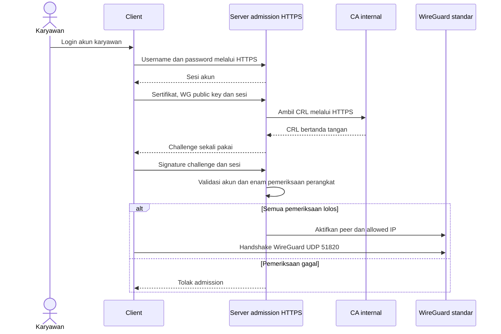

# Catatan revisi proposal VanGuard — 12 Oktober 2026

Acuan: [proposal asli](https://docs.google.com/document/d/1FWkmRWSUzfvPzLz1S2Bdxv2lCrgtB35IMzyWPZNX6BA/edit),
dibaca melalui Google Drive pada 12 Oktober; metadata perubahan terakhir 7 Juli
2026 15:49:59 UTC. Catatan ini adalah **usulan untuk ditinjau bersama pembimbing**,
bukan perubahan langsung pada Google Docs atau persetujuan perubahan ruang lingkup.
Implementasi dan hasil tes dibedakan dari target penelitian yang belum tercapai.

## 1. Kesimpulan audit

Fondasi sistem sesuai dengan arah proposal: lima VM, WireGuard standar, CA OpenSSL
internal single-tier, akun karyawan, binding X.509–public key WireGuard, dashboard
admin dengan TOTP, penolakan default, CRL dan pemutusan peer. Namun sistem belum
memenuhi seluruh fitur dan pengujian yang tertulis. Beberapa uraian proposal juga
bertentangan dengan batasannya sendiri: larangan mengubah kernel dibanding
penyisipan sertifikat ke handshake, serta validasi sebelum akses dibanding
penambahan peer langsung saat registrasi.

Revisi sebaiknya menjelaskan sistem yang benar dan tetap mempertahankan daftar
kebutuhan yang belum selesai. Mengubah tulisan menjadi lebih sempit tidak otomatis
menyelesaikan kebutuhan awal; perubahan cakupan perlu persetujuan pembimbing.

## 2. Prioritas revisi per bagian

| Prioritas / acuan | Temuan | Usulan |
|---|---|---|
| P0 · §1.2–1.3, §3.2.1–3.3.1, §3.3.4–3.3.6 | Sertifikat digambarkan dikirim dalam handshake UDP WireGuard; tidak sesuai larangan modifikasi kernel dan implementasi | Pisahkan admission HTTPS dari handshake WireGuard standar; perbarui semua diagram bersama narasinya |
| P0 · §3.3.2 | Peer aktif saat registrasi dan bundle berisi private key | Registrasi hanya registry/binding; key dibuat di client; bundle hanya materi publik; aktivasi peer setelah sesi akun dan enam pemeriksaan |
| P0 · daftar pustaka / Bab II | Sitasi [12]–[19] ada pada teks tetapi daftar pustaka yang terbaca hanya [1]–[11]; beberapa nomor tabel berbeda identitas referensinya | Rekonsiliasi nomor, judul, penulis, tahun, DOI/URL dan klaim sebelum proposal dipakai sebagai dasar ilmiah |
| P1 · abstrak | Sudah menyatakan pengujian membuktikan pemblokiran total tanpa mengorbankan throughput | Pada proposal gunakan bentuk rencana; pada laporan hasil hanya sebut hasil dan keterbatasan yang benar-benar diukur |
| P1 · judul, latar, batasan | Akses internet, akses internal dan simulasi manufaktur bercampur | Tegaskan akses jarak jauh ke resource internal yang disimulasikan; lab belum menjadi internet gateway atau jaringan pabrik nyata |
| P1 · §1.2–1.3 | AKE X.509, penghilangan insiden, optimalisasi MTTD/MTTR belum punya pembanding operasional | Ganti AKE tambahan menjadi admission berbasis sertifikat; definisikan metrik aplikasi dan batasi kesimpulan pada skenario terukur |
| P1 · §3.2.3 | CA hanya dapat diakses dashboard; validasi ditempatkan di CA | CA diakses admin untuk issue/revoke dan server untuk mengambil CRL; validasi signature/validity/PoP/binding berjalan di server |
| P1 · §3.3.2–3.3.3 | Notifikasi pemilik dan pengujian handshake otomatis saat registrasi | Bedakan flash/audit admin dari notifikasi endpoint. Handshake diuji setelah admission; notifikasi pemilik tetap backlog |
| P1 · §3.4 | Relasi perangkat : sertifikat 1:N dan renewal berkala | Saat ini 1 identitas : 1 sertifikat, dengan riwayat aktivitas; renewal/rotasi dan histori multi-sertifikat belum diimplementasikan |
| P1 · §3.5.2 | iperf3 diklaim mengukur seluruh latency; belum ada parameter/perbandingan yang cukup | TCP receiver goodput, RTT ping, UDP jitter/loss dan CPU server ditulis terpisah; cantumkan parameter, urutan, seed, pilot dan kegagalan |
| P1 · S-01 / S-02 | Nama credential stuffing dan certificate replay tidak tepat menggambarkan semua uji | Sebut penyalahgunaan kredensial valid dan penggunaan ulang sertifikat revoked; replay challenge diuji sebagai skenario terpisah |
| P1 · S-03 / S-04 | Capture tunnel dan pemutusan seketika berpotensi disimpulkan terlalu luas | Capture underlay dengan kontrol plaintext; threshold revoke <60 s dalam lab, bukan nol detik atau SLA produksi |
| P2 · §3.2.1 | Python dianggap cukup untuk mendukung Windows | Windows membutuhkan adapter jaringan, service, permission dan tes tersendiri; dukungan saat ini Ubuntu 22.04 |
| P2 · §1.2–1.3 | Mikrosegmentasi disimpulkan dari metadata atau host firewall | Tentukan resource, port, subjek yang boleh/ditolak dan matriks uji. Kolom departemen bukan enforcement kebijakan |
| P2 · struktur | Pengulangan “Tahap ini”, typo, penomoran gambar/daftar isi tidak konsisten | Rapikan setelah arsitektur final; regenerasi daftar isi/caption, samakan VanGuard, revokasi, kedaluwarsa dan istilah Indonesia/Inggris |

## 3. Contoh redaksi pengganti

### Judul dan cakupan

Alternatif judul untuk dibahas: **Implementasi Autentikasi Akun dan Perangkat
Berbasis PKI pada Akses VPN WireGuard dengan Prinsip Zero Trust dalam Simulasi
Jaringan Perusahaan Manufaktur**.

> Penelitian mengimplementasikan kontrol akses VPN pada lima virtual machine
> Ubuntu Server 22.04. Lingkungan ini merepresentasikan peran CA, gateway,
> karyawan, administrator dan penyerang. Validasi dilakukan terhadap identitas
> akun dan identitas kriptografis perangkat sebelum peer WireGuard diaktifkan.
> Penelitian tidak memodifikasi kernel atau format pesan WireGuard. Hasil lab
> tidak langsung digeneralisasi ke seluruh jaringan manufaktur, perangkat OT,
> koneksi WAN, endpoint Windows atau akses internet umum.

Jika Windows tetap menjadi kebutuhan wajib, pertahankan kebutuhan tersebut dan
tambahkan rencana adapter serta bukti pengujiannya; jangan menghapusnya diam-diam.

### Abstrak proposal

> Penelitian ini mengusulkan Sistem VanGuard untuk membatasi akses VPN berdasarkan
> sesi akun karyawan dan identitas kriptografis perangkat. Sistem mengintegrasikan
> WireGuard standar, CA internal berbasis OpenSSL, admission HTTPS dan dashboard
> administrasi. Sebelum peer diaktifkan, server memeriksa sertifikat X.509, CRL,
> proof-of-possession dan binding public key WireGuard. Akses yang telah diberikan
> dievaluasi kembali melalui lease dan rekonsiliasi status sertifikat serta akun.
> Evaluasi direncanakan pada lab lima VM melalui pengujian fungsional, penyalahgunaan
> kredensial valid, penggunaan sertifikat dicabut, observasi trafik dan pengukuran
> performa. Hasil akan digunakan untuk menilai keberhasilan kontrol akses serta
> biaya performa dalam batas lingkungan pengujian.

Untuk laporan akhir, ubah rencana menjadi hasil hanya setelah dataset lengkap.
Hindari “total”, “tanpa overhead”, “seketika”, atau penurunan insiden dunia nyata
tanpa definisi, pembanding dan bukti yang memadai.

### Tujuan autentikasi dan §3.3.1 / §3.3.4

> VanGuard Client memperoleh sesi melalui login akun karyawan pada HTTPS API.
> Client mengirim sertifikat dan public key WireGuard untuk meminta challenge,
> lalu menandatangani challenge dengan private key X.509 lokal. Server memeriksa
> signature CA, masa berlaku, CRL terkini, serial revocation, proof-of-possession
> dan binding sertifikat–public key WireGuard, serta validitas sesi/binding akun.
> Hanya setelah semua pemeriksaan lolos, server menambahkan peer dengan allowed IP
> yang tercatat. WireGuard kemudian melakukan handshake standar pada UDP 51820.
> Renewal dan daemon rekonsiliasi mempertahankan akses hanya selama persyaratan
> masih terpenuhi.

Dokumentasi [protokol WireGuard](https://www.wireguard.com/protocol/) menjelaskan
handshake Noise berbasis key WireGuard. Admission aplikasi bukan modifikasi AKE
WireGuard. Diagram yang disarankan:

Diagram ini tidak merinci seluruh pengambilan ulang CRL; validasi final tidak
mengandalkan hasil challenge lama. Cantumkan itu pada penjelasan sequence.

### Registrasi, provisioning dan database

> Key X.509 dan key WireGuard independen dibuat pada client. Administrator yang
> telah lolos password/TOTP memasukkan metadata, memilih akun karyawan dan
> mengunggah CSR/public key. Dashboard memeriksa ketersediaan CA, meminta sertifikat,
> menyimpan workflow dan mencatat binding pada registry server. Registrasi tidak
> menambahkan peer live. Bundle onboarding berisi sertifikat, root CA publik,
> manifest binding dan petunjuk; tidak berisi private key, password atau token.

> Audit administrasi menyimpan waktu, aktor, peristiwa dan identitas perangkat.
> Pencabutan menyimpan alasan permintaan dan waktu penyelesaian workflow. Satu
> identitas saat ini memiliki satu sertifikat; pembaruan sertifikat untuk identitas
> yang sama memerlukan mekanisme lifecycle tambahan yang belum tersedia.

ERD perlu mencantumkan akun karyawan, sesi/binding akun dan audit admin selain
registry perangkat. SQLite CA/server/admin terpisah bukan satu database terdistribusi
atomik; status pending/retry menangani kegagalan parsial. `revoked_at` dashboard
adalah waktu workflow selesai, berbeda dari timestamp pencabutan di CRL.
Alasan bisnis dashboard juga berbeda dari reason code OpenSSL yang saat ini
tetap `cessationOfOperation`; jangan mengklaim reason dashboard sudah diekspor ke CRL.

### Ancaman, metrik dan hasil keamanan

> S-01 mensimulasikan penyerang yang mengetahui kredensial karyawan valid tetapi
> tidak memiliki private key perangkat yang sah. Login akun dapat berhasil,
> sedangkan admission perangkat harus ditolak. Uji sertifikat publik yang disalin
> dengan key proof salah merupakan subkasus yang berbeda dari perangkat tanpa
> sertifikat. Pengujian ini tidak membuktikan perlindungan ketika seluruh private
> key dan sesi perangkat ikut dicuri.

[OWASP](https://community.owasp.org/attacks/Credential_stuffing) membahas credential
stuffing sebagai penggunaan kredensial bocor secara otomatis pada layanan lain.
Nama “penyalahgunaan kredensial valid dari perangkat tidak sah” lebih tepat untuk
uji lab satu akun ini; tambahkan skenario otomatis tersendiri jika tetap ingin
mengevaluasi credential stuffing secara luas.

> MTTD aplikasi dihitung dari awal pemrosesan request Flask sampai penolakan
> terdeteksi. MTTR Respond aplikasi dihitung dari deteksi sampai JSON penolakan
> siap, sebelum penyimpanan telemetry dan pengiriman jaringan. RTT attacker
> dicatat terpisah. Semua selisih memakai satu jam monotonic per node. Angka ini
> bukan waktu sejak kebocoran password atau respons operator/SOC.

Hasil terukur 0.1.4: sepuluh sampel, mean deteksi 69,649 ms dan Respond 19,383 ms.
Angka S-04 lama 7,351–12,737 detik adalah batas konfirmasi pengamat termasuk
SSH/polling; bukan MTTD/MTTR. Cantumkan n, median, variasi, kondisi mesin dan
[batas pengukuran](RESPONSE_METRICS_2026-10-10.md).

Untuk S-03, ambil capture dari underlay dan bandingkan kontrol plaintext di wg0.
Capture wg0 memang dapat menampilkan plaintext setelah dekripsi; itu bukan bukti
WireGuard gagal. Tidak terlihatnya marker pada underlay bukan pembuktian formal
ketahanan kriptografi atau MITM. S-04 yang ada mengukur ICMP; TCP/aplikasi belum diuji.

### Performa dan klaim Zero Trust

> Performa dibandingkan pada clear, WireGuard standar dan VanGuard menggunakan
> sepuluh blok dengan urutan acak berseed. Pilot dipisahkan dari dataset formal.
> Ukur TCP receiver goodput 10 detik setelah warmup 2 detik; RTT dari 30 ping;
> jitter/loss UDP pada 10 Mbps dan payload 1200 byte. CPU seluruh VM server
> diukur melalui /proc/stat pada envelope koneksi kontrol, termasuk warmup dan
> finalisasi, dengan durasi aktual dilaporkan. Dataset gagal tidak dianggap nol
> atau digabung diam-diam ke rata-rata.

Rincian dan keterbatasan counter UDP paket iperf ada di [protokol benchmark](BENCHMARK_PLAN.md).
Baseline tetap menjalankan layanan VanGuard sebagai beban latar yang sama;
jelaskan bahwa ini perbandingan jalur data, bukan penghapusan seluruh platform.
Jika tujuan penelitian biaya keseluruhan platform, dibutuhkan desain eksperimen
tambahan. Jangan klaim tiga konfigurasi selesai berdasarkan pilot dua kondisi.

[NIST SP 800-207](https://csrc.nist.gov/pubs/sp/800/207/final) dapat dipakai untuk
merapikan terminologi arsitektur Zero Trust. Jelaskan PEP pada enforcement peer/
firewall dan fungsi keputusan admission. IEP merupakan istilah dari kerangka
rujukan tertentu; jangan menyebutnya komponen baku NIST tanpa pemetaan. Metadata
departemen belum membentuk mikrosegmentasi. Untuk klaim per-resource, tambahkan
matriks akun/perangkat → resource/port → izin, beserta uji allow dan deny.

## 4. Audit referensi yang harus diselesaikan

Pemeriksaan teks menemukan sitasi bernomor 1–19, sedangkan bagian daftar pustaka
hanya memuat 1–11. Ini ketidakkonsistenan dalam dokumen yang dibaca, bukan vonis
bahwa suatu publikasi tidak ada. Contoh pemetaan yang berbeda:

| Nomor | Tabel penelitian terdahulu | Daftar pustaka |
|---|---|---|
| [2] | Li, Feng & Zheng; survey VPN | Hermawan & Saputra; tunneling cloud/WireGuard |
| [3] | Abdulazeez dkk.; perbandingan protokol | Prameswari & Marcus; IKE/IPsec Mikrotik |
| [4] | Lafourcade dkk.; analisis simbolik WireGuard | Wulandari dkk.; VPN topologi star |

Periksa tiap artikel melalui halaman penerbit/DOI, cocokkan isi yang mendukung
klaim dan baru renumerasi. Statistik 77% dan 74%, angka codebase, perbandingan
performa dan klaim “belum ada penelitian” memerlukan sumber primer yang sesuai
tahun, populasi dan konteks. Audit ini belum memvalidasi seluruh bibliografi;
jangan menambahkan DOI atau hasil penelitian berdasarkan tebakan.

## 5. Kriteria penutupan gap

- Renewal: skema histori 1:N, binding baru yang tervalidasi, pergantian atomik,
  revokasi lama dan tes gagal/rollback tanpa menghidupkan sertifikat revoked.
- Windows: adapter nyata dan uji install/login/admission/tunnel/revoke/cleanup
  pada endpoint Windows, atau perubahan cakupan yang disetujui pembimbing.
- Notifikasi pemilik: kanal dan penerima ditentukan, status kirim/retry diuji;
  flash dashboard belum memenuhi kebutuhan ini.
- Kebijakan resource: enforcement dan bukti allow/deny untuk resource simulasi;
  endpoint produksi/OT tidak boleh diasumsikan ada.
- Benchmark: pilot semua kondisi, keputusan pengecualian peer WG terisolasi,
  seri tiga × 10, raw data/cleanup dan analisis variasi serta selisih berpasangan.
- Klaim novelty: tekankan integrasi admission/CRL/binding/dashboard dan evaluasi
  yang dapat direproduksi; bukan kriptografi baru atau klaim pertama di dunia.

Lihat [matriks implementasi](PROPOSAL_ALIGNMENT.md), [jurnal perubahan](PROGRESS_2026-10-12.md)
dan checkpoint untuk membedakan pekerjaan selesai, bukti historis dan backlog.
