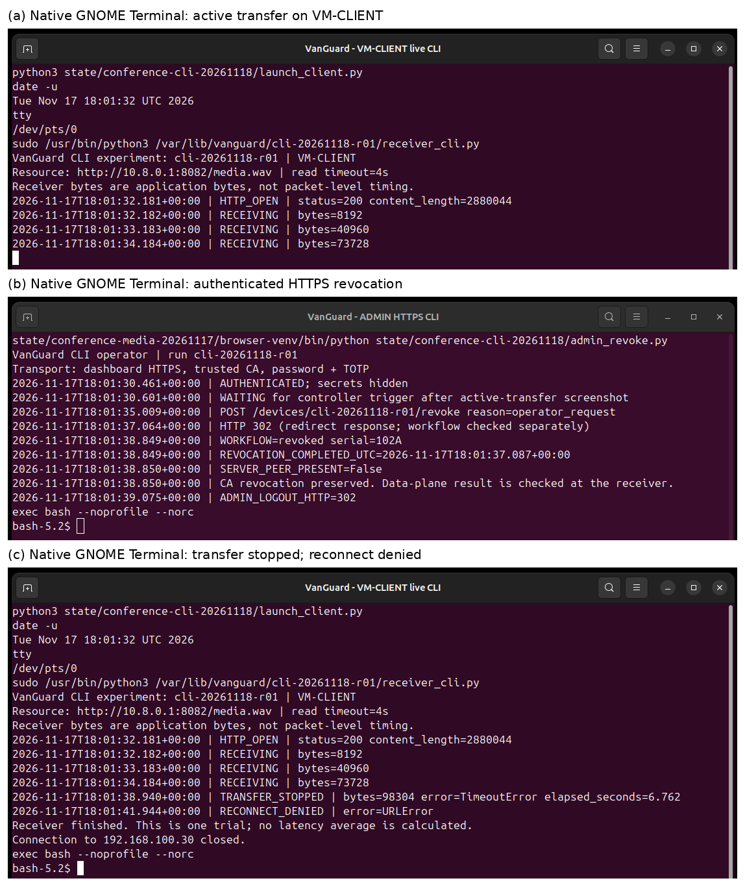

# Certificate-Based Access Control and Revocation for a Virtualized Digital Media Service Using WireGuard

**Working draft — 18 November 2026. Not ready for submission.** Author names and affiliations await confirmation. Two illustrative VM media runs and a native-terminal Figure 2 are available; the full experimental matrix and independent repetitions remain pending. Historical platform evidence is reported separately. Target: English, at most six pages including references. Final pagination must be rechecked after adding results and figures. Reference eligibility currently uses JCR 2024; SJR-specific eligibility has not been verified.

**Authors:** [Author names, affiliations, city, country, and email; apply the confirmed blind-review rules before submission.]

**Abstract—** Digital media services require access decisions that remain enforceable after a user authenticates. An encrypted tunnel alone does not express whether an employee session remains valid or whether a device certificate has been revoked. This paper presents VanGuard, a prototype that combines employee authentication, certificate-based device admission, and resource-specific authorization around an unmodified WireGuard tunnel. Before installing a live peer, an HTTPS admission service verifies certificate trust and validity, current revocation information, private-key possession, and the registered certificate-to-WireGuard-key binding. Time-limited leases and a reconciliation daemon enforce subsequent access withdrawal. We describe a virtual testbed and a planned evaluation using a controlled digital media download service. Existing platform experiments provide preliminary evidence of admission, application access control, and revocation. Illustrative VM media runs additionally demonstrate intact authorized downloads and transfer interruption after dashboard revocation; repeated performance measurements remain pending. The evaluation separates new connection denial, interruption of an ongoing transfer, and peer removal, supported by timestamped logs and screenshots. The contribution is an implementation and evaluation approach for revocable access to a protected service, without changing WireGuard or claiming media-content authenticity.

**Keywords—** zero trust, access control, device certificates, WireGuard, revocation, digital media security

## I. Introduction

A digital media repository may distribute recordings, images, or other assets to authorized users across managed and unmanaged networks. A relevant security problem is continued access after a credential is stolen, a device becomes unauthorized, or an administrator withdraws permission. In this setting, successful login and network reachability should not independently imply permission to retrieve protected content.

Zero trust architecture separates access decisions from implicit trust in network location and considers both subjects and devices [1]. VanGuard applies this principle to a small, centrally administered testbed. It requires an employee session and cryptographic device authentication before activating a WireGuard peer. Resource policy then determines which application can be reached. The proposed media workload is a concrete service to evaluate these controls; it does not add an artificial intelligence model or a media-forensics algorithm.

This study asks three questions. RQ1: Can valid employee credentials authorize access when device authentication fails? RQ2: Does revocation stop new requests and ongoing authorized transfers, and with what observed delay? RQ3: Does the system preserve access restrictions when its authorization dependencies become unavailable?

The intended contributions are a documented admission and revocation design, an explicit threat model for a protected media service, and a reproducible evaluation linking access outcomes to control-plane events. The work does not claim a new cryptographic protocol, hardware-bound identity, or superiority over commercial zero trust products. This draft distinguishes implemented platform behavior from the media experiment that must be completed before submission.

## II. Background and Related Work

A review surveys authentication, access control, trust assessment, micro-segmentation, and software-defined perimeters in zero trust architectures [1]. Another review compares related approaches and their implementation challenges [2]. Together, these reviews support evaluating user identity, device evidence, and resource permissions separately; they do not establish that any one VPN deployment implements every zero trust capability.

A critical analysis argues that assembling security mechanisms is insufficient without a systematic treatment of threats and countermeasures [3]. This motivates the explicit adversary assumptions and negative controls in this study. VanGuard's contribution is evaluated as an integration of existing mechanisms, without claiming a new cryptographic protocol or treating the zero trust label as proof of security.

Deployment also extends beyond tunnel configuration. A migration framework addresses organizational transition to zero trust [4]. A separate review discusses resource protection, implementation strategies, and limitations [5]. A modeling study analyzes deployment costs and modeled organizational benefits [6]. These works motivate documenting operational dependencies and evaluation boundaries. The present VM study does not measure enterprise migration success, organizational risk reduction, or cost savings.

A review of zero trust VPN research proposes a framework combining certificate-based authentication, user identity checks, and session controls for hybrid and remote work [7]. The framework also considers device health and location. VanGuard addresses a narrower implementation problem: enforcing certificate-to-WireGuard-key binding and revocable access without changing the tunnel protocol. Those broader contextual controls are outside its evaluated feature set.

A multi-level authorization design for industrial remote access is supported by software-defined networking and trusted execution environments [8]. This design provides precedent for separating network access from resource authorization. VanGuard instead uses a small VM deployment; its software-held private keys do not provide trusted-execution or hardware-attestation guarantees.

Certificate issuance and certificate-status enforcement are separate concerns. A survey examines X.509 infrastructure and revocation proposals, including blockchain and ledger approaches [9]. An experimental study identifies incomplete revocation checking and soft-fail behavior in some browser configurations [10]. These findings concern web PKI, not VanGuard, but motivate directly testing how unavailable revocation information affects access. VanGuard uses a conventional private CA and CRLs; it neither implements blockchain revocation nor assumes browser certificate handling enforces VPN policy.

A comparison of WireGuard and OpenVPN in Azure and VMware finds that performance depends on deployment and network conditions [11]. A study evaluates RTT and bandwidth across VPN and overlay configurations using virtualized testbeds [12]. These studies motivate recording the environment and separating transport measurements from authorization outcomes. Their throughput results cannot be reused as VanGuard measurements or as evidence that an ongoing transfer stops after authorization is withdrawn.

These selected studies motivate evaluating the interaction of admission, resource policy, and revocation during a media transfer. They do not establish an exhaustive novelty review or prove that the integration is unprecedented. Access authentication must also be distinguished from media authenticity: authorizing a download does not establish who created its content or detect a manipulated recording.

## III. System Design and Threat Model

### A. Components and Trust Boundaries

The testbed contains five Ubuntu virtual machines: a certificate authority, a WireGuard gateway and admission server, an administrator dashboard, an authorized client, and an attacker client. The administrator approves registration and binds a device identity to an employee account. The client independently generates its X.509 and WireGuard private keys; registration transfers public material only. The CA signs certificates and maintains revocation state. Registration does not itself install a live peer.

The proposed media service will run behind the gateway's application policy, using the existing internal service endpoint at tunnel address 10.8.0.1 and TCP port 8082. It will serve non-sensitive, controlled test content. This service workload has not yet been deployed or evaluated. The client-facing policy must explicitly identify the authorized device, resource address, protocol, and port. Direct access through the virtual LAN will be included as a negative control. An industrial-network architecture combines microsegmentation with centrally managed, distributed enforcement [13]. This architecture supports the rationale for resource-scoped policy, while VanGuard uses a centralized gateway and makes no equivalent distributed-resilience claim.

[FIGURE 1 PLACEHOLDER: Draw the five-node architecture, management boundary, HTTPS admission path, WireGuard data path, and protected media service. Mark the media workload as planned until deployed. This is a design figure, not an experimental screenshot.]

### B. Admission and Authorization

An employee authenticates over HTTPS and receives a session associated with the device binding. A subsequent device challenge and proof must use the same valid session. The admission service checks the certificate signature against the trusted root, the validity period, the freshness and validity of the CRL, the certificate serial against revocation records, private-key proof-of-possession, and the certificate-to-WireGuard-public-key registry binding. An analysis identifies design-level weaknesses in multi-factor authentication protocols [14]. Consequently, dashboard TOTP, employee login, and device proof remain distinct controls; their presence alone does not establish resistance to every authentication attack.

A successful decision authorizes a live WireGuard peer with its assigned tunnel address. A failed or indeterminate decision does not authorize a new peer. The challenge is single-use and expires; possession of a copied certificate without the corresponding private key is insufficient. After admission, the resource policy remains default-deny. A peer entry or a recent handshake is therefore not equivalent to permission to access every service.

### C. Access Withdrawal and Dependency Failure

The implementation uses leases of at most 300 seconds, capped by the employee-session expiry. Lease renewal repeats authorization checks and does not extend certificate validity. A daemon reconciles active peers against current access conditions. Its configured interval is five seconds after the preceding cycle completes, so this interval is not a guaranteed revocation latency. Dependency requests, scheduling, and enforcement operations contribute to the observed delay. A certificate-management survey distinguishes certificate lifecycle functions and identifies CRL publication frequency as a constraint on revocation freshness [15]. This motivates measuring dissemination and enforcement together rather than treating an administrator action as instantaneous revocation.

Invalid or unavailable revocation information causes access leases to be invalidated and peer removal to be attempted. The deployment also uses service supervision and tunnel shutdown on daemon termination. The resulting behavior must be observed at the application, not inferred solely from a healthy process indicator. Authenticated logout targets the supplied session and its owned access; an older session must not revoke access owned by a newer session. A usage-control model includes continued authorization checks and termination of long-lived operations after permission becomes invalid [16]. VanGuard implements periodic reconciliation rather than the cited score-based IoT model.

### D. Adversary and Assumptions

The attacker controls a separate client VM and may possess valid employee credentials, a copied public certificate, or a previously observed challenge. The attacker does not initially possess the legitimate device's private keys and cannot administer the CA, gateway, hypervisor, or dashboard. The evaluation includes invalid proof, replay, revocation, and direct-path access attempts within the authorized lab.

The root trust anchor and initial profile distribution are assumed trustworthy. A compromise of the root CA or gateway administrator is outside the evaluated threat model. Copying both private keys and the complete client state is not prevented by cryptographic identity binding alone. The system does not provide deepfake detection, watermarking, storage encryption, or tamper-evident logging. Audit records support operational traceability but are not an immutable external ledger. SealFSv2 provides a contrasting forward-integrity logging design [17]. VanGuard does not implement that protection, so its archive checksums must not be described as protection against a privileged actor rewriting both records and checksums.

## IV. Experimental Method

### A. Versioning and Workload

The planned media evaluation will freeze the verified deployment combination: CA 0.1.17 and gateway, dashboard, and Ubuntu client 0.1.15. Before execution, the experiment record will include installed-source hashes, operating-system versions, host and guest resource allocations, time synchronization, and dependency readiness. Historical results from other releases remain separate datasets. Gotham documents reproducible device configurations, attack scripts, and topology [18]. A testbed review distinguishes emulated evidence from live physical evidence in smart-environment testbeds [19]. Applying these methodological lessons here means retaining versioned scenarios and labeling each result by its actual execution environment.

The media workload will use a versioned synthetic asset, with its size, SHA-256 digest, delivery rate, and server settings recorded. A sustained download will be long enough for revocation to occur during transfer. Counters at the receiver will distinguish application bytes already buffered from new network delivery. A digest comparison on a completed authorized download will check transfer correctness; it will not establish authorship or resistance to malicious content replacement.

### B. Scenarios and Controls

Table I defines the planned media-service experiments. Each scenario includes an authorized positive control and the relevant denied condition. Disposable test identities will be revoked or disabled during cleanup; primary identities and CA history will be preserved.

**TABLE I. MEDIA-SERVICE EVALUATION PLAN — NOT YET EXECUTED**

| Scenario | Required observation |
| --- | --- |
| Registration and login only | No live peer or protected media access before device admission |
| Valid device and account | Admission, explicit resource grant, and successful media download |
| Stolen credentials, invalid device proof | Denial, no attacker peer, and no protected media bytes |
| Revoked, expired, mismatched, or replayed identity evidence | Separate denied cases with correlated reasons and no new authorized access |
| Revocation during download | Timed access withdrawal, receiver-byte observations, and denied reconnection |
| Direct LAN path or unauthorized port | Application remains unreachable outside the authorized path/policy |
| Renewal, logout, and dependency failure | Scoped withdrawal and fail-closed behavior under the stated condition |

The target is at least ten independently initialized runs for the primary denial and revocation measurements. This is a collection plan, not an achieved sample count or a statistical power claim. Run order, background load, failed attempts, and timeouts will be retained. Results will report sample size and descriptive statistics rather than replacing missing measurements with zero.

### C. Timing and Evidence

For revocation, one observer will record the interval from its request initiation to the first observed access failure, with request acknowledgement recorded separately. This operational interval includes request transport and polling uncertainty; it is not the exact internal enforcement instant. The probe interval and timeout will be reported. Peer disappearance and application-transfer interruption will be measured separately. Timestamps from different VMs will not be subtracted to manufacture precise latency. A session-lifecycle study measures session-driven revocation using enforcement-completion receipts and tests dependency failure [20]. The study's different timing boundary and architecture preclude numerical comparison with VanGuard's historical samples; they reinforce the need to state precisely what each timer measures.

For application rejection timing, the existing instrumentation distinguishes request-handler entry, detection of an invalid proof, and completion of the denial response. These boundaries exclude network time outside the handler and do not measure time since credential theft. Any historical metric is labeled with its original release and definition.

Screenshots will show genuine client, gateway, and dashboard states from identifiable runs. Each selected image will be linked to timestamps, scenario identifiers, and retained logs. Secrets and personal information will be redacted in publication copies; original evidence will remain private. Screenshots illustrate observations, while logs and receiver counters support quantitative claims.

Figure 2. Native GNOME Terminal captures from run cli-20261118-r01, November 18 WIB (November 17 UTC): (a) live receiver on VM-CLIENT through SSH; (b) host CLI operator performing authenticated dashboard HTTPS revocation; (c) receiver timeout and failed reconnection. These are actual desktop terminal pixels; the operator CLI is experiment instrumentation, not a new product interface.

## V. Preliminary Evidence and Discussion

### A. Existing Platform Evidence

The available records establish preliminary behavior of the underlying platform, not the proposed media workload. The November 2–3 release record for version 0.1.15 documents successful HTTPS admission and WireGuard integration, denial without an application grant, access with an explicit TCP 8082 grant, and blocking of an active internal application TCP flow after grant withdrawal. A Linux CA-only revocation sample recorded peer removal after 6.828 seconds, blocking of the active test flow, and denial of readmission. That value is a single historical observation, not a mean or service-level guarantee.

Separate historical Windows tests used version 0.1.15 on Windows 10 build 19044 and Windows 11 build 26300. The records contain 122 and 98 probes, respectively, covering managed Internet access transitions, renewals, and revocation. These counts are individual probe observations, not independent replicated experiments. Recorded peer-removal times were 10.056 and 4.359 seconds, each from one revocation sample. They do not establish a controlled performance difference between Windows versions.

**TABLE II. HISTORICAL PLATFORM OBSERVATIONS — NOT MEDIA RESULTS**

| Environment and release | Recorded observation | Interpretation limit |
| --- | --- | --- |
| Linux integration, 0.1.15 | Resource allow/deny and active internal TCP blocking; peer removal 6.828 s in one CA-only revoke sample | Generic application fixture; one timing sample |
| Windows 10 build 19044, 0.1.15 | 122 probes; peer removal 10.056 s in one sample | New Internet connection probes; no ongoing media-transfer test |
| Windows 11 build 26300, 0.1.15 | 98 probes; peer removal 4.359 s in one sample | Different environment; not a paired OS comparison |

The Windows experiments invoked installed client APIs directly and do not prove a complete interactive installer workflow on a fresh physical machine. The Windows guests have subsequently been retired; their retained evidence must not be presented as a new run. These observations motivate the controlled media experiment but cannot substitute for it.

### B. Representative Media Run and Remaining Evaluation

[RESULTS PENDING: Add the completed Table I outcomes, the number of independent runs, transfer-interruption measurements, timing distributions, and the screenshot run identifiers. Update the abstract and conclusion only after these observations have been verified.]

On November 18 (WIB), a new Ubuntu VM run used CA 0.1.17 and server, admin, and client 0.1.15. A synthetic 180-second, mono 8-kHz WAV file (2,880,044 bytes) was downloaded completely with a matching SHA-256 digest. A separate transfer of the same file used 8,192-byte chunks with a nominal 250-ms sender pause. The receiver reported HTTP 200 and increasing byte counts before dashboard revocation of serial 102A, then timed out after receiving 98,304 bytes. Reconnection failed, readmission was rejected with upstream HTTP 403, and the peer was absent. Server audit records show accepted admission followed by device disable in the captured interval. The receiver used a four-second read timeout and three-second reconnect timeout; buffered bytes and timeout detection prevent interpreting its final timestamp as the precise enforcement instant.

This new identity/run had a positive-control download and one interrupted-transfer attempt. An earlier November 17 pilot received 122,880 bytes before interruption; its browser-based captures and failed attempts are retained separately. That earlier pilot encountered CRL-fetch failures and an upstream-related client stop. The new run had a startup admin readiness failure (database unknown), followed by readiness success before transfer; its device audit contains no CRL-related peer withdrawal. Neither successful run resolves the earlier availability concerns or supplies a controlled timing distribution. No interruption distribution, full Table I coverage, media-service LAN bypass result, or numerical improvement over plain WireGuard is claimed.

### C. Interpretation

The distinction between registration, admission, and resource permission is central to the design. A user can be registered and authenticated without receiving a live tunnel peer; a live peer can remain unable to reach a resource without a grant. Similarly, removing an authorization should be evaluated through both the control state and attempted data transfer. A dashboard label alone cannot demonstrate that active traffic has stopped.

The preliminary observations support the feasibility of enforcing these transitions in the tested platform. They do not establish comprehensive media security: a legitimately authorized recipient may retain previously downloaded bytes, and revocation cannot retract those copies. Resilience also includes a tradeoff: refusing access when the CA cannot be validated protects the authorization boundary but reduces availability.

## VI. Limitations and Conclusion

All planned new experiments use VMs on a shared host, where resource contention can affect timing. Historical measurements were collected at different development stages and will not be pooled as if they came from one controlled trial. Fresh Windows installation, physical endpoints, sustained production load, and physical CA power-loss behavior remain outside the present evidence. Startup readiness timeouts have occurred in prior observations; later successful probes do not establish that their cause has been eliminated.

VanGuard implements certificate-based admission, employee-session checks, and resource-specific access withdrawal around an unchanged WireGuard tunnel. The existing platform evidence justifies further evaluation of a protected digital media service. The representative media run adds transfer-withdrawal evidence, but repeated measurements and remaining scenarios are necessary to substantiate broader application-specific conclusions. This draft therefore presents an implemented control architecture and a defined evaluation method, rather than a completed media-security validation.

## References

[1] N. F. Syed, S. W. Shah, A. Shaghaghi, A. Anwar, Z. Baig, and R. Doss, “Zero trust architecture (ZTA): A comprehensive survey,” IEEE Access, vol. 10, pp. 57143–57179, 2022, doi: 10.1109/ACCESS.2022.3174679.

[2] P. Dhiman, N. Saini, Y. Gulzar, S. Turaev, A. Kaur, K. U. Nisa, and Y. Hamid, “A review and comparative analysis of relevant approaches of zero trust network model,” Sensors, vol. 24, no. 4, Art. no. 1328, 2024, doi: 10.3390/s24041328.

[3] E. B. Fernandez and A. Brazhuk, “A critical analysis of Zero Trust Architecture (ZTA),” Computer Standards & Interfaces, vol. 89, Art. no. 103832, 2024, doi: 10.1016/j.csi.2024.103832.

[4] P. Phiayura and S. Teerakanok, “A comprehensive framework for migrating to zero trust architecture,” IEEE Access, vol. 11, pp. 19487–19511, 2023, doi: 10.1109/ACCESS.2023.3248622.

[5] M. Tsai, S. Lee, and S. W. Shieh, “Strategy for implementing of zero trust architecture,” IEEE Transactions on Reliability, vol. 73, no. 1, pp. 93–100, 2024, doi: 10.1109/TR.2023.3345665.

[6] Z. Adahman, A. W. Malik, and Z. Anwar, “An analysis of zero-trust architecture and its cost-effectiveness for organizational security,” Computers & Security, vol. 122, Art. no. 102911, 2022, doi: 10.1016/j.cose.2022.102911.

[7] S. M. Zohaib, S. M. Sajjad, Z. Iqbal, M. Yousaf, M. Haseeb, and Z. Muhammad, “Zero trust VPN (ZT-VPN): A systematic literature review and cybersecurity framework for hybrid and remote work,” Information, vol. 15, no. 11, Art. no. 734, 2024, doi: 10.3390/info15110734.

[8] F. Federici, D. Martintoni, and V. Senni, “A zero-trust architecture for remote access in industrial IoT infrastructures,” Electronics, vol. 12, no. 3, Art. no. 566, 2023, doi: 10.3390/electronics12030566.

[9] S. Khan, F. Luo, Z. Zhang, F. Ullah, F. Amin, S. F. Qadri, M. B. B. Heyat, R. Ruby, L. Wang, S. Ullah, M. Li, V. C. M. Leung, and K. Wu, “A survey on X.509 public-key infrastructure, certificate revocation, and their modern implementation on blockchain and ledger technologies,” IEEE Communications Surveys & Tutorials, vol. 25, no. 4, pp. 2529–2568, 2023, doi: 10.1109/COMST.2023.3323640.

[10] D. G. Berbecaru and A. Lioy, “An evaluation of X.509 certificate revocation and related privacy issues in the web PKI ecosystem,” IEEE Access, vol. 11, pp. 79156–79175, 2023, doi: 10.1109/ACCESS.2023.3299357.

[11] J. Anyam, R. R. Singh, H. Larijani, and A. Philip, “Empirical performance analysis of WireGuard vs. OpenVPN in cloud and virtualised environments under simulated network conditions,” Computers, vol. 14, no. 8, Art. no. 326, 2025, doi: 10.3390/computers14080326.

[12] A. F. Gentile, D. Macrì, E. Greco, and P. Fazio, “Overlay and virtual private networks security performances analysis with open source infrastructure deployment,” Future Internet, vol. 16, no. 8, Art. no. 283, 2024, doi: 10.3390/fi16080283.

[13] C. Zanasi, S. Russo, and M. Colajanni, “Flexible zero trust architecture for the cybersecurity of industrial IoT infrastructures,” Ad Hoc Networks, vol. 156, Art. no. 103414, 2024, doi: 10.1016/j.adhoc.2024.103414.

[14] K. W. Ang, E. G. Chekole, and J. Zhou, “Unveiling the covert vulnerabilities in multi-factor authentication protocols: A systematic review and security analysis,” ACM Computing Surveys, vol. 57, no. 11, Art. no. 293, pp. 1–37, 2025, doi: 10.1145/3734864.

[15] J. Göppert, A. Walz, and A. Sikora, “A survey on life-cycle-oriented certificate management in industrial networking environments,” Journal of Sensor and Actuator Networks, vol. 13, no. 2, Art. no. 26, 2024, doi: 10.3390/jsan13020026.

[16] S. Ameer, L. Praharaj, R. Sandhu, S. Bhatt, and M. Gupta, “ZTA-IoT: A novel architecture for zero-trust in IoT systems and an ensuing usage control model,” ACM Transactions on Privacy and Security, vol. 27, no. 3, Art. no. 22, pp. 1–36, 2024, doi: 10.1145/3671147.

[17] G. Guardiola-Múzquiz and E. Soriano-Salvador, “SealFSv2: Combining storage-based and ratcheting for tamper-evident logging,” International Journal of Information Security, vol. 22, no. 2, pp. 447–466, 2023, doi: 10.1007/s10207-022-00643-1.

[18] X. Sáez-de-Cámara, J. L. Flores, C. Arellano, A. Urbieta, and U. Zurutuza, “Gotham testbed: A reproducible IoT testbed for security experiments and dataset generation,” IEEE Transactions on Dependable and Secure Computing, vol. 21, no. 1, pp. 186–203, 2024, doi: 10.1109/TDSC.2023.3247166.

[19] V. Kampourakis, K. E. Kampourakis, M. Takaronis, and V. Gkioulos, “A systematic review of cybersecurity testbeds for smart environments: Architectures, attack coverage, and defensive evidence,” Future Internet, vol. 18, no. 9, Art. no. 445, 2026, doi: 10.3390/fi18090445.

[20] P. Chang and G. Xu, “Design and implementation of a zero trust access control model driven by session lifecycle,” IEEE Access, vol. 14, pp. 33819–33827, 2026, doi: 10.1109/ACCESS.2026.3669103.
