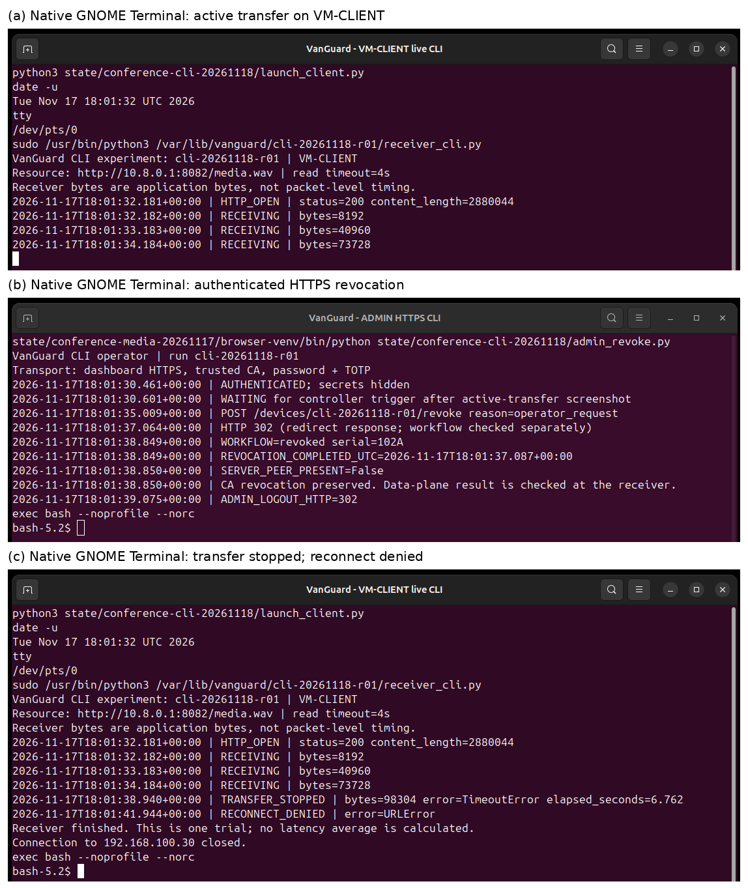

# Pengendalian dan Pencabutan Akses Berbasis Sertifikat untuk Layanan Media Digital Tervirtualisasi Menggunakan WireGuard

**Draf kerja bahasa Indonesia — 18 November 2026. Belum siap diajukan.** Versi ini mengikuti revisi draf Inggris 18 November untuk penelaahan dan diskusi. Nama serta afiliasi penulis menunggu konfirmasi. Dua uji media VM ilustratif dan Gambar 2 terminal native tersedia; matriks eksperimen lengkap serta pengulangan independen masih tertunda. Bukti historis platform disajikan terpisah. Naskah pengajuan tetap berbahasa Inggris, maksimal enam halaman termasuk referensi. Jumlah halaman akhir harus diperiksa kembali setelah hasil dan gambar ditambahkan. Kelayakan referensi saat ini memakai JCR 2024; kelayakan berdasarkan SJR belum diverifikasi.

**Penulis:** [Nama penulis, afiliasi, kota, negara, dan surel; terapkan ketentuan penelaahan anonim yang telah dikonfirmasi sebelum pengajuan.]

**Abstrak—** Layanan media digital memerlukan keputusan akses yang tetap dapat ditegakkan setelah pengguna melakukan autentikasi. Tunnel terenkripsi saja tidak menunjukkan apakah sesi karyawan masih berlaku atau sertifikat perangkat telah dicabut. Artikel ini menyajikan VanGuard, prototipe yang menggabungkan autentikasi karyawan, penerimaan perangkat berbasis sertifikat (admission), dan otorisasi khusus sumber daya di atas tunnel WireGuard yang tidak dimodifikasi. Sebelum memasang peer aktif, layanan admission melalui HTTPS memeriksa kepercayaan dan masa berlaku sertifikat, informasi pencabutan terkini, kepemilikan kunci privat, serta pengikatan sertifikat dengan kunci WireGuard yang terdaftar. Izin akses berbatas waktu (lease) dan daemon rekonsiliasi digunakan untuk menegakkan pencabutan akses berikutnya. Artikel ini menjelaskan lingkungan uji virtual dan rencana evaluasi menggunakan layanan unduh media digital yang terkendali. Eksperimen platform memberikan bukti awal tentang admission, pengendalian akses aplikasi, dan pencabutan. Uji media VM ilustratif juga menunjukkan unduhan berizin yang utuh dan transfer terputus setelah pencabutan melalui dasbor; pengukuran kinerja berulang masih tertunda. Evaluasi membedakan penolakan koneksi baru, penghentian transfer yang sedang berlangsung, dan penghapusan peer, dengan dukungan log bertanda waktu dan tangkapan layar. Kontribusinya berupa implementasi serta pendekatan evaluasi akses yang dapat dicabut ke layanan terlindungi, tanpa mengubah WireGuard atau mengklaim autentisitas konten media.

**Kata kunci—** zero trust, pengendalian akses, sertifikat perangkat, WireGuard, pencabutan akses, keamanan media digital

## I. Pendahuluan

Repositori media digital dapat mendistribusikan rekaman, gambar, atau aset lain kepada pengguna yang berwenang melalui jaringan terkelola maupun tidak terkelola. Salah satu masalah keamanan yang relevan adalah akses yang tetap berlangsung setelah kredensial dicuri, perangkat kehilangan kewenangan, atau administrator mencabut izin. Dalam konteks ini, keberhasilan login dan keterjangkauan jaringan tidak boleh dengan sendirinya memberikan izin untuk mengambil konten terlindungi.

Arsitektur zero trust memisahkan keputusan akses dari kepercayaan implisit terhadap lokasi jaringan serta mempertimbangkan subjek dan perangkat [1]. VanGuard menerapkan prinsip ini pada lingkungan uji kecil yang dikelola secara terpusat. Sistem mewajibkan sesi karyawan dan autentikasi kriptografis perangkat sebelum mengaktifkan peer WireGuard. Kebijakan sumber daya kemudian menentukan aplikasi yang dapat dijangkau. Beban kerja media yang diusulkan menjadi layanan konkret untuk mengevaluasi kontrol tersebut; penggunaannya tidak menambahkan model kecerdasan buatan atau algoritme forensik media.

Penelitian ini mengajukan tiga pertanyaan. RQ1: Apakah kredensial karyawan yang valid dapat memberikan akses ketika autentikasi perangkat gagal? RQ2: Apakah pencabutan menghentikan permintaan baru dan transfer berizin yang sedang berlangsung, serta berapa jeda yang teramati? RQ3: Apakah sistem mempertahankan pembatasan akses ketika dependensi otorisasinya tidak tersedia?

Kontribusi yang dituju adalah rancangan admission dan pencabutan yang terdokumentasi, model ancaman yang eksplisit untuk layanan media terlindungi, serta evaluasi yang dapat direproduksi dengan menghubungkan hasil akses dan kejadian pada bidang kendali. Penelitian ini tidak mengklaim protokol kriptografi baru, identitas yang terikat pada perangkat keras, atau keunggulan dibandingkan produk zero trust komersial. Draf ini membedakan perilaku platform yang telah diimplementasikan dari eksperimen media yang masih harus diselesaikan sebelum pengajuan.

## II. Latar Belakang dan Penelitian Terkait

Syed dkk. [1] meninjau autentikasi, pengendalian akses, penilaian kepercayaan, mikrosegmentasi, dan perimeter berbasis perangkat lunak pada arsitektur zero trust. Dhiman dkk. [2] membandingkan pendekatan terkait beserta tantangan implementasinya. Kedua kajian mendukung evaluasi identitas pengguna, bukti perangkat, dan izin sumber daya secara terpisah; keduanya tidak membuktikan bahwa suatu penerapan VPN telah memiliki seluruh kemampuan zero trust.

Fernandez dan Brazhuk [3] berpendapat bahwa penggabungan mekanisme keamanan tidak cukup tanpa kajian sistematis terhadap ancaman dan tindakan penanggulangannya. Hal ini menjadi dasar penggunaan asumsi penyerang dan kontrol negatif yang eksplisit dalam penelitian ini. Kontribusi VanGuard dinilai sebagai integrasi mekanisme yang sudah ada, tanpa mengklaim protokol kriptografi baru atau memperlakukan label zero trust sebagai bukti keamanan.

Penerapan juga mencakup hal di luar konfigurasi tunnel. Phiayura dan Teerakanok [4] mengembangkan kerangka migrasi yang mencakup transisi organisasi menuju zero trust, sedangkan Tsai dkk. [5] membahas perlindungan sumber daya, strategi implementasi, dan keterbatasannya. Adahman dkk. [6] menganalisis biaya penerapan dan manfaat organisasi melalui pemodelan. Karya-karya tersebut mendasari pencatatan dependensi operasional dan batas evaluasi. Studi VM ini tidak mengukur keberhasilan migrasi perusahaan, penurunan risiko organisasi, atau penghematan biaya.

Zohaib dkk. [7] meninjau penelitian zero trust VPN dan mengusulkan kerangka yang menggabungkan autentikasi berbasis sertifikat, pemeriksaan identitas pengguna, serta pengendalian sesi untuk kerja hibrida dan jarak jauh. Kerangka mereka juga mempertimbangkan kondisi keamanan dan lokasi perangkat. VanGuard menangani masalah implementasi yang lebih terbatas: menegakkan pengikatan sertifikat dengan kunci WireGuard dan akses yang dapat dicabut tanpa mengubah protokol tunnel. Kontrol kontekstual yang lebih luas tersebut berada di luar fitur yang dievaluasi pada VanGuard.

Federici dkk. [8] mengusulkan otorisasi bertingkat untuk akses jarak jauh pada lingkungan industri, didukung jaringan berbasis perangkat lunak dan lingkungan eksekusi tepercaya. Karya tersebut memberikan dasar bagi pemisahan akses jaringan dan otorisasi sumber daya. VanGuard menggunakan penerapan VM berskala kecil; kunci privat yang disimpan oleh perangkat lunak tidak memberikan jaminan eksekusi tepercaya atau atestasi perangkat keras.

Penerbitan sertifikat dan penegakan status sertifikat merupakan dua persoalan yang berbeda. Khan dkk. [9] meninjau infrastruktur X.509 dan usulan mekanisme pencabutan, termasuk pendekatan blockchain dan ledger. Berbecaru dan Lioy [10] menemukan melalui eksperimen bahwa beberapa konfigurasi peramban melakukan pemeriksaan pencabutan yang tidak lengkap dan menunjukkan perilaku soft-fail. Temuan tersebut berkaitan dengan PKI web, bukan VanGuard, tetapi mendasari pengujian langsung terhadap dampak ketidaktersediaan informasi pencabutan pada akses. VanGuard menggunakan CA privat konvensional dan daftar pencabutan sertifikat (CRL); sistem tidak menerapkan pencabutan berbasis blockchain ataupun mengasumsikan penanganan sertifikat oleh peramban sudah menegakkan kebijakan VPN.

Anyam dkk. [11] membandingkan WireGuard dan OpenVPN di Azure serta VMware dan menemukan bahwa kinerja bergantung pada lingkungan penerapan dan kondisi jaringan. Gentile dkk. [12] mengevaluasi RTT dan bandwidth pada berbagai konfigurasi VPN serta overlay dengan lingkungan uji tervirtualisasi. Studi tersebut mendasari pencatatan lingkungan dan pemisahan pengukuran transport dari hasil otorisasi. Angka throughput mereka tidak dapat digunakan sebagai pengukuran VanGuard atau bukti bahwa transfer yang sedang berlangsung berhenti setelah otorisasi dicabut.

Studi-studi terpilih ini mendasari evaluasi interaksi admission, kebijakan sumber daya, dan pencabutan selama transfer media. Daftar ini bukan kajian kebaruan yang menyeluruh dan tidak membuktikan bahwa integrasinya belum pernah dilakukan. Autentikasi akses juga harus dibedakan dari autentisitas media: pemberian izin mengunduh tidak membuktikan pencipta konten atau mendeteksi rekaman yang telah dimanipulasi.

## III. Rancangan Sistem dan Model Ancaman

### A. Komponen dan Batas Kepercayaan

Lingkungan uji terdiri atas lima mesin virtual Ubuntu: otoritas sertifikat, gateway WireGuard sekaligus server admission, dasbor administrator, client berwenang, dan client penyerang. Administrator menyetujui pendaftaran dan mengikat identitas perangkat dengan akun karyawan. Client membuat kunci privat X.509 dan WireGuard secara mandiri; pendaftaran hanya mengirimkan material publik. CA menandatangani sertifikat dan memelihara status pencabutan. Pendaftaran tidak dengan sendirinya memasang peer aktif.

Layanan media yang diusulkan akan ditempatkan di belakang kebijakan aplikasi gateway, menggunakan endpoint layanan internal yang sudah ada pada alamat tunnel 10.8.0.1 dan port TCP 8082. Layanan akan menyajikan konten uji terkendali yang tidak sensitif. Beban kerja layanan ini belum diterapkan atau dievaluasi. Kebijakan akses client harus secara eksplisit menyebutkan perangkat berwenang, alamat sumber daya, protokol, dan port. Akses langsung melalui LAN virtual akan disertakan sebagai kontrol negatif. Zanasi dkk. [13] menggabungkan mikrosegmentasi dengan penegakan terdistribusi yang dikelola secara terpusat pada jaringan industri. Arsitektur mereka mendukung alasan penggunaan kebijakan khusus sumber daya, sedangkan VanGuard memakai gateway terpusat dan tidak mengklaim ketahanan terdistribusi yang setara.

[GAMBAR 1 BELUM TERSEDIA: Buat diagram arsitektur lima node, batas pengelolaan, jalur admission HTTPS, jalur data WireGuard, dan layanan media terlindungi. Tandai beban kerja media sebagai rencana sampai diterapkan. Ini merupakan gambar rancangan, bukan tangkapan layar eksperimen.]

### B. Admission dan Otorisasi

Karyawan melakukan autentikasi melalui HTTPS dan memperoleh sesi yang terkait dengan pengikatan perangkat. Tantangan (challenge) dan bukti perangkat berikutnya harus menggunakan sesi valid yang sama. Layanan admission memeriksa tanda tangan sertifikat terhadap root tepercaya, masa berlaku, kemutakhiran dan keabsahan CRL, nomor seri sertifikat terhadap catatan pencabutan, bukti kepemilikan kunci privat, serta pengikatan sertifikat dengan kunci publik WireGuard pada registri. Ang dkk. [14] mengidentifikasi kelemahan pada tingkat desain protokol autentikasi multifaktor. Karena itu, TOTP dasbor, login karyawan, dan bukti perangkat tetap diperlakukan sebagai kontrol yang berbeda; keberadaannya saja tidak membuktikan ketahanan terhadap semua serangan autentikasi.

Keputusan yang berhasil mengizinkan peer WireGuard aktif dengan alamat tunnel yang telah ditetapkan. Keputusan gagal atau tidak dapat dipastikan tidak mengizinkan peer baru. Challenge hanya dapat digunakan sekali dan memiliki masa berlaku; salinan sertifikat tanpa kunci privat yang sesuai tidak cukup. Setelah admission, kebijakan sumber daya tetap menolak akses secara bawaan (default-deny). Keberadaan peer atau handshake terbaru dengan demikian tidak setara dengan izin mengakses semua layanan.

### C. Pencabutan Akses dan Kegagalan Dependensi

Implementasi menggunakan lease paling lama 300 detik, dengan batas akhir yang tidak melewati kedaluwarsa sesi karyawan. Pembaruan lease mengulangi pemeriksaan otorisasi dan tidak memperpanjang masa berlaku sertifikat. Daemon merekonsiliasi peer aktif terhadap kondisi akses terkini. Interval yang dikonfigurasi adalah lima detik setelah siklus sebelumnya selesai, sehingga interval tersebut bukan jaminan latensi pencabutan. Permintaan ke dependensi, penjadwalan, dan operasi penegakan turut memengaruhi jeda yang teramati. Göppert dkk. [15] membedakan fungsi-fungsi siklus hidup sertifikat serta mengidentifikasi frekuensi penerbitan CRL sebagai pembatas kemutakhiran informasi pencabutan. Hal ini mendasari pengukuran distribusi informasi dan penegakan secara bersama, alih-alih menganggap tindakan administrator sebagai pencabutan seketika.

Informasi pencabutan yang tidak valid atau tidak tersedia menyebabkan lease akses dibatalkan dan penghapusan peer diupayakan. Penerapan juga menggunakan pengawasan layanan dan penghentian tunnel ketika daemon berakhir. Perilaku yang dihasilkan harus diamati pada aplikasi, bukan disimpulkan hanya dari indikator proses yang sehat. Logout terautentikasi menargetkan sesi yang diberikan beserta akses miliknya; sesi lama tidak boleh mencabut akses yang dimiliki sesi lebih baru. Ameer dkk. [16] memodelkan pemeriksaan otorisasi berkelanjutan serta penghentian operasi berdurasi panjang ketika izin tidak lagi valid. VanGuard menerapkan rekonsiliasi periodik, berbeda dari model IoT berbasis skor pada penelitian tersebut.

### D. Penyerang dan Asumsi

Penyerang mengendalikan VM client terpisah dan dapat memiliki kredensial karyawan yang valid, salinan sertifikat publik, atau challenge yang sebelumnya teramati. Pada kondisi awal, penyerang tidak memiliki kunci privat perangkat sah dan tidak dapat mengadministrasikan CA, gateway, hypervisor, atau dasbor. Evaluasi mencakup bukti yang tidak valid, replay, pencabutan, dan percobaan akses melalui jalur langsung dalam laboratorium yang diizinkan.

Root sebagai jangkar kepercayaan dan distribusi profil awal diasumsikan tepercaya. Kompromi terhadap root CA atau administrator gateway berada di luar model ancaman yang dievaluasi. Penyalinan kedua kunci privat beserta seluruh state client tidak dapat dicegah hanya melalui pengikatan identitas secara kriptografis. Sistem tidak menyediakan deteksi deepfake, watermarking, enkripsi penyimpanan, atau pencatatan log yang dapat mendeteksi manipulasi. Catatan audit mendukung penelusuran operasional, tetapi bukan ledger eksternal yang tidak dapat diubah. SealFSv2 [17] menjadi pembanding berupa rancangan log dengan forward integrity; VanGuard tidak menerapkan perlindungan tersebut, sehingga checksum arsip tidak boleh digambarkan sebagai perlindungan terhadap pihak berhak istimewa yang menulis ulang catatan sekaligus checksumnya.

## IV. Metode Eksperimen

### A. Versi dan Beban Kerja

Evaluasi media yang direncanakan akan mempertahankan kombinasi versi penerapan yang telah diverifikasi: CA 0.1.17 serta gateway, dasbor, dan client Ubuntu 0.1.15. Sebelum pelaksanaan, catatan eksperimen akan mencakup hash source terpasang, versi sistem operasi, alokasi sumber daya host dan guest, sinkronisasi waktu, serta kesiapan dependensi. Hasil historis dari rilis lain tetap menjadi dataset terpisah. Gotham mendokumentasikan konfigurasi perangkat, skrip serangan, dan topologi yang dapat direproduksi [18]. Kampourakis dkk. [19] membedakan bukti emulasi dari bukti fisik langsung pada lingkungan uji smart environment. Penerapan pelajaran metodologis tersebut di sini berarti menyimpan skenario berversi dan memberi label hasil sesuai lingkungan pelaksanaan yang sebenarnya.

Beban kerja media akan memakai aset sintetis berversi, dengan ukuran, digest SHA-256, laju pengiriman, dan konfigurasi server yang dicatat. Pengunduhan berkelanjutan akan berlangsung cukup lama agar pencabutan dapat dilakukan di tengah transfer. Penghitung pada penerima akan membedakan byte aplikasi yang sudah berada di buffer dari data baru yang dikirim melalui jaringan. Perbandingan digest pada unduhan berizin yang selesai akan memeriksa ketepatan transfer; pemeriksaan ini tidak membuktikan kepengarangan atau ketahanan terhadap penggantian konten secara berbahaya.

### B. Skenario dan Kontrol

Tabel I mendefinisikan eksperimen layanan media yang direncanakan. Setiap skenario mencakup kontrol positif yang berwenang dan kondisi penolakan yang relevan. Identitas uji sementara akan dicabut atau dinonaktifkan saat pembersihan; identitas utama dan histori CA akan dipertahankan.

**TABEL I. RENCANA EVALUASI LAYANAN MEDIA — BELUM DILAKSANAKAN**

| Skenario | Pengamatan yang diperlukan |
| --- | --- |
| Hanya pendaftaran dan login | Tidak ada peer aktif atau akses media terlindungi sebelum admission perangkat |
| Perangkat dan akun valid | Admission, izin sumber daya eksplisit, dan pengunduhan media berhasil |
| Kredensial dicuri, bukti perangkat tidak valid | Penolakan, tidak ada peer penyerang, dan tidak ada byte media terlindungi yang diterima |
| Bukti identitas dicabut, kedaluwarsa, tidak sesuai, atau diputar ulang | Kasus penolakan terpisah dengan alasan yang berkorelasi dan tanpa akses baru yang diizinkan |
| Pencabutan saat pengunduhan | Pengukuran waktu pencabutan akses, pengamatan byte penerima, dan penolakan koneksi ulang |
| Jalur LAN langsung atau port tanpa izin | Aplikasi tetap tidak dapat dijangkau di luar jalur/kebijakan yang diizinkan |
| Pembaruan lease, logout, dan kegagalan dependensi | Pencabutan sesuai cakupan dan perilaku fail-closed pada kondisi yang ditetapkan |

Targetnya adalah sedikitnya sepuluh pelaksanaan yang masing-masing diinisialisasi secara independen untuk pengukuran utama penolakan dan pencabutan. Ini merupakan rencana pengumpulan data, bukan jumlah sampel yang sudah tercapai atau klaim daya uji statistik. Urutan pelaksanaan, beban latar belakang, percobaan gagal, dan timeout akan dipertahankan dalam catatan. Hasil akan melaporkan ukuran sampel dan statistik deskriptif, tanpa mengganti pengukuran yang tidak tersedia dengan angka nol.

### C. Pengukuran Waktu dan Bukti

Untuk pencabutan, satu pengamat akan mencatat interval dari awal pengiriman permintaannya hingga kegagalan akses pertama yang teramati, dengan konfirmasi penerimaan permintaan dicatat secara terpisah. Interval operasional ini mencakup transport permintaan dan ketidakpastian polling; nilainya bukan waktu persis penegakan internal. Interval probe dan timeout akan dilaporkan. Hilangnya peer dan terhentinya transfer aplikasi akan diukur secara terpisah. Timestamp dari VM berbeda tidak akan dikurangkan untuk menghasilkan latensi presisi yang tidak dapat dipertanggungjawabkan. Chang dan Xu [20] mengukur pencabutan berbasis sesi menggunakan konfirmasi penyelesaian penegakan serta menguji kegagalan dependensi. Perbedaan batas pengukuran dan arsitektur mereka tidak memungkinkan perbandingan angka dengan sampel historis VanGuard; penelitian tersebut menegaskan perlunya menyatakan secara tepat apa yang diukur setiap timer.

Untuk waktu penolakan aplikasi, instrumentasi yang tersedia membedakan saat masuk ke handler permintaan, deteksi bukti yang tidak valid, dan penyelesaian respons penolakan. Batas-batas ini tidak mencakup waktu jaringan di luar handler dan tidak mengukur waktu sejak kredensial dicuri. Setiap metrik historis diberi label rilis dan definisi asalnya.

Tangkapan layar akan menunjukkan kondisi client, gateway, dan dasbor yang nyata dari pelaksanaan uji yang dapat diidentifikasi. Setiap gambar terpilih akan dikaitkan dengan timestamp, identitas skenario, dan log yang disimpan. Rahasia dan informasi pribadi akan disamarkan pada salinan publikasi; bukti asli tetap disimpan secara privat. Tangkapan layar mengilustrasikan pengamatan, sedangkan log dan penghitung byte penerima mendukung klaim kuantitatif.

Gambar 2. Tangkapan GNOME Terminal native pada run cli-20261118-r01, 18 November WIB (17 November UTC): (a) penerima langsung pada VM-CLIENT melalui SSH; (b) operator CLI host melakukan pencabutan lewat HTTPS dasbor terautentikasi; (c) timeout penerima dan koneksi ulang gagal. Gambar berasal dari pixel terminal desktop asli; CLI operator merupakan instrumentasi eksperimen, bukan antarmuka produk baru.

## V. Bukti Awal dan Pembahasan

### A. Bukti Platform yang Tersedia

Catatan yang tersedia menunjukkan perilaku awal platform dasar, bukan beban kerja media yang diusulkan. Catatan rilis 2–3 November untuk versi 0.1.15 mendokumentasikan keberhasilan admission HTTPS dan integrasi WireGuard, penolakan tanpa izin aplikasi, akses dengan izin TCP 8082 yang eksplisit, serta pemblokiran aliran TCP aplikasi internal yang aktif setelah izin dicabut. Satu sampel pencabutan hanya melalui CA pada Linux mencatat penghapusan peer setelah 6,828 detik, pemblokiran aliran uji aktif, dan penolakan admission ulang. Nilai tersebut merupakan satu pengamatan historis, bukan rata-rata atau jaminan tingkat layanan.

Pengujian Windows historis yang terpisah menggunakan versi 0.1.15 pada Windows 10 build 19044 dan Windows 11 build 26300. Catatan masing-masing memuat 122 dan 98 probe yang mencakup transisi akses Internet terkelola, pembaruan lease, serta pencabutan. Jumlah tersebut merupakan pengamatan probe individual, bukan pengulangan eksperimen yang independen. Waktu penghapusan peer yang tercatat adalah 10,056 dan 4,359 detik, masing-masing berasal dari satu sampel pencabutan. Nilai-nilai tersebut tidak membuktikan perbedaan kinerja terkontrol antarversi Windows.

**TABEL II. PENGAMATAN HISTORIS PLATFORM — BUKAN HASIL MEDIA**

| Lingkungan dan rilis | Pengamatan tercatat | Batas interpretasi |
| --- | --- | --- |
| Integrasi Linux, 0.1.15 | Izin/penolakan sumber daya dan pemblokiran TCP internal aktif; penghapusan peer 6,828 detik pada satu sampel pencabutan hanya melalui CA | Fixture aplikasi umum; satu sampel waktu |
| Windows 10 build 19044, 0.1.15 | 122 probe; penghapusan peer 10,056 detik pada satu sampel | Probe koneksi Internet baru; belum ada uji transfer media yang sedang berlangsung |
| Windows 11 build 26300, 0.1.15 | 98 probe; penghapusan peer 4,359 detik pada satu sampel | Lingkungan berbeda; bukan perbandingan OS berpasangan |

Eksperimen Windows memanggil API client terpasang secara langsung dan tidak membuktikan alur installer interaktif yang lengkap pada komputer fisik dengan instalasi sistem operasi baru. Guest Windows tersebut kemudian telah dipensiunkan; bukti yang disimpan tidak boleh disajikan sebagai pelaksanaan uji baru. Pengamatan ini mendasari eksperimen media terkontrol, tetapi tidak dapat menggantikannya.

### B. Uji Media Representatif dan Evaluasi Tersisa

[HASIL BELUM TERSEDIA: Tambahkan hasil Tabel I yang sudah dilaksanakan, jumlah pelaksanaan independen, pengukuran penghentian transfer, distribusi waktu, dan identitas pelaksanaan pada tangkapan layar. Perbarui abstrak serta kesimpulan hanya setelah pengamatan tersebut diverifikasi.]

Pada 18 November (WIB), uji VM Ubuntu baru menggunakan CA 0.1.17 serta server, admin, dan client 0.1.15. Berkas WAV sintetis mono 8 kHz berdurasi 180 detik (2.880.044 byte) berhasil diunduh utuh dengan digest SHA-256 yang sama. Transfer terpisah atas berkas yang sama memakai potongan 8.192 byte dengan jeda nominal pengirim 250 ms. Penerima mencatat HTTP 200 dan jumlah byte meningkat sebelum pencabutan serial 102A melalui dasbor, lalu timeout setelah menerima 98.304 byte. Koneksi ulang gagal, admission ulang ditolak dengan HTTP 403 dari upstream, dan peer tidak ada. Audit server mencatat admission diterima lalu perangkat dinonaktifkan dalam interval yang ditangkap. Timeout baca adalah empat detik dan timeout koneksi ulang tiga detik; buffering serta deteksi timeout membuat timestamp terakhir tidak dapat dianggap sebagai waktu tepat penegakan pencabutan.

Identitas/run baru ini mencakup unduhan kontrol positif dan satu percobaan transfer yang diputus. Pilot 17 November sebelumnya menerima 122.880 byte sebelum terputus; tangkapan melalui browser serta percobaan gagalnya disimpan terpisah. Pilot sebelumnya mengalami kegagalan mengambil CRL dan client berhenti akibat kegagalan upstream. Pada run baru, readiness admin sempat gagal saat startup (database unknown), lalu berhasil sebelum transfer; audit perangkat tidak mencatat pencabutan peer karena CRL. Dua run yang berhasil tidak menyelesaikan persoalan ketersediaan sebelumnya atau menyediakan distribusi waktu terkontrol. Tidak ada klaim distribusi waktu penghentian, cakupan lengkap Tabel I, hasil bypass layanan media melalui LAN, atau keunggulan numerik terhadap WireGuard biasa.

### C. Interpretasi

Pembedaan antara pendaftaran, admission, dan izin sumber daya menjadi inti rancangan. Pengguna dapat terdaftar dan terautentikasi tanpa memperoleh peer tunnel aktif; peer aktif tetap dapat tidak memiliki akses ke sumber daya jika belum diberi izin. Demikian pula, pencabutan otorisasi perlu dievaluasi melalui kondisi kendali dan percobaan transfer data. Label pada dasbor saja tidak dapat membuktikan bahwa lalu lintas aktif telah berhenti.

Pengamatan awal mendukung kelayakan penegakan transisi tersebut pada platform yang diuji. Pengamatan ini tidak membuktikan keamanan media secara menyeluruh: penerima yang sah dapat menyimpan byte yang telah diunduh, dan pencabutan tidak dapat menarik kembali salinan tersebut. Ketahanan juga melibatkan kompromi: menolak akses ketika CA tidak dapat divalidasi melindungi batas otorisasi, tetapi mengurangi ketersediaan layanan.

## VI. Keterbatasan dan Kesimpulan

Seluruh eksperimen baru yang direncanakan menggunakan VM pada satu host bersama, sehingga perebutan sumber daya dapat memengaruhi pengukuran waktu. Pengukuran historis dikumpulkan pada tahap pengembangan yang berbeda dan tidak akan digabung seolah-olah berasal dari satu eksperimen terkontrol. Instalasi Windows pada sistem operasi baru, endpoint fisik, beban produksi berkelanjutan, dan perilaku CA saat kehilangan daya fisik masih berada di luar bukti yang tersedia. Timeout pemeriksaan kesiapan saat startup pernah terjadi; probe yang berhasil setelahnya tidak membuktikan bahwa penyebabnya sudah dihilangkan.

VanGuard mengimplementasikan admission berbasis sertifikat, pemeriksaan sesi karyawan, dan pencabutan akses khusus sumber daya di atas tunnel WireGuard yang tidak diubah. Bukti platform yang tersedia mendukung evaluasi lebih lanjut terhadap layanan media digital terlindungi. Uji media representatif menambah bukti pencabutan transfer, tetapi pengukuran berulang dan skenario tersisa masih diperlukan untuk mendukung kesimpulan khusus aplikasi yang lebih luas. Dengan demikian, draf ini menyajikan arsitektur kendali yang telah diimplementasikan dan metode evaluasi yang terdefinisi, bukan validasi keamanan media yang sudah selesai.

## Daftar Pustaka

[1] N. F. Syed, S. W. Shah, A. Shaghaghi, A. Anwar, Z. Baig, and R. Doss, “Zero trust architecture (ZTA): A comprehensive survey,” IEEE Access, vol. 10, pp. 57143–57179, 2022, doi: 10.1109/ACCESS.2022.3174679.

[2] P. Dhiman, N. Saini, Y. Gulzar, S. Turaev, A. Kaur, K. U. Nisa, and Y. Hamid, “A review and comparative analysis of relevant approaches of zero trust network model,” Sensors, vol. 24, no. 4, Art. no. 1328, 2024, doi: 10.3390/s24041328.

[3] E. B. Fernandez and A. Brazhuk, “A critical analysis of Zero Trust Architecture (ZTA),” Computer Standards & Interfaces, vol. 89, Art. no. 103832, 2024, doi: 10.1016/j.csi.2024.103832.

[4] P. Phiayura and S. Teerakanok, “A comprehensive framework for migrating to zero trust architecture,” IEEE Access, vol. 11, pp. 19487–19511, 2023, doi: 10.1109/ACCESS.2023.3248622.

[5] M. Tsai, S. Lee, and S. W. Shieh, “Strategy for implementing of zero trust architecture,” IEEE Transactions on Reliability, vol. 73, no. 1, pp. 93–100, 2024, doi: 10.1109/TR.2023.3345665.

[6] Z. Adahman, A. W. Malik, and Z. Anwar, “An analysis of zero-trust architecture and its cost-effectiveness for organizational security,” Computers & Security, vol. 122, Art. no. 102911, 2022, doi: 10.1016/j.cose.2022.102911.

[7] S. M. Zohaib, S. M. Sajjad, Z. Iqbal, M. Yousaf, M. Haseeb, and Z. Muhammad, “Zero trust VPN (ZT-VPN): A systematic literature review and cybersecurity framework for hybrid and remote work,” Information, vol. 15, no. 11, Art. no. 734, 2024, doi: 10.3390/info15110734.

[8] F. Federici, D. Martintoni, and V. Senni, “A zero-trust architecture for remote access in industrial IoT infrastructures,” Electronics, vol. 12, no. 3, Art. no. 566, 2023, doi: 10.3390/electronics12030566.

[9] S. Khan, F. Luo, Z. Zhang, F. Ullah, F. Amin, S. F. Qadri, M. B. B. Heyat, R. Ruby, L. Wang, S. Ullah, M. Li, V. C. M. Leung, and K. Wu, “A survey on X.509 public-key infrastructure, certificate revocation, and their modern implementation on blockchain and ledger technologies,” IEEE Communications Surveys & Tutorials, vol. 25, no. 4, pp. 2529–2568, 2023, doi: 10.1109/COMST.2023.3323640.

[10] D. G. Berbecaru and A. Lioy, “An evaluation of X.509 certificate revocation and related privacy issues in the web PKI ecosystem,” IEEE Access, vol. 11, pp. 79156–79175, 2023, doi: 10.1109/ACCESS.2023.3299357.

[11] J. Anyam, R. R. Singh, H. Larijani, and A. Philip, “Empirical performance analysis of WireGuard vs. OpenVPN in cloud and virtualised environments under simulated network conditions,” Computers, vol. 14, no. 8, Art. no. 326, 2025, doi: 10.3390/computers14080326.

[12] A. F. Gentile, D. Macrì, E. Greco, and P. Fazio, “Overlay and virtual private networks security performances analysis with open source infrastructure deployment,” Future Internet, vol. 16, no. 8, Art. no. 283, 2024, doi: 10.3390/fi16080283.

[13] C. Zanasi, S. Russo, and M. Colajanni, “Flexible zero trust architecture for the cybersecurity of industrial IoT infrastructures,” Ad Hoc Networks, vol. 156, Art. no. 103414, 2024, doi: 10.1016/j.adhoc.2024.103414.

[14] K. W. Ang, E. G. Chekole, and J. Zhou, “Unveiling the covert vulnerabilities in multi-factor authentication protocols: A systematic review and security analysis,” ACM Computing Surveys, vol. 57, no. 11, Art. no. 293, pp. 1–37, 2025, doi: 10.1145/3734864.

[15] J. Göppert, A. Walz, and A. Sikora, “A survey on life-cycle-oriented certificate management in industrial networking environments,” Journal of Sensor and Actuator Networks, vol. 13, no. 2, Art. no. 26, 2024, doi: 10.3390/jsan13020026.

[16] S. Ameer, L. Praharaj, R. Sandhu, S. Bhatt, and M. Gupta, “ZTA-IoT: A novel architecture for zero-trust in IoT systems and an ensuing usage control model,” ACM Transactions on Privacy and Security, vol. 27, no. 3, Art. no. 22, pp. 1–36, 2024, doi: 10.1145/3671147.

[17] G. Guardiola-Múzquiz and E. Soriano-Salvador, “SealFSv2: Combining storage-based and ratcheting for tamper-evident logging,” International Journal of Information Security, vol. 22, no. 2, pp. 447–466, 2023, doi: 10.1007/s10207-022-00643-1.

[18] X. Sáez-de-Cámara, J. L. Flores, C. Arellano, A. Urbieta, and U. Zurutuza, “Gotham testbed: A reproducible IoT testbed for security experiments and dataset generation,” IEEE Transactions on Dependable and Secure Computing, vol. 21, no. 1, pp. 186–203, 2024, doi: 10.1109/TDSC.2023.3247166.

[19] V. Kampourakis, K. E. Kampourakis, M. Takaronis, and V. Gkioulos, “A systematic review of cybersecurity testbeds for smart environments: Architectures, attack coverage, and defensive evidence,” Future Internet, vol. 18, no. 9, Art. no. 445, 2026, doi: 10.3390/fi18090445.

[20] P. Chang and G. Xu, “Design and implementation of a zero trust access control model driven by session lifecycle,” IEEE Access, vol. 14, pp. 33819–33827, 2026, doi: 10.1109/ACCESS.2026.3669103.
